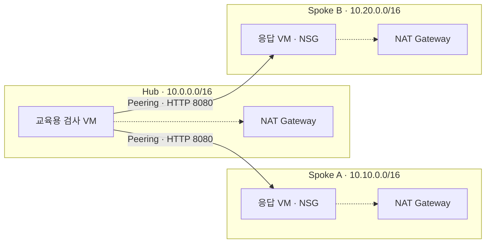
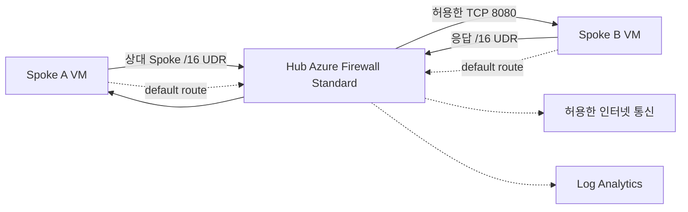

# 처음 시작하는 Azure Landing Zone: Hub & Spoke 워크숍

Azure Virtual Network Manager를 사용하는 독립 저장소
`jungwoonlee_microsoft/ms-landing-zone-02`의 루트에서 실행합니다.

> Azure가 처음인 참가자를 위한 한국어 핸즈온입니다. **전체 목표 시간 160–190분** 동안
> Cloud Shell과 Portal로 Hub & Spoke를 만들고, NSG·중앙 Firewall·경로·로그를 확인한 뒤 안전하게 정리합니다.

**처음이라면 [00. Azure 첫걸음](docs/00-azure-basics.md)부터 시작하세요.**
로컬 개발 도구나 컨테이너 지식은 필요하지 않습니다.

## 실습을 진행하는 방법

각 실습 단계는 **👁️ 설명 → 🟢 실행 → 📋 확인** 순서입니다.
설명으로 목적을 이해하고, 한 블록씩 실행한 뒤 확인 항목과 실제 결과를 비교합니다.
비용·삭제 등은 **⚠️ 주의**로 구분합니다. 개념만 배우는 단계에는 실행 명령이 없으며,
모듈 끝에서 Portal 확인과 완료 체크를 진행합니다.
실행 블록의 `#`로 시작하는 한글 주석도 함께 복사해도 됩니다. 주석은 실행되지 않습니다.
명령은 모두 저장소 루트의 **Cloud Shell Bash**에서 실행하며, VM 안에서 직접 입력하지 않습니다.
`scripts/run-vm.sh`가 필요한 명령만 VM으로 전달합니다.

처음 보는 Bash 문법과 공통 함수는 [실행 블록 읽는 법](docs/01-prerequisites.md#실행-블록-읽는-법)을
먼저 확인하세요. 블록 전체를 실행한 뒤 결과를 비교하고, 오류가 나면 다음 블록으로 넘어가지 않습니다.
특히 **예상된 통신 차단**과 **배포·검증 명령의 오류**는 다릅니다. 검증기는 차단 이유까지
확인해야 `PASS`를 출력합니다. 중간 실패 시에는 해당 모듈의 복구 또는 공통 정리 절차를 따릅니다.

## 무엇을 배우나요?

구독·리소스 그룹·리전을 구분하고, 겹치지 않는 네트워크를 설계합니다.
모듈 03에서는 AVNM(Azure Virtual Network Manager), Network Group, Connectivity Configuration을
사용해 Korea Central에 Hub↔Spoke 연결을 배포합니다. AVNM은 연결 구성을 중앙 관리하지만
패킷을 대신 전달하는 데이터 플레인 라우터나 방화벽은 아닙니다.
Hub와 두 Spoke를 연결하고, 공인 IP 없는 VM으로 정상 통신과 NSG 차단을 비교합니다.
이어서 Firewall을 거치는 왕복 경로와 실제 Allow/Deny 로그를 확인합니다.
**모듈 00–07을 순서대로 진행하는 하나의 과정**이며, Firewall과 최종 정리까지 모두 포함합니다.

이 과정은 **단일 구독의 교육용 축소 Landing Zone**입니다. 운영 Landing Zone 전체의
보안·가용성 인증이나 자동 구축 도구가 아닙니다. 관리 그룹·다중 구독·Policy 상속은
[운영 전환 대응표](docs/07-cleanup-production.md#운영-landing-zone으로-확장하기)에서 설명합니다.

## 1단계: Peering과 NSG 통신 확인

실선은 허용할 교육용 HTTP 경로, 점선은 관리 기능을 유지하는 아웃바운드입니다.
VM은 모두 private IP만 사용합니다. NAT별 Public IP는 있지만 VM에 붙지 않습니다.
Cloud Shell의 Run Command는 Azure 관리 기능과 VM agent를 이용합니다.

**모듈 04까지는 Spoke A→B가 연결되지 않습니다.** Peering은 자동 중계를 하지 않습니다.
NSG가 허용하더라도 경로가 없으면 실패한다는 것을 확인합니다.
이 단계에서는 아직 중앙 아웃바운드 검사나 인터넷 allowlist를 제공하지 않습니다.
Hub VM은 교육용 검사 도구이며, 운영 애플리케이션을 Hub에 배치하는 권장이 아닙니다.

## 2단계: 중앙 Firewall과 경로·로그 검증

Spoke 간 요청·응답은 Firewall을 통과합니다. Hub의 검사 VM→Spoke는 직접 Peering을
유지하므로 **모든 통신이 Firewall을 거친다고 주장하지 않습니다.**
정상 경로 검증 후 두 Spoke NAT를 제거합니다. Hub NAT는 최종 정리까지 유지됩니다.

## 사전 요구사항

| 항목 | 필요한 준비 |
|---|---|
| Azure 계정 | 실습용 구독의 Contributor 또는 운영자가 준비한 동등한 권한 |
| 브라우저 | Azure Portal 및 Cloud Shell **Bash** |
| GitHub | 이 저장소를 clone할 수 있는 권한; 비공개일 때 인증 필요 |
| 기본 리전 | Korea Central, Standard_B2als_v2 3대에 필요한 총 6 vCPU와 Basv2-family quota |
| 시간과 비용 | 목표 시간보다 배포가 길어질 수 있으며 종료 시 반드시 cleanup |

Owner나 역할 할당 권한은 이 워크숍에서 요구하지 않습니다. 조직의 Policy·할당량·
지역 용량 제한은 참가자 구독에서 별도로 확인합니다.

## 모듈 목차

| # | 모듈 | 완료하면 할 수 있는 일 | 목표 시간 |
|---|---|---|---:|
| 00 | [Azure 첫걸음](docs/00-azure-basics.md) | 구독·RG·리전·Landing Zone의 목적 설명 | 15분 |
| 01 | [실습 준비](docs/01-prerequisites.md) | Cloud Shell·권한·상태 복구·quota 확인 | 15분 |
| 02 | [네트워크 뼈대](docs/02-network-foundation.md) | Hub·Spoke·Subnet·NSG 준비 | 20분 |
| 03 | [AVNM 연결 관리](docs/03-avnm-connectivity.md) | Network Group과 Hub-and-Spoke 연결 배포 | 20분 |
| 04 | [통신과 NSG](docs/04-connectivity-nsg.md) | private VM 정상/차단/복구 및 경로 확인 | 30분 |
| 05 | [중앙 Firewall](docs/05-firewall.md) | 중앙 Firewall와 진단 준비 | 20–30분 |
| 06 | [경로와 보안 검증](docs/06-routing-validation.md) | 왕복 UDR·Allow/Deny 로그·egress 검증 및 Spoke NAT 제거 | 30–45분 |
| 07 | [정리와 운영 전환](docs/07-cleanup-production.md) | 정확한 실습 리소스 삭제와 운영 차이 이해 | 10–15분 |
| | **전체 합계** | | **160–190분** |

모듈 04 이후에도 같은 실행 ID와 리소스를 유지한 채 **05 → 06 → 07**로 진행합니다.
목표 시간은 배포·로그 수집·단계별 NAT 제거 검증·삭제 대기에 따라 늘어날 수 있습니다.
중도 중단 시에는 남은 실습 대신 모듈 07의 정리를 실행하세요.

## 비용과 정리

| 항목 | 모듈 04까지 | 모듈 05–06에서 변화 | 유의사항 |
|---|---:|---|---|
| VM·OS 디스크·NIC | 각 3개 | 동일 | VM deallocate 후에도 디스크 비용 유지 |
| NAT Gateway | 3개 | 검증 후 Spoke 2개 제거, Hub 1개 유지 | 유휴 상태에도 시간 과금 |
| Standard Public IP | NAT용 3개 | Firewall용 1개 추가 후 Spoke용 2개 제거 | 연결·할당 상태에 따라 비용 발생 |
| Azure Firewall Standard | 없음 | 1개 | 배포·유휴 시간 및 처리량 과금 |
| Azure Virtual Network Manager | 모듈 03부터 1개 | 동일 | 관리 범위와 구성 사용량에 따라 비용이 발생할 수 있음 |
| Log Analytics | 없음 | 1개 | 수집량과 보존에 따른 비용 |
| Peering·전송 | 사용량 기반 | 사용량 기반 | 반복/대량 부하 검사는 하지 않기 |

고정 금액이나 무료 사용을 약속하지 않습니다.
[가격 계산기](https://azure.microsoft.com/pricing/calculator/),
[VM](https://azure.microsoft.com/pricing/details/virtual-machines/linux/),
[NAT](https://azure.microsoft.com/pricing/details/azure-nat-gateway/),
[Firewall](https://azure.microsoft.com/pricing/details/azure-firewall/),
[Virtual Network Manager](https://azure.microsoft.com/pricing/details/azure-virtual-network-manager/),
[Monitor](https://azure.microsoft.com/pricing/details/monitor/)에서 리전·시간을 확인하세요.

**완료·실패 여부와 관계없이 [cleanup](docs/07-cleanup-production.md)을 실행하세요.**
대상은 `rg-lzbegin-hub-{runId}`, `rg-lzbegin-spokea-{runId}`, `rg-lzbegin-spokeb-{runId}`입니다.
공유 Network Watcher와 Cloud Shell 저장소는 삭제하지 않습니다.

## 세션이 끊겼을 때

Cloud Shell 변수는 새 세션에 남지 않습니다. [상태 복구](docs/01-prerequisites.md#세션-재연결-시-변수-복구)로
`.workshop-state/{runId}.json`을 읽고 **원래 실행 ID**를 사용합니다.
이 파일과 실습용 키는 Git에서 제외됩니다. 임시 Cloud Shell이면 종료 전에 상태 JSON을 내려받으세요.

## 진행 전 알아둘 한계

- 사설 HTTP는 전송 암호화와 인증이 아닙니다. 비민감 응답만 사용합니다.
- Run Command는 높은 관리 권한입니다. 신뢰할 수 없는 스크립트를 실행하지 않습니다.
- Firewall 규칙의 `AzureCloud:443`은 자사 tenant 전용 허용이 아닙니다.
- 기본 VM은 관리형 디스크의 플랫폼 암호화를 사용합니다. host encryption·guest ADE와
  VM extension 금지 권고에는 [명시적인 교육용 예외](docs/maintainer-validation.md#보안-검사-예외)가 있습니다.
- **2026-09-21 Linux CLI 기록은 수동 Peering 기반 원본 워크숍의 역사적 리허설 증거입니다.**
  발견한 배포 결함을 수정하고 통신·차단·복구 및 Spoke NAT 제거 후 경로를 확인했습니다.
  브라우저 Cloud Shell/Portal 조작과 다른 구독의 용량·정책은 검증 범위가 아닙니다.
  이 기록은 단일 과정으로 재편하기 전의 실행이며, 현재 AVNM 변형의 실행 증거가 아닙니다.
  개최 전 [역사적 기록과 AVNM 리허설 체크리스트](docs/maintainer-validation.md#avnm-변형-리허설-체크리스트)를 확인하세요.

## 태깅 범례와 트러블슈팅

| 표시 | 읽는 방법 |
|---|---|
| 👁️ **설명** | 작업 목적, 개념과 리소스 관계를 먼저 읽습니다. |
| 🟢 **실행** | 바로 아래 명령 블록이나 Portal 작업을 수행합니다. |
| 📋 **확인** | 실제 출력의 이름·값·상태를 제시된 기준과 비교합니다. |
| ⚠️ **주의** | 보안·비용·삭제·실패 복구에 관한 조건을 확인합니다. |

각 표시는 본문과 분리된 줄에 배치합니다. 확인 항목에 포함된 출력 예시와 Portal 이미지는
비교를 돕는 참고 자료이며, 자신의 실제 실행 증거가 아닙니다.

| 증상 | 이동 |
|---|---|
| 권한·quota·상태 파일·소스 인증 | [사전 준비](docs/01-prerequisites.md#트러블슈팅) |
| 주소·Peering 상태 | [네트워크](docs/02-network-foundation.md#트러블슈팅), [AVNM 연결 관리](docs/03-avnm-connectivity.md#트러블슈팅) |
| Run Command·HTTP·NSG | [통신과 NSG](docs/04-connectivity-nsg.md#트러블슈팅) |
| Firewall·진단·로그 지연 | [Firewall 준비](docs/05-firewall.md#트러블슈팅), [경로와 보안 검증](docs/06-routing-validation.md#트러블슈팅) |
| 중도 실패·삭제 지연 | [정리](docs/07-cleanup-production.md#트러블슈팅) |

## 참고 자료

- [Azure Landing Zone 개요](https://learn.microsoft.com/azure/cloud-adoption-framework/ready/landing-zone/)
- [CAF 네트워크 설계 권장 사항](https://learn.microsoft.com/azure/cloud-adoption-framework/ready/azure-best-practices/traditional-azure-networking-topology)
- [Hub & Spoke 아키텍처](https://learn.microsoft.com/azure/architecture/networking/architecture/hub-spoke)
- [Linux Run Command 요구사항](https://learn.microsoft.com/azure/virtual-machines/linux/run-command)
- [NAT Gateway](https://learn.microsoft.com/azure/nat-gateway/nat-overview)
- [NSG 규칙](https://learn.microsoft.com/azure/virtual-network/network-security-groups-overview)
- [Azure Firewall 구조화 로그](https://learn.microsoft.com/azure/firewall/firewall-structured-logs)
- [교재 형식 참고 워크숍](https://github.com/freeman9844/aca-github-runner-workshop-private/tree/master)

참고 교재의 진행 형식을 활용했으며 원본 문장·코드·이미지를 복사하지 않았습니다.
