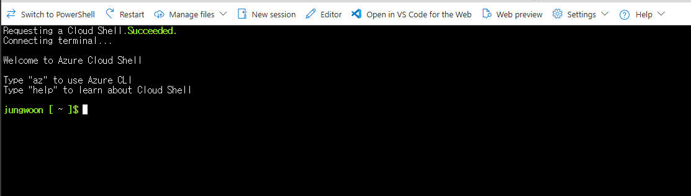
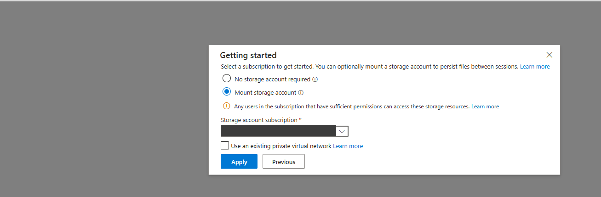
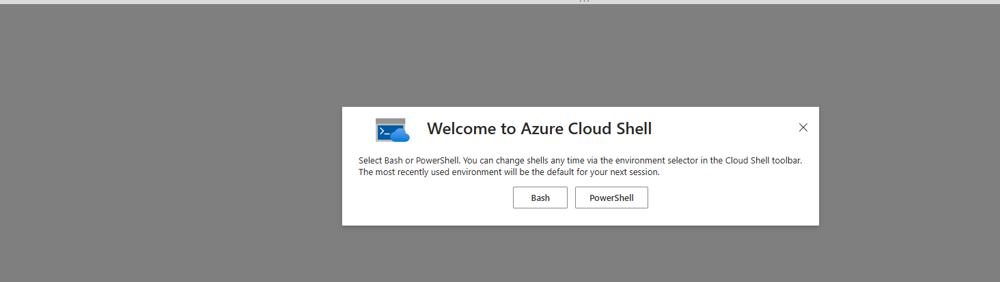
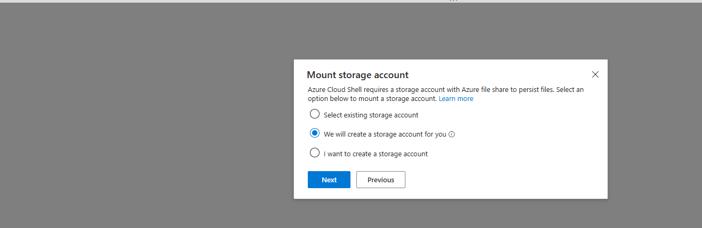

# 01. 실습 준비

> 목표 시간 15분. 브라우저에서 Cloud Shell Bash를 열고 실습의 구독·이름·복구 파일을 준비합니다.

## 목표

잘못된 구독에 배포하지 않고, 세션이 끊겨도 동일한 실습을 계속할 수 있습니다.

## 1. 계정과 비용 확인

👁️ **설명**

Azure 구독의 **Contributor** 권한 또는 운영자가 준비한 동등한 권한이 필요합니다.
Owner나 역할 할당 권한은 이 워크숍의 요구사항이 아닙니다.
Azure Policy 때문에 특정 리전·SKU·Public IP 생성이 거부될 수 있습니다.
권한과 quota 확인만으로 실제 리전 용량을 예약할 수는 없습니다.

⚠️ **주의**

모듈 03의 AVNM 관리 범위와 모듈 04의 Azure Firewall Standard 1개·Firewall용
Public IP 1개·Log Analytics 1개부터 비용이 발생할 수 있습니다. 모듈 05에서는
VM 3대·디스크·Hub NAT Gateway 1개·Hub NAT용 Public IP 1개를 추가합니다.
Firewall 시간·처리량 및 로그 수집·보존 비용을 포함하여 확인하세요. Spoke NAT는 만들지 않습니다.
전체 175–210분은 교육 목표이지 무료 사용 시간이나 보장된 배포 시간은 아닙니다.
[가격 안내](../README.md#비용과정리)를 읽고 실습용 구독을 사용하세요.

## 2. Cloud Shell과 소스 준비

👁️ **설명**

브라우저의 Cloud Shell Bash에서 Azure CLI와 교재 파일을 함께 사용합니다.
처음 시작할 때 영구 스토리지를 연결하면 재접속 후에도 홈 디렉터리의
clone 파일과 `.workshop-state/`의 실습 상태 JSON을 사용할 수 있습니다.
교재를 clone한 폴더가 이후 명령의 기준 위치입니다.

### Cloud Shell 최초 준비

처음 Cloud Shell을 여는 경우 다음 순서로 준비합니다. 이미 Bash와 영구
스토리지가 연결되어 있다면 이 설정을 반복하지 말고 아래 **워크숍 소스 준비**로 이동하세요.

1. [Azure Portal](https://portal.azure.com)에 로그인해 상단 **Cloud Shell (`>_`)**을 열고 **Bash**를 선택합니다.

   

2. **Getting started**에서 **Mount storage account**를 선택하고 **Storage account subscription**에서
   실습에 사용할 구독을 선택한 뒤 **Apply**를 누릅니다.

   

3. **Mount storage account**에서 **We will create a storage account for you**를 선택하고 **Next**를 누릅니다.
   이 단계는 별도의 Cloud Shell 스토리지 자원을 만들므로 해당 구독에 생성 권한이 필요합니다.

   

4. 요청이 완료돼 Bash 프롬프트가 표시되면 다음 단계로 진행합니다.

   

위 화면은 [참고 워크숍의 Cloud Shell 준비 절차](https://github.com/freeman9844/aca-github-runner-workshop-private/blob/master/docs/01-prerequisites-github.md)에서
재게시 허가를 받아 사용했습니다. Portal 화면과 표시 이름은 예시이므로 자신의 구독을 선택하세요.

**No storage account required**를 선택하면 세션 종료 후 파일이 보존되지 않습니다.
이미 임시 세션으로 시작했다면 상태 파일과 키를 먼저 안전하게 내려받은 다음
Cloud Shell **Settings → Reset User Settings**를 선택하고 다시 열어 위 영구 스토리지
연결 절차를 진행하세요. 새로 연 뒤에는 필요한 파일을 다시 업로드해야 합니다.
[Microsoft Learn: 영구 스토리지로 Cloud Shell 시작](https://learn.microsoft.com/azure/cloud-shell/get-started/new-storage)에 화면별 설명이 있습니다.

⚠️ **주의**

Cloud Shell용 스토리지 계정·파일 공유는 **실습용 Hub/Spoke RG 세 개와 별개**이며
모듈 07의 삭제 대상이 아닙니다. 보관 비용과 접근 권한을 별도로 관리하세요.
홈 디렉터리에는 상태 파일·SSH 키 등이 보관될 수 있으므로 공유하지 마세요.

### 워크숍 소스 준비

⚠️ **주의**

이 저장소가 비공개이면 GitHub 인증이 필요합니다. 조직에서 허용하는 Git
credential helper 또는 `gh auth login`을 사용하세요. PAT를 clone URL에 넣거나
워크숍 파일에 기록하지 마세요. 인증이 안 되면 GitHub 웹에서 접근 권한부터 확인합니다.

🟢 **실행**

Bash 프롬프트에서 접근 권한이 있는 GitHub 계정으로 다음 저장소를 복제합니다.

```bash
# 이 독립 저장소의 루트가 현재 워크숍 경로입니다.
git clone https://github.com/jungwoonlee_microsoft/ms-landing-zone-02.git \
  "$HOME/ms-landing-zone-02"
cd "$HOME/ms-landing-zone-02"
# 구독 이름과 UUID를 함께 확인합니다. 이 명령은 구독 선택이나 리소스 생성을 하지 않습니다.
az account list --query "[].{Name:name,Subscription:id,Default:isDefault}" -o table
```

📋 **확인**

사용할 Azure 구독의 이름과 UUID가 표시됩니다. Cloud Shell 스토리지 구독을
선택한 것만으로 CLI의 활성 구독이 반드시 같다고 가정하지 마세요. 3단계에서
실습용 구독을 명시적으로 선택합니다.

### AVNM CLI 준비

👁️ **설명**

새 실행의 구독 충돌 점검에서 `az network manager list`를 사용하므로, 상태 파일을
만들기 전에 `virtual-network-manager` Azure CLI 확장을 설치합니다.
정적 Network Group membership은 Azure Policy 정의나 할당 역할이 필요하지 않습니다.
대신 이 워크숍의 기존 구독 `Contributor` 요구사항은 그대로 유지됩니다.

🟢 **실행**

<!-- exec:install-avnm-cli -->
```bash
az extension add --name virtual-network-manager --upgrade --yes
```

📋 **확인**

```bash
az extension show --name virtual-network-manager \
  --query '{Name:name,Version:version}' -o table
```

확장 설치나 확인이 실패하면 새 실행을 시작하지 마세요.

### 이번 실행의 IPAM 직접 생성

운영자가 별도의 공유 RG나 pool을 준비할 필요가 없습니다. 모듈 02에서
이번 실행의 Hub RG에 `avnm-lzbegin-<실행 ID>`를 만들고 그 아래에
`ipam-lzbegin-<실행 ID>` pool(root `172.20.0.0/14`)을 직접 생성합니다.
세 VNet과 네 Subnet은 해당 pool에서 주소를 할당받고, 모듈 07에서
Spoke RG를 먼저 정리한 후 Hub RG와 함께 pool을 삭제합니다.
구독 Contributor 또는 동등한 관리자·pool 생성/할당 권한이 필요합니다.
조회 성공만으로 실제 할당 권한은 증명되지 않습니다.

**같은 구독에서 한 번에 한 실행만 지원합니다.** 실행별 AVNM의 구독 범위 기능이
서로 충돌하고, 실행별 pool은 서로 간 주소 중복을 조율하지 않습니다. 새 실행
전에 기존 AVNM과 VNet 주소 범위를 읽기 전용으로 확인하며, 구독 밖 연결망과
온프레미스의 `172.20.0.0/14` 충돌 여부도 확인하세요. 이미 존재하는 운영자 공유
`rg-lzbegin-ipam`은 신규 실습에서 사용하거나 삭제하지 않습니다.

기존 실행을 재개한다면 현재 상태 JSON을 그대로 보관하고 운영자가 게시한
`workshop-pre-ipam-8d4781f` 태그(`8d4781f`)의 교재·스크립트를 **별도 clone**에서
사용하세요. 기존 Cloud Shell checkout을 reset하거나 상태 파일을 새 실행용으로
덮어쓰지 마세요.

## 실행 블록 읽는 법

👁️ **설명**

아래 표는 이후 모듈에서 반복되는 문법입니다. 외우기보다 각 블록의 한글 주석과 함께 읽으세요.

실습의 목적은 반복문 작성이 아니라 **Azure 자원과 연결 관계를 이해하는 것**입니다.
참가자 실행 블록은 반복문 대신 Hub·Spoke A·Spoke B별 `az` 명령을 명시합니다.
`-g`/`--resource-group`으로 **대상**, `--vnet-name`·`--remote-vnet`·`--route-table` 등으로
**연결 관계**를 확인하며 위에서 아래로 실행하세요. 줄 끝 `\`로 이어진 부분은 하나의 명령입니다.
**모듈 02–07은 한 작업의 코드 블록만 복사하고 결과를 확인**합니다.
모듈 시작의 **공통 준비에서 한 번만** 함수를 읽고 `load_run "$STATE_FILE"`과
`assert_subscription`을 실행합니다. 이후 작업은 준비한 같은 Cloud Shell 세션을 사용합니다.
재접속 후 활성 구독이 원래 구독과 같다면 이어갈 모듈의 공통 준비를 다시 실행하세요.
새 세션에서 `STATE_FILE`이 비어 있으면 공통 준비가 기존 JSON 경로를 묻습니다.
`.workshop-state/<실행 ID>.json`처럼 점까지 입력하세요.
활성 구독이 다르거나 다른 실습/구독으로 전환했다면 아래 **세션 재연결 시 변수 복구**를 먼저 실행하세요.
공통 준비의 `assert_subscription`은 구독을 자동 전환하지 않습니다.
모듈 03–06은 세 RG의 소유권을 공통 준비에서 한 번 확인하고, 개별 작업에서는 중복 검사를 생략합니다.
모듈 02의 RG 생성은 기존 RG를 덮어쓸 수 있어 예외적으로 소유권을 확인합니다.
모듈 02를 재개할 때는 `assert_owned_rg "$RG_HUB"`처럼 작업할 RG의 소유권을 확인하고,
이미 성공한 생성 블록을 다시 실행하지 마세요.
필요한 조회와 해당 변경은 `&&`로 연결합니다. 경로 전환·NAT 삭제 직전의 현재 상태 검사는 유지합니다.
직접 Azure 명령의 `--subscription "$SUBSCRIPTION_ID"`는 상태 파일의 구독을 명시합니다.
앞 단계에서 조회한 임시 ID/IP를 재사용하지 않고 필요한 작업에서 다시 조회합니다.
이 준비 모듈의 Provider 블록에 남아 있는 `( ... )`는 별도 셸 문법이며 이후 모듈 전체를 묶는 패턴이 아닙니다.
참가자 셸에 `set -e`를 적용하거나 오류 처리용 `exit`를 직접 실행하지 마세요.

구독·소유권 확인, 게스트 실행 결과 판정, 통신 검증, 안전한 정리는 공통 스크립트를 유지합니다.
VM·NIC·NAT 생성용 Bicep도 보조 도구로 유지하고, 학습 대상인 네트워크 연결·NSG·경로 변경은
교재에 드러난 Azure CLI 명령으로 수행합니다. 명령을 짧게 만들려고 안전 검사를 생략하지 마세요.
독립 실행 스크립트 내부의 구독·소유권 검사는 별도 프로세스에서도 안전하도록 유지합니다.
이를 참가자 작업마다 공통 준비를 반복하라는 뜻으로 해석하지 않습니다.

| 표기 | 의미와 주의점 |
|---|---|
| `# 설명` | 실행하지 않는 주석입니다. 줄 끝이 `\`인 명령 중간에는 임의로 주석을 끼워 넣지 않습니다. |
| `\` | 긴 명령을 다음 줄로 이어 씁니다. 뒤에 공백이나 글자를 추가하지 않습니다. |
| `"$변수"` / `$(명령)` | 저장한 값을 사용 / 명령의 출력을 값으로 저장합니다. 따옴표를 유지하세요. |
| `&&` | 앞 명령이 성공했을 때만 다음 명령을 실행합니다. |
| `( ... )` | 별도 셸에서 블록을 실행합니다. 블록의 변수 변경은 바깥에 남지 않지만 Azure 변경은 남습니다. |
| `set -euo pipefail` | 명령 실패·미정의 변수·파이프 내부 실패를 숨기지 않고 중단하도록 돕습니다. 이미 만든 자원을 자동으로 되돌리지는 않습니다. |
| `-g`, `-n`, `-l` | 일반적으로 리소스 그룹, 이름, 리전 옵션의 짧은 표기입니다. |
| `--query`, `-o` | Azure 응답에서 필요한 항목을 선택하고 출력 형식을 지정합니다. `tsv`는 변수에 담을 단일 값, `json`은 구조 확인, `table`은 사람이 읽는 표에 사용합니다. |
| `-o none`, `>/dev/null` | 정상 출력만 숨깁니다. 출력이 없다고 실행을 건너뛴 것은 아닙니다. |
| `jq -e`, `<<< "$값"` | JSON의 조건을 검사하고 실패를 종료 코드로 알림 / 변수 내용을 명령의 입력으로 전달합니다. |

`source scripts/workshop-common.sh`는 다음 **교재 전용 함수**를 현재 셸에 읽습니다.
구독 충돌·실행별 pool 검사 함수는 `source scripts/workshop-ipam.sh`로 읽습니다.
이 함수들은 Azure CLI 자체 명령이 아닙니다.

| 함수 | 하는 일 |
|---|---|
| `new_run` | 새 난수 ID와 로컬 상태 JSON을 준비합니다. Azure RG 이름 충돌을 조회하지만 RG를 만들지는 않습니다. |
| `load_run` | 이전 실습·구역 변수를 비운 뒤 JSON을 검증하고 `RUN_ID`, `LOCATION`, 세 RG 이름 등을 복구합니다. 실패하면 대상 변수는 미설정 상태입니다. |
| `assert_subscription` | 활성 구독과 상태 파일의 구독이 같은지 확인합니다. 임의로 구독을 바꾸지 않습니다. |
| `assert_new_run_subscription` | 새 실행 전에 현재 구독의 다른 AVNM 기능 범위와 VNet 주소가 충돌하는지 읽기 전용으로 확인합니다. 조회 실패는 성공으로 처리하지 않습니다. |
| `assert_run_ipam_pool` | 모듈 02에서 만든 이번 실행의 pool·부모 AVNM ID, prefix, 상태와 범위를 확인합니다. |
| `assert_owned_rg` | 정확한 RG 이름·구독·네 가지 소유 태그를 확인합니다. 태그는 실수 방지 장치이지 RBAC 권한 경계가 아닙니다. |

`zone_context`는 내부 검증 스크립트에서 구역별 이름을 선택할 때만 사용합니다.
참가자 실행 블록에서는 `$RG_HUB`, `$RG_SPOKEA`, `$RG_SPOKEB`와 해당 VNet 이름을 직접 씁니다.
여기서 구역은 Hub/Spoke 구분이며 Azure 가용 영역(Availability Zone)을 뜻하지 않습니다.

`STATE_FILE`은 복구할 JSON의 **경로**, `RUN_ID`는 자원 이름에 붙는 **실행 식별자**입니다.
`export STATE_FILE`은 이후 실행할 하위 스크립트에도 경로를 전달합니다.
예제의 ID를 직접 복사하거나 다른 참가자의 상태 파일을 사용하지 마세요.

## 3. 실행 ID와 상태 파일 만들기

👁️ **설명**

목록에서 사용할 **실습 구독 UUID**를 복사해 입력합니다. 아래 블록은 필요한 함수만
source하므로 검증 실패가 Cloud Shell 전체를 종료하지 않습니다.

🟢 **실행**

```bash
# 공통 함수를 읽기만 합니다. 이 줄 자체는 Azure 리소스를 만들지 않습니다.
source scripts/workshop-common.sh &&
source scripts/workshop-ipam.sh &&
# 이전 실습 상태 경로·pool ID가 새 실행의 실패 뒤에 남지 않도록 비웁니다.
clear_run &&
unset STATE_FILE &&
# 구독 이름과 ID를 확인한 뒤 사용할 ID를 복사합니다.
az account list --query "[].{Name:name,Subscription:id,Default:isDefault}" -o table &&
read -rp "실습 Azure subscription ID: " SELECTED_SUBSCRIPTION &&
# 선택 구독의 기존 AVNM·VNet 충돌을 읽기 전용으로 확인한 뒤 새 실습 JSON을 만듭니다.
az account set --subscription "$SELECTED_SUBSCRIPTION" &&
  SUBSCRIPTION_ID="${SELECTED_SUBSCRIPTION,,}" &&
  assert_subscription &&
  { STATE_FILE=$(new_run "$SELECTED_SUBSCRIPTION" koreacentral) ||
      { unset STATE_FILE; fail "New run could not be created."; }; } &&
  export STATE_FILE &&
  load_run "$STATE_FILE" &&
  assert_subscription &&
  printf '복구할 파일: %s\n' "$STATE_FILE"
```

📋 **확인**

`.workshop-state/7e19a60c42bd.json` 같은 경로입니다.
이 이름은 예시입니다. **자신에게 출력된 경로를 보관**하세요.
`new_run`은 시간 대신 난수로 12자리 ID를 만들므로 같은 분에 시작한 참가자들도
서로 다른 이름을 사용합니다. 공유 구독의 세 RG 이름 중 하나라도 이미 존재하면
태그가 같아도 새 실습 생성을 거부하며, 상태 파일을 만들지 않습니다.
충돌 오류이면 이 블록을 다시 실행해 새 ID를 받으세요.
로컬 상태 파일도 덮어쓰지 않습니다. **기존 실습 재개에는 아래 상태 복구만 사용**하세요.
AVNM·VNet 사전 점검이 실패하면 새 상태 파일을 만들지 않습니다.
`az account show --query id -o tsv`로 구독을 확인하고 기존 기능 범위 또는
`172.20.0.0/14` 주소 충돌을 해결하세요. 상위 관리 그룹 범위의 AVNM이나
동시에 생성되는 자원은 사전 조회만으로 배제할 수 없습니다. 모듈 02에서
Azure가 관리자 생성·pool 할당을 거부하면 오류를 확인하고 중단하세요.

⚠️ **주의**

상태 JSON(schema 4)에는 구독, 리전, 실행 ID, RG 이름과 정확한 실행별 pool ID만 저장합니다.
토큰·비밀번호·SSH 개인 키를 추가하지 마세요.

## 4. Provider 등록

👁️ **설명**

Provider는 Azure 서비스의 리소스 종류를 구독에서 사용할 수 있게 하는 등록입니다.
등록은 구독 수준 변경이므로 조직 정책을 확인하고 실행합니다.

🟢 **실행**

```bash
(
  # 오류가 나면 이 블록만 중단합니다. 성공하지 않은 상태로 다음 모듈을 진행하지 않습니다.
  set -euo pipefail
  source scripts/workshop-common.sh
  # 저장된 구독 정보를 읽고 현재 명령을 보낼 구독과 일치하는지 확인합니다.
  load_run "$STATE_FILE"
  assert_subscription
  # 서비스 사용을 등록하고 완료까지 기다립니다. VM이나 VNet을 배포하는 명령은 아닙니다.
  az provider register --namespace Microsoft.Network --wait
  az provider register --namespace Microsoft.Compute --wait
)
```

📋 **확인**

두 Provider 등록 명령이 오류 없이 완료되어야 합니다. VM 크기와 남은 할당량은
모듈 05에서 VM 배포 직전에 `preflight.sh`로 확인합니다. 등록 성공이
VM 배포 승인이나 용량 확보를 보장하지는 않습니다.

## 세션 재연결 시 변수 복구

👁️ **설명**

**모듈 02–07 어디서든 재접속 후 활성 구독이 원래 구독과 다르거나 다른
실습/구독으로 전환했다면 이 절차를 먼저 사용합니다. 새 실행 ID를 만들지 마세요.**
활성 구독이 같다면 이어갈 모듈의 공통 준비만 실행해도 됩니다.

생성 시 보관한 `.workshop-state/<자신의 실행 ID>.json` 경로를 입력합니다.
다운로드한 JSON을 다시 올렸다면 업로드한 실제 경로를 입력합니다. `.workshop-state/` 밖의 JSON도 사용할 수 있습니다.
입력 전에 `.workshop-state/`가 있으면 파일명을 보여주고, `예:`에 실제 파일
경로를 표시합니다. 파일이 여러 개라면 현재 실습의 파일을 직접 선택하세요.

🟢 **실행**

```bash
# 처음 clone한 폴더로 돌아갑니다. 다른 위치에 받았다면 해당 경로로 이동하세요.
cd "$HOME/ms-landing-zone-02" &&
source scripts/workshop-common.sh &&
show_workshop_state_files &&
# 새 파일이 아니라 기존 실습 JSON을 선택해야 같은 자원을 이어서 관리할 수 있습니다.
read -rp "저장된 상태 파일 경로 (예: $(workshop_state_example)): " STATE_FILE &&
export STATE_FILE &&
# JSON 검증 후 그 안의 구독을 명시적으로 선택하고 일치 여부를 다시 확인합니다.
load_run "$STATE_FILE" &&
  az account set --subscription "$SUBSCRIPTION_ID" &&
  assert_subscription
```

📋 **확인**

오류 없이 프롬프트로 돌아오면 원래 실습의 변수와 구독이 복구된 상태입니다.
복구 후 이어갈 모듈의 **공통 준비**를 실행하세요. 복구 절차는 해당 모듈의
소유권 검사나 추가 읽기 전용 함수를 대신하지 않습니다.

⚠️ **주의**

폴더 이동·함수 로딩·입력·JSON 복구 중 하나라도 실패하면 뒤의 구독 선택은 실행되지 않습니다.
JSON 복구 실패 시 이전 실습의 변수도 지워지므로 다음 작업으로 넘어가지 말고 올바른 파일로 다시 복구하세요.
상태 파일을 잃었다면
[정리 모듈의 복구](07-cleanup-production.md#상태파일을잃은경우)를 사용합니다.

## Portal 확인

👁️ **설명**

CLI에서 선택한 실습 구독에 자원을 만들 권한이 있는지 Portal에서도 확인합니다. 권한 부여가 아니라 현재 권한 조회입니다.

🟢 **실행**

**Subscriptions → 실습 구독 → Access control (IAM) → View my access**에서
자신의 권한을 확인합니다. 역할을 새로 할당하지 않습니다.

📋 **확인**

선택한 구독이 실습용 구독이며, Contributor 또는 운영자가 준비한 동등한 권한이 있는지 확인합니다.

## 트러블슈팅

| 증상 | 조치 |
|---|---|
| `Subscription mismatch` | 상태 파일의 UUID를 확인한 뒤 명시적으로 `az account set` |
| `NotRegistered` | 해당 provider 등록 권한을 확인하고 등록 완료 후 재검사 |
| quota 부족/Standard_B2als_v2 제한 | 운영자에게 증액 또는 검증된 리전 요청; 큰 SKU로 자동 변경하지 않기 |
| 파일이 재접속 후 없음 | 임시 Cloud Shell인지 확인; 보관한 JSON 업로드 |
| GitHub 404/인증 오류 | 저장소 접근 권한 확인; 비밀을 URL이나 파일에 넣지 않기 |

## 완료 체크

- 정확한 구독과 상태 파일을 확인했습니다.
- 유료 리소스와 정리 방법을 이해했습니다.
- preflight가 성공했습니다.

## 다음 단계

- [이전: Azure 첫걸음](00-azure-basics.md)
- [다음: 네트워크 뼈대](02-network-foundation.md)
- [중단 시 정리](07-cleanup-production.md)
