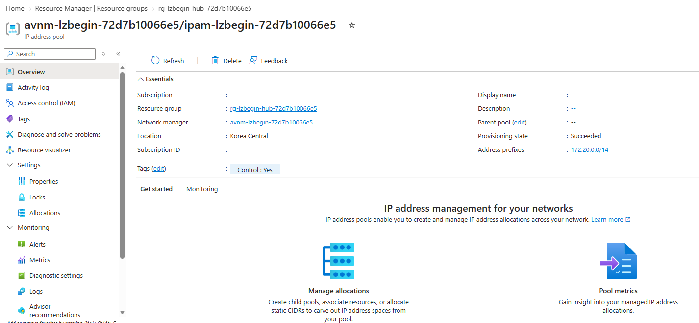
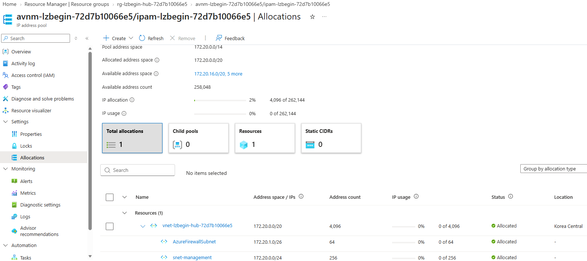
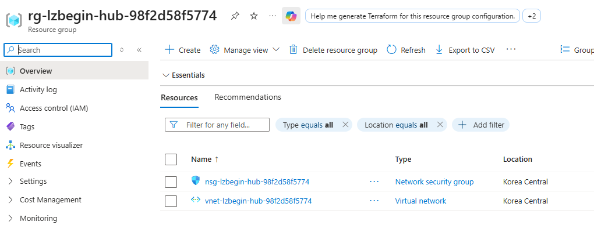
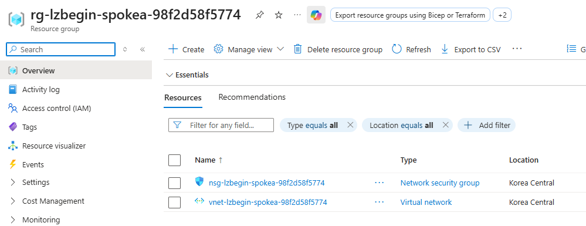
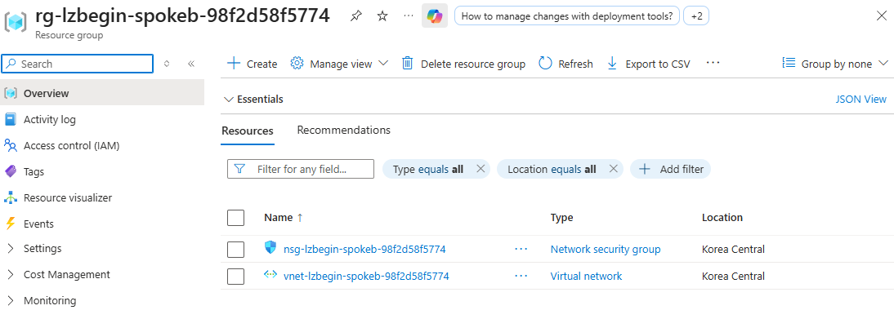
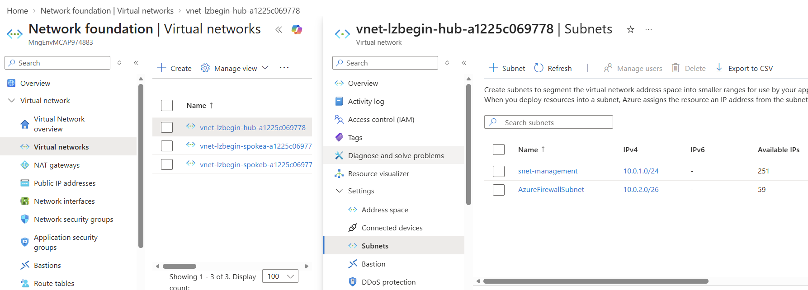

# 02. 네트워크 뼈대

> 목표 시간 20분. 세 리소스 그룹에 Hub와 두 Spoke를 만들고 주소·태그·Subnet을 확인합니다.

## 목표

서로 겹치지 않는 주소를 배치하고 네트워크의 용도와 소유 범위를 구분합니다.
재접속 후 활성 구독이 원래 구독과 같다면 아래 공통 준비에서 기존 JSON 경로를 입력합니다.
활성 구독이 다르거나 다른 실습/구독으로 전환했다면
[모듈 01의 세션 복구](01-prerequisites.md#세션-재연결-시-변수-복구)를 먼저 실행한 뒤 공통 준비로 돌아오세요.

## 실행 방법: 한 단계씩 실행하고 확인하기

👁️ **설명**

이 모듈은 전체를 묶는 `( ... )` 없이 **단계별 코드 블록을 분리**했습니다.
**코드 블록 하나만 복사 → 실행 결과 확인 → 다음 설명 읽기** 순서로 진행하세요.
여러 코드 블록을 합쳐 한꺼번에 붙여 넣지 않습니다. 위에서 아래로 수행하되 각 단계에서 멈춰 확인합니다.

아래 공통 준비에서 함수·상태 파일·구독을 **한 번만** 확인합니다.
RG 생성 단계에서 같은 이름의 기존 RG를 재사용할 때만 소유권을 확인합니다.
이후 개별 생성·조회에서는 같은 검사를 반복하지 않습니다.
`&&`는 앞 검사가 성공해야 **그 블록의 Azure CLI 명령만** 실행되게 합니다.
현재 Cloud Shell 전체에 `set -e`를 설정하거나 `exit`로 세션을 종료하지 않습니다.
오류가 나면 **다음 블록을 실행하지 말고 원인을 해결**하세요. 이미 만든 자원은 자동 삭제되지 않습니다.

각 블록은 준비한 같은 Cloud Shell 세션의 구독·실행 ID·RG 이름을 사용합니다.
재접속, `STATE_FILE` 변경, 다른 실습/구독으로 전환했다면 **공통 준비를 다시 실행**하세요.
모듈 02를 이어서 진행할 때는 작업할 RG의 생성 단계(1-1·2-1·3-1)도 다시 실행하여 소유권을 확인하세요.
명령의 `--subscription`은 상태 파일의 구독을 명시합니다.
앞 작업의 임시 변수에 의존하지 않지만, **Hub RG → 실행별 AVNM → 실행별 IPAM pool → 각 RG·NSG → IPAM VNet·Subnet** 순서를 지켜야 합니다.
pool 할당을 위한 VNet과 그 Subnet은 한 번의 선언형 배포로 원자적으로 요청하므로
한 자원당 한 블록 원칙의 유일한 예외입니다.
JSON 출력의 속성 순서는 달라도 되며, 각 단계 아래의 **확인** 항목을 비교하세요.

### 공통 준비

👁️ **설명**

모듈 01에서 선택한 `STATE_FILE`을 사용합니다. 새 세션에서 경로가 비어 있으면 기존 JSON
경로를 묻기 전에 `ls .workshop-state/`로 파일명을 보여줍니다.
`예:`의 실제 파일 경로를 참고해 `.workshop-state/<실행 ID>.json`처럼
폴더 앞의 점까지 입력하세요. 파일이 여러 개라면 현재 실습의 경로를 선택하세요.
경로가 이미 설정돼 있으면 다시 묻지 않습니다. 실패하면 다음 작업으로 넘어가지 않습니다.

🟢 **실행**

<!-- exec:prepare-02 -->
```bash
source scripts/workshop-common.sh &&
ensure_state_file &&
load_run "$STATE_FILE" &&
require_run_schema_four &&
assert_subscription
```

📋 **확인**

오류 없이 프롬프트로 돌아옵니다. 아직 Azure 자원은 생성하지 않았습니다.

⚠️ **주의**

생성 단계는 모듈 02의 초기 준비용입니다. VM 배포나 Firewall 경로 전환 이후에 전체를
무작정 재실행하지 마세요. Subnet의 NAT·UDR 연결을 먼저 조회하고 필요한 개별 명령만 복구합니다.
기존 운영 네트워크에 적용하지 않습니다.

## 1. Hub 만들기

👁️ **설명**

Hub는 중앙 관리용 네트워크입니다. 이번 실행의 pool에서 VNet `/20`, 관리 Subnet `/24`,
Firewall 전용 Subnet `/26`을 할당받습니다.

### 1-1. Hub 리소스 그룹

👁️ **설명**

RG는 관련 자원을 묶는 관리 단위입니다. 같은 이름이 이미 있으면 소유 태그만 검사하고
새 태그로 덮어쓰지 않습니다. `case`는 이 안전 분기이며 다른 자원까지 생성하는 반복문이 아닙니다.

🟢 **실행**

<!-- exec:foundation-hub-rg -->
```bash
exists=$(az group exists --name "$RG_HUB" -o tsv --subscription "$SUBSCRIPTION_ID") &&
case "$exists" in
  true) assert_owned_rg "$RG_HUB" && printf '기존 Hub RG의 소유 확인 완료\n' ;;
  false)
    # 이번 실습을 식별할 네 가지 태그를 RG에 붙입니다.
    az group create --name "$RG_HUB" --location "$LOCATION" \
      --tags workshop=lz-beginner environment=lab "runId=$RUN_ID" managedBy=workshop -o json --subscription "$SUBSCRIPTION_ID" ;;
  *) fail "Cannot determine whether $RG_HUB exists" ;;
esac
```

📋 **확인**

새 RG의 `name`은 `rg-lzbegin-hub-<실행 ID>`, `tags.runId`는 자신의 실행 ID입니다.
이미 소유한 RG라면 소유 확인 완료 문구만 출력됩니다.

### 1-2. 실행별 AVNM 만들기 (VNet보다 먼저)

👁️ **설명**

이번 실행의 Connectivity·SecurityAdmin·Routing AVNM을 Hub RG에 만듭니다.
다음 단계에서 이 AVNM 아래에 이번 실행의 IPAM pool도 만듭니다.
같은 구독에서 두 번째 실행별 AVNM을 만들면 기능 범위가 충돌하므로 한 구독에서
한 번에 한 실습만 진행합니다.
생성 블록이 직전에 AVNM 목록을 조회해 비어 있을 때만 생성합니다.
목록 조회에 실패하거나 예상치 못한 자원이 있으면 중단합니다. `Updating` 응답이면
다시 생성하지 말고 아래 읽기 전용 확인을 재실행하세요.

🟢 **실행**

<!-- exec:avnm-create -->
```bash
create_avnm_if_empty() {
  local managers manager_id body result
  managers=$(az network manager list \
    --resource-group "$RG_HUB" \
    -o json --subscription "$SUBSCRIPTION_ID") || return 1
  jq -e 'type == "array" and length == 0' <<<"$managers" >/dev/null ||
    { fail "Hub RG already contains an AVNM; do not overwrite it."; return 1; }
  manager_id="/subscriptions/$SUBSCRIPTION_ID/resourceGroups/$RG_HUB/providers/Microsoft.Network/networkManagers/$AVNM"
  body=$(jq -cn --arg location "$LOCATION" --arg scope "/subscriptions/$SUBSCRIPTION_ID" '{
    location:$location,
    properties:{
      description:"Beginner Hub and Spoke connectivity",
      networkManagerScopes:{subscriptions:[$scope]},
      networkManagerScopeAccesses:["Connectivity","SecurityAdmin","Routing"]
    }
  }') || return 1
  result=$(az rest --method put --url "$manager_id?api-version=2025-01-01" \
    --body "$body" -o json --subscription "$SUBSCRIPTION_ID") || return 1
  jq -e --arg id "$manager_id" --arg scope "/subscriptions/$SUBSCRIPTION_ID" '
    (.id | ascii_downcase) == ($id | ascii_downcase) and
    (.properties.networkManagerScopes.subscriptions | type == "array" and length == 1) and
    ((.properties.networkManagerScopes.subscriptions[0] | ascii_downcase) == ($scope | ascii_downcase)) and
    (.properties.networkManagerScopeAccesses | sort) == (["Connectivity","SecurityAdmin","Routing"] | sort)
  ' <<<"$result" >/dev/null ||
    { fail "Unexpected AVNM scope or resource ID; inspect the created manager before continuing."; return 1; }
  printf '%s\n' "$result"
}
create_avnm_if_empty
```

📋 **확인**

정확한 AVNM ID·구독 scope·세 access를 확인하세요. 실패하거나 `Updating`이면
이 쓰기 블록을 다시 실행하지 마세요.

🟢 **실행**

<!-- exec:avnm-ready -->
```bash
inspect_avnm_ready() {
  local manager expected_id
  manager=$(az network manager show --name "$AVNM" \
    --resource-group "$RG_HUB" -o json --subscription "$SUBSCRIPTION_ID") || return 1
  expected_id="/subscriptions/$SUBSCRIPTION_ID/resourceGroups/$RG_HUB/providers/Microsoft.Network/networkManagers/$AVNM"
  jq -e --arg id "$expected_id" --arg scope "/subscriptions/$SUBSCRIPTION_ID" '
    ((.id | ascii_downcase) == ($id | ascii_downcase)) and
    .provisioningState == "Succeeded" and
    (.networkManagerScopes.subscriptions | type == "array" and length == 1) and
    ((.networkManagerScopes.subscriptions[0] | ascii_downcase) == ($scope | ascii_downcase)) and
    (.networkManagerScopeAccesses | sort) == (["Connectivity","SecurityAdmin","Routing"] | sort)
  ' <<<"$manager" >/dev/null ||
    { fail "AVNM scope or provisioning state is not ready."; return 1; }
  printf '%s\n' "$manager"
}
inspect_avnm_ready
```

📋 **확인**

`provisioningState=Succeeded`가 될 때까지 이 조회만 반복하세요. 범위가 다르면 중단합니다.

### 1-3. 이번 실행의 IPAM pool 만들기

👁️ **설명**

방금 만든 Hub AVNM 아래에 `ipam-lzbegin-<실행 ID>`를 만들고 주소 root
`172.20.0.0/14`를 등록합니다. 기존 운영자 공유 RG나 pool을 사용하지 않습니다.
재접속했다면 위 공통 준비와 `avnm-ready` 조회를 먼저 재실행하세요.
`run_ipam_pool_status`가 Hub RG 소유권·AVNM 준비 상태와 pool 목록을 검사합니다.
pool이 이미 있다면 생성 명령을 반복하지 않고 정확한 ID·구성·준비 상태만 확인합니다.
`Updating`이면 조회만 다시 수행하고, 다른 pool이나 조회 실패이면 중단합니다.

🟢 **실행**

<!-- exec:run-ipam-pool -->
```bash
source scripts/workshop-ipam.sh &&
pool_status=$(run_ipam_pool_status) &&
if [[ "$pool_status" == missing ]]; then
  az network manager ipam-pool create \
    --name "ipam-lzbegin-$RUN_ID" --network-manager-name "$AVNM" \
    -g "$RG_HUB" --location "$LOCATION" \
    --address-prefixes '["172.20.0.0/14"]' \
    -o json --subscription "$SUBSCRIPTION_ID" &&
  assert_run_ipam_pool
elif [[ "$pool_status" == ready ]]; then
  printf '기존 IPAM pool 준비 확인 완료\n'
else
  fail "Unexpected IPAM pool status: $pool_status"
fi
```

📋 **확인**

오류 없이 끝나면 `IPAM_POOL_ID`의 마지막 부분은 `ipam-lzbegin-<실행 ID>`입니다.
pool의 root prefix는 `172.20.0.0/14`, `provisioningState=Succeeded`여야 합니다.
생성에 실패하면 현재 pool을 조회해 원인을 확인하고 새 실행을 만들지 마세요.
주소 root가 기존 연결망·온프레미스와 겹치면 진행하지 않습니다.

Azure Portal에서도 **Resource groups → `rg-lzbegin-hub-<실행 ID>` → `avnm-lzbegin-<실행 ID>` → IP address pools**에서
생성된 pool을 열어 `Provisioning state: Succeeded`와 `Address prefixes: 172.20.0.0/14`를 확인할 수 있습니다.
아래 화면의 실행 ID는 예시이며, 자신의 실행 ID를 사용하세요.



### 1-4. Hub NSG

👁️ **설명**

NSG는 통신 허용·차단 규칙의 묶음입니다. 생성만으로 Subnet에 적용되지는 않습니다.

🟢 **실행**

<!-- exec:foundation-hub-nsg -->
```bash
# 다음 단계에서 관리 Subnet에 연결할 NSG를 먼저 만듭니다.
az network nsg create --resource-group "$RG_HUB" --name "nsg-lzbegin-hub-$RUN_ID" \
  --location "$LOCATION" \
  --tags workshop=lz-beginner environment=lab "runId=$RUN_ID" managedBy=workshop -o json --subscription "$SUBSCRIPTION_ID"
```

📋 **확인**

응답의 NSG 이름이 `nsg-lzbegin-hub-<실행 ID>`입니다.
NSG 생성 응답은 `NewNSG` 안에 표시될 수 있습니다. 기본 규칙과 직접 추가하는 규칙을 구분합니다.

### 1-5. Hub VNet·관리·Firewall Subnet을 pool에서 할당

👁️ **설명**

이번 실행에서 만든 pool ID를 상태 파일에서 가져옵니다. Hub VNet `/20`, 관리
Subnet `/24`, 정확한 이름의 `AzureFirewallSubnet` `/26`을 순서대로 요청합니다.
관리 Subnet만 NSG를 연결하고 기본 outbound를 끕니다. 실패·부분 성공 시
이미 생성된 VNet을 다시 만들지 말고 조회 블록으로 실제 상태를 확인한 뒤 진행하세요.
Azure VNet 이름은 대소문자를 구분하지 않으므로 기존 이름도 대소문자 구분 없이 검사합니다.

🟢 **실행**

<!-- exec:foundation-hub-vnet -->
```bash
deploy_hub_vnet() {
  local existing
  existing=$(az network vnet list --resource-group "$RG_HUB" -o json --subscription "$SUBSCRIPTION_ID") || return 1
  jq -e --arg name "vnet-lzbegin-hub-$RUN_ID" 'type == "array" and all(.[]; (.name | ascii_downcase) != ($name | ascii_downcase))' <<<"$existing" >/dev/null ||
    { fail "Hub VNet exists or VNet lookup is malformed; inspect it instead of redeploying."; return 1; }
  az network vnet create --resource-group "$RG_HUB" --name "vnet-lzbegin-hub-$RUN_ID" \
    --location "$LOCATION" \
    --ipam-allocations "[0].number-of-ip-addresses=4096" "[0].id=$IPAM_POOL_ID" \
    --tags workshop=lz-beginner environment=lab "runId=$RUN_ID" managedBy=workshop \
    -o json --subscription "$SUBSCRIPTION_ID" || return 1
  az network vnet subnet create --resource-group "$RG_HUB" \
    --vnet-name "vnet-lzbegin-hub-$RUN_ID" --name snet-management \
    --ipam-allocations "[0].number-of-ip-addresses=256" "[0].id=$IPAM_POOL_ID" \
    --network-security-group "nsg-lzbegin-hub-$RUN_ID" \
    --default-outbound-access false -o json --subscription "$SUBSCRIPTION_ID" || return 1
  az network vnet subnet create --resource-group "$RG_HUB" \
    --vnet-name "vnet-lzbegin-hub-$RUN_ID" --name AzureFirewallSubnet \
    --ipam-allocations "[0].number-of-ip-addresses=64" "[0].id=$IPAM_POOL_ID" \
    -o json --subscription "$SUBSCRIPTION_ID"
}
deploy_hub_vnet
```

📋 **확인**

각 명령의 출력과 아래 조회 블록에서 `/20`·`/24`·`/26` 실제 할당 주소와 pool 연결,
관리 Subnet의 `defaultOutboundAccess=false` 및 Hub NSG ID를 확인합니다.
`AzureFirewallSubnet`에는 NSG가 없어야 합니다. 불일치하면 다음 블록을 실행하지 마세요.
암묵적 인터넷 출구는 사용하지 않으며 모듈 04에서 NAT를 명시적으로 연결합니다.

Azure Portal에서도 **Resource groups → `rg-lzbegin-hub-<실행 ID>` → IPAM pool → Allocations**에서
Hub VNet `/20`과 두 Subnet `/24`·`/26`의 할당을 확인할 수 있습니다.
아래 화면의 주소와 실행 ID는 예시이며, 자신의 할당 결과를 확인하세요.



### 1-6. Hub의 기본 VNet 내부 허용보다 앞서는 차단

👁️ **설명**

기본 `AllowVNetInBound`보다 먼저 평가되는 차단 규칙을 추가합니다.
이후 필요한 통신만 더 작은 우선순위 번호의 Allow 규칙으로 열기 위한 기준입니다.

🟢 **실행**

<!-- exec:foundation-hub-deny -->
```bash
# 작은 우선순위 번호가 먼저 평가됩니다. 기본 AllowVNetInBound보다 앞서 차단합니다.
az network nsg rule create --resource-group "$RG_HUB" --nsg-name "nsg-lzbegin-hub-$RUN_ID" \
  --name deny-other-vnet-inbound --priority 4000 --direction Inbound --access Deny \
  --protocol '*' --source-address-prefixes VirtualNetwork --source-port-ranges '*' \
  --destination-address-prefixes '*' --destination-port-ranges '*' -o json --subscription "$SUBSCRIPTION_ID"
```

📋 **확인**

규칙의 `priority=4000`, `direction=Inbound`, `access=Deny`를 확인합니다.
필요한 HTTP 허용은 모듈 04에서 더 작은 우선순위 번호로 추가합니다.

Azure Portal에서도 **Resource groups → `rg-lzbegin-hub-<실행 ID>` → Overview**에서
생성한 VNet과 NSG를 확인할 수 있습니다. 아래 화면의 실행 ID는 예시이며, 자신의 RG·실행 ID를 사용하세요.



## 2. Spoke A 만들기

👁️ **설명**

첫 번째 워크로드 네트워크입니다. **Hub와 명령 형태는 같지만 대상 RG·이름·주소가 다릅니다.**

### 2-1. Spoke A 리소스 그룹

👁️ **설명**

Spoke A의 자원을 Hub와 별도로 관리할 RG를 만듭니다.
같은 이름의 RG가 이미 있으면 소유 태그를 확인하고 재사용합니다.

🟢 **실행**

<!-- exec:foundation-spokea-rg -->
```bash
exists=$(az group exists --name "$RG_SPOKEA" -o tsv --subscription "$SUBSCRIPTION_ID") &&
case "$exists" in
  true) assert_owned_rg "$RG_SPOKEA" && printf '기존 Spoke A RG의 소유 확인 완료\n' ;;
  false)
    # Hub가 아닌 Spoke A의 관리 묶음을 만듭니다.
    az group create --name "$RG_SPOKEA" --location "$LOCATION" \
      --tags workshop=lz-beginner environment=lab "runId=$RUN_ID" managedBy=workshop -o json --subscription "$SUBSCRIPTION_ID" ;;
  *) fail "Cannot determine whether $RG_SPOKEA exists" ;;
esac
```

📋 **확인**

`name`은 `rg-lzbegin-spokea-<실행 ID>`입니다. 기존 RG이면 소유 확인 완료 문구가 나옵니다.

### 2-2. Spoke A NSG

👁️ **설명**

Spoke A 워크로드의 통신 규칙을 담을 NSG를 만듭니다. Hub NSG를 공유하지 않고 A의 규칙을 따로 관리합니다.

🟢 **실행**

<!-- exec:foundation-spokea-nsg -->
```bash
# A의 워크로드 Subnet에 적용할 통신 규칙 묶음입니다.
az network nsg create --resource-group "$RG_SPOKEA" --name "nsg-lzbegin-spokea-$RUN_ID" \
  --location "$LOCATION" \
  --tags workshop=lz-beginner environment=lab "runId=$RUN_ID" managedBy=workshop -o json --subscription "$SUBSCRIPTION_ID"
```

📋 **확인**

NSG 이름은 `nsg-lzbegin-spokea-<실행 ID>`입니다.

### 2-3. Spoke A VNet·워크로드 Subnet을 pool에서 할당

👁️ **설명**

A VNet `/20`과 워크로드 Subnet `/24`를 이번 실행의 pool에서 요청합니다.
실제 할당 주소가 Hub와 겹치면 중단하세요. 인터넷 출구는 모듈 04에서 준비합니다.

🟢 **실행**

<!-- exec:foundation-spokea-vnet -->
```bash
deploy_spokea_vnet() {
  local existing
  existing=$(az network vnet list --resource-group "$RG_SPOKEA" -o json --subscription "$SUBSCRIPTION_ID") || return 1
  jq -e --arg name "vnet-lzbegin-spokea-$RUN_ID" 'type == "array" and all(.[]; (.name | ascii_downcase) != ($name | ascii_downcase))' <<<"$existing" >/dev/null ||
    { fail "Spoke A VNet exists or VNet lookup is malformed; inspect it instead of redeploying."; return 1; }
  az deployment group create --resource-group "$RG_SPOKEA" --name "ipam-vnet-spokea-$RUN_ID" \
    --template-file infra/workshop-ipam-vnet.bicep \
    --parameters "runId=$RUN_ID" zone=spokea "location=$LOCATION" "ipamPoolId=$IPAM_POOL_ID" \
    -o json --subscription "$SUBSCRIPTION_ID"
}
deploy_spokea_vnet
```

📋 **확인**

출력의 `vnetPrefixes`, `subnets`와 실제 VNet을 조회하여 `/20`·`/24` pool
할당, `defaultOutboundAccess=false`, Spoke A NSG ID를 확인하세요.

### 2-4. Spoke A의 VNet 내부 인바운드 차단

👁️ **설명**

A에서도 VNet 내부 트래픽의 기본 허용보다 앞서 차단합니다.
Hub HTTP 연결은 모듈 05에서 AVNM Security Admin `Always Allow` 규칙으로 허용합니다.

🟢 **실행**

<!-- exec:foundation-spokea-deny -->
```bash
# 허용할 HTTP 트래픽은 모듈 05의 AVNM Security Admin 규칙으로 설정합니다.
az network nsg rule create --resource-group "$RG_SPOKEA" --nsg-name "nsg-lzbegin-spokea-$RUN_ID" \
  --name deny-other-vnet-inbound --priority 4000 --direction Inbound --access Deny \
  --protocol '*' --source-address-prefixes VirtualNetwork --source-port-ranges '*' \
  --destination-address-prefixes '*' --destination-port-ranges '*' -o json --subscription "$SUBSCRIPTION_ID"
```

📋 **확인**

Spoke A NSG 안에 `deny-other-vnet-inbound` 규칙이 생겼고 우선순위는 `4000`입니다.

Azure Portal에서도 **Resource groups → `rg-lzbegin-spokea-<실행 ID>` → Overview**에서
생성한 VNet과 NSG를 확인할 수 있습니다. 화면의 실행 ID 대신 자신의 RG·실행 ID를 사용하세요.



## 3. Spoke B 만들기

👁️ **설명**

두 번째 워크로드 네트워크입니다. A와 같은 Subnet 이름을 써도 **서로 다른 VNet 안의 별도 Subnet**입니다.

### 3-1. Spoke B 리소스 그룹

👁️ **설명**

두 번째 워크로드를 관리할 Spoke B RG를 만듭니다.
Hub·A와 이름을 구분하고 같은 이름의 기존 RG는 소유권 확인 후 재사용합니다.

🟢 **실행**

<!-- exec:foundation-spokeb-rg -->
```bash
exists=$(az group exists --name "$RG_SPOKEB" -o tsv --subscription "$SUBSCRIPTION_ID") &&
case "$exists" in
  true) assert_owned_rg "$RG_SPOKEB" && printf '기존 Spoke B RG의 소유 확인 완료\n' ;;
  false)
    # Spoke B를 별도의 RG로 관리합니다.
    az group create --name "$RG_SPOKEB" --location "$LOCATION" \
      --tags workshop=lz-beginner environment=lab "runId=$RUN_ID" managedBy=workshop -o json --subscription "$SUBSCRIPTION_ID" ;;
  *) fail "Cannot determine whether $RG_SPOKEB exists" ;;
esac
```

📋 **확인**

`name`은 `rg-lzbegin-spokeb-<실행 ID>`입니다. 기존 RG이면 소유 확인 완료 문구가 나옵니다.

### 3-2. Spoke B NSG

👁️ **설명**

B의 워크로드용 NSG를 만듭니다. A에 만든 규칙은 B에 자동으로 적용되지 않습니다.

🟢 **실행**

<!-- exec:foundation-spokeb-nsg -->
```bash
# A의 규칙이 B에 자동 적용되지 않으므로 B의 NSG도 따로 만듭니다.
az network nsg create --resource-group "$RG_SPOKEB" --name "nsg-lzbegin-spokeb-$RUN_ID" \
  --location "$LOCATION" \
  --tags workshop=lz-beginner environment=lab "runId=$RUN_ID" managedBy=workshop -o json --subscription "$SUBSCRIPTION_ID"
```

📋 **확인**

NSG 이름은 `nsg-lzbegin-spokeb-<실행 ID>`입니다.

### 3-3. Spoke B VNet·워크로드 Subnet을 pool에서 할당

👁️ **설명**

B VNet `/20`과 `/24` Subnet을 할당하고 B NSG를 연결합니다.
Hub·A와 겹치지 않는 주소는 서비스가 같은 pool에서 선택합니다.
A와 Subnet 이름은 같지만 VNet과 주소 범위가 다른 별도 자원입니다.

🟢 **실행**

<!-- exec:foundation-spokeb-vnet -->
```bash
deploy_spokeb_vnet() {
  local existing
  existing=$(az network vnet list --resource-group "$RG_SPOKEB" -o json --subscription "$SUBSCRIPTION_ID") || return 1
  jq -e --arg name "vnet-lzbegin-spokeb-$RUN_ID" 'type == "array" and all(.[]; (.name | ascii_downcase) != ($name | ascii_downcase))' <<<"$existing" >/dev/null ||
    { fail "Spoke B VNet exists or VNet lookup is malformed; inspect it instead of redeploying."; return 1; }
  az deployment group create --resource-group "$RG_SPOKEB" --name "ipam-vnet-spokeb-$RUN_ID" \
    --template-file infra/workshop-ipam-vnet.bicep \
    --parameters "runId=$RUN_ID" zone=spokeb "location=$LOCATION" "ipamPoolId=$IPAM_POOL_ID" \
    -o json --subscription "$SUBSCRIPTION_ID"
}
deploy_spokeb_vnet
```

📋 **확인**

출력의 `vnetPrefixes`, `subnets`와 실제 VNet을 조회하여 `/20`·`/24` pool
할당, `defaultOutboundAccess=false`, Spoke B NSG ID를 확인하세요.

### 3-4. Spoke B의 VNet 내부 인바운드 차단

👁️ **설명**

B에도 우선순위 `4000`의 기본 차단 규칙을 추가합니다.
Hub→B와 A→B의 HTTP는 모듈 05에서 AVNM Security Admin 규칙으로 허용합니다.

🟢 **실행**

<!-- exec:foundation-spokeb-deny -->
```bash
# B에서도 기본 VNet 허용보다 먼저 이 차단 규칙을 평가합니다.
az network nsg rule create --resource-group "$RG_SPOKEB" --nsg-name "nsg-lzbegin-spokeb-$RUN_ID" \
  --name deny-other-vnet-inbound --priority 4000 --direction Inbound --access Deny \
  --protocol '*' --source-address-prefixes VirtualNetwork --source-port-ranges '*' \
  --destination-address-prefixes '*' --destination-port-ranges '*' -o json --subscription "$SUBSCRIPTION_ID"
```

📋 **확인**

Spoke B NSG 안에 우선순위 `4000`의 `Deny` 규칙이 있습니다.

Azure Portal에서도 **Resource groups → `rg-lzbegin-spokeb-<실행 ID>` → Overview**에서
생성한 VNet과 NSG를 확인할 수 있습니다. 화면의 실행 ID 대신 자신의 RG·실행 ID를 사용하세요.



## 4. Firewall용 Subnet 확인

👁️ **설명**

Hub VNet 배포에서 함께 만든 `AzureFirewallSubnet`을 아래 조회로 확인합니다.
**이 단계는 유료 Firewall 장비를 배포하지 않습니다.**

📋 **확인**

Subnet 이름은 정확히 `AzureFirewallSubnet`, 주소 크기는 `/26`입니다.
관리 Subnet과 달리 NSG는 연결하지 않습니다.

## 5. 주소와 태그를 하나씩 조회하기

👁️ **설명**

아래 세 블록도 **각각 실행**합니다. 조회만 하므로 자원을 변경하지 않습니다.
`--query` 안의 `{...}`는 출력할 필드를 고르는 JMESPath 표현식이며 셸 명령을 묶는 괄호가 아닙니다.

### 5-1. Hub 조회

👁️ **설명**

Hub의 주소 공간과 두 Subnet을 조회합니다. VM용 관리 Subnet과 Firewall 전용 Subnet을 구분하세요.

🟢 **실행**

<!-- exec:inspect-foundation-hub -->
```bash
# 관리 Subnet과 Firewall 예약 Subnet이 서로 다른 주소인지 확인합니다.
az network vnet show -g "$RG_HUB" -n "vnet-lzbegin-hub-$RUN_ID" \
  --query '{VNet:name,Address:addressSpace.addressPrefixes,Pool:addressSpace.ipamPoolPrefixAllocations,Subnets:subnets[].{Name:name,Prefix:addressPrefix,Pool:ipamPoolPrefixAllocations,NSG:networkSecurityGroup.id,DefaultOutbound:defaultOutboundAccess},Tags:tags}' -o json --subscription "$SUBSCRIPTION_ID"
```

📋 **확인**

할당된 `/20` 안에 `snet-management`(`/24`)와 `AzureFirewallSubnet`(`/26`)이 있습니다.
관리 Subnet의 `DefaultOutbound`는 `false`입니다.

### 5-2. Spoke A 조회

👁️ **설명**

A VNet의 주소·Subnet·태그를 조회합니다. 생성 명령의 입력값이 아니라 실제 저장된 설정을 비교합니다.

🟢 **실행**

<!-- exec:inspect-foundation-spokea -->
```bash
# Hub와 겹치지 않는 A의 VNet·Subnet 주소와 실행 ID 태그를 비교합니다.
az network vnet show -g "$RG_SPOKEA" -n "vnet-lzbegin-spokea-$RUN_ID" \
  --query '{VNet:name,Address:addressSpace.addressPrefixes,Pool:addressSpace.ipamPoolPrefixAllocations,Subnets:subnets[].{Name:name,Prefix:addressPrefix,Pool:ipamPoolPrefixAllocations,NSG:networkSecurityGroup.id,DefaultOutbound:defaultOutboundAccess},Tags:tags}' -o json --subscription "$SUBSCRIPTION_ID"
```

📋 **확인**

VNet `/20`, Subnet `/24`, `DefaultOutbound=false`와 pool 연결을 확인하세요.

### 5-3. Spoke B 조회

👁️ **설명**

B의 저장된 설정을 조회하여 A와 주소가 겹치지 않는지 확인합니다.
세 VNet의 태그가 모두 같은 실습 실행 ID를 가리켜야 합니다.

🟢 **실행**

<!-- exec:inspect-foundation-spokeb -->
```bash
# A와 같은 Subnet 이름이지만 VNet과 주소 공간이 다르다는 점을 확인합니다.
az network vnet show -g "$RG_SPOKEB" -n "vnet-lzbegin-spokeb-$RUN_ID" \
  --query '{VNet:name,Address:addressSpace.addressPrefixes,Pool:addressSpace.ipamPoolPrefixAllocations,Subnets:subnets[].{Name:name,Prefix:addressPrefix,Pool:ipamPoolPrefixAllocations,NSG:networkSecurityGroup.id,DefaultOutbound:defaultOutboundAccess},Tags:tags}' -o json --subscription "$SUBSCRIPTION_ID"
```

📋 **확인**

VNet `/20`, Subnet `/24`, `DefaultOutbound=false`와 pool 연결을 확인하세요.
세 VNet의 태그에 자신의 `runId`가 있어야 합니다. 이전처럼 마지막 `PASS` 문구 하나로
전체 성공을 판단하지 말고, 각 단계의 응답을 직접 확인하세요.

### 5-4. 세 VNet·네 Subnet의 실제 할당 주소 확인

👁️ **설명**

세 VNet 배포가 모두 끝난 뒤에만 실행합니다. 부분 배포 중에는 아래 검사를 요구하지
않으며 각 자원 조회·복구를 먼저 진행하세요. 실제 Azure 응답의 ID·태그·pool
연결·크기·포함관계·중복을 확인하고 일곱 주소를 출력합니다.

🟢 **실행**

<!-- exec:inspect-foundation-cidrs -->
```bash
source scripts/workshop-ipam.sh &&
assert_owned_rg "$RG_HUB" &&
assert_owned_rg "$RG_SPOKEA" &&
assert_owned_rg "$RG_SPOKEB" &&
load_ipam_cidrs &&
printf 'Hub VNet %s / 관리 %s / Firewall %s\nSpoke A VNet %s / 워크로드 %s\nSpoke B VNet %s / 워크로드 %s\n' \
  "$HUB_VNET_CIDR" "$HUB_SUBNET_CIDR" "$FIREWALL_SUBNET_CIDR" \
  "$SPOKEA_VNET_CIDR" "$SPOKEA_SUBNET_CIDR" "$SPOKEB_VNET_CIDR" "$SPOKEB_SUBNET_CIDR"
```

📋 **확인**

일곱 CIDR이 출력되고 오류가 없어야 모듈 03으로 진행합니다. 다음 세션에서는
상태 JSON의 주소를 재사용하지 않고 Azure에서 다시 조회합니다.

## Portal 확인

👁️ **설명**

CLI로 만든 주소와 태그를 Portal 화면에서도 대조합니다. RG와 VNet의 태그는 각각 확인해야 합니다.

🟢 **실행**

**Virtual networks → 각 VNet → Address space / Subnets**에서 주소를 비교합니다.
**Resource groups → 해당 RG → Tags**와 VNet 자체의 Tags도 확인합니다.

📋 **확인**

Hub·A·B의 주소가 위 단계의 값과 일치하고 RG와 VNet의 `runId`가 자신의 실행 ID인지 확인합니다.
RG 태그가 하위 리소스로 자동 상속되는 것은 아닙니다.

아래는 **Virtual networks → Hub VNet → Subnets**의 참고 화면입니다. 목록의 Hub·Spoke A·
Spoke B VNet과 Hub의 `snet-management`, `AzureFirewallSubnet`을
비교하세요. 화면은 이전 고정 주소 실행의 예시이므로 주소 값은 일치하지 않습니다.
이 화면만으로 Spoke Subnet 주소,
`defaultOutboundAccess` 또는 RG·VNet 태그까지 확인한 것으로 간주하지 말고
각 VNet·RG의 해당 화면과 위 CLI 조회 결과를 별도로 대조하세요.



## 트러블슈팅

| 증상 | 조치 |
|---|---|
| Ownership mismatch | 구독·실행 ID 확인; 기존 RG 태그를 수정해 우회하지 않기 |
| Subscription mismatch | 올바른 구독을 명시적으로 선택하고 실패한 단계부터 다시 확인 |
| 주소 겹침 | 실제 할당을 조회하고 중단; pool 밖 운영 네트워크와 겹치면 운영자에게 문의 |
| Policy 거부 | 오류의 정책 이름과 scope를 운영자에게 전달 |
| 중간에 실패 | 다음 블록을 실행하지 않기; 실제 AVNM·VNet·Subnet 상태를 읽기 전용으로 확인하고 아직 생성되지 않은 단계부터 계속하기. 기존 VNet을 재배포하거나 주소를 수정하지 않기 |
| 재접속 후 변수 없음 | 모듈 01의 상태 복구로 `STATE_FILE`을 복구한 뒤 필요한 단계 실행 |

## 완료 체크

- 세 VNet과 겹치지 않는 주소를 확인했습니다.
- 테스트 Subnet의 NSG와 명시적 outbound 준비 상태를 이해했습니다.
- Firewall용 빈 Subnet과 테스트 Subnet을 구분했습니다.
- 아직 VNet 간 연결을 만들지 않았고, 다음 모듈에서 AVNM이 Hub↔Spoke 연결을 배포한다는 점을 이해했습니다.
- 각 자원 생성과 조회를 별도 단계로 실행하고 결과를 확인했습니다.

## 다음 단계

- [이전: 실습 준비](01-prerequisites.md)
- [다음: AVNM 연결 관리](03-avnm-connectivity.md)
- [중단 시 정리](07-cleanup-production.md)
