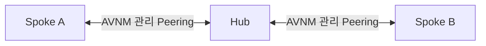

# 03. AVNM으로 Hub와 Spoke 연결 관리

> 목표 시간 20분. 수동 네 방향 Peering 대신 Azure Virtual Network Manager(AVNM) Connectivity로 Hub↔Spoke 연결을 배포하고 비전이성을 이해합니다.

## 공통 준비

👁️ **설명**

모듈 02의 세 VNet이 먼저 있어야 합니다. 모듈 01의 `STATE_FILE`을 그대로 사용합니다.
구독과 세 RG의 소유권 확인은 공통 준비에서 한 번만 실행합니다. 재접속 후 `STATE_FILE`이
비어 있다면 기존 JSON 경로를 묻습니다. `.workshop-state/<실행 ID>.json`처럼 점까지 입력하고
다른 실습/구독으로 전환할 때는 [상태 복구](01-prerequisites.md#세션-재연결-시-변수-복구)를 실행하세요.
이후 블록은 같은 세션을 공유하며 필요한 AVNM 이름과 ID는 상태 파일에서 복구합니다.
**한 블록 실행 → 확인 → 다음 블록** 순서입니다. 오류 시 다음 단계로 넘어가지 않습니다.
`&&`는 앞 검사 실패 시 해당 작업을 멈추며 Cloud Shell을 종료하지 않습니다.

🟢 **실행**

<!-- exec:prepare-03 -->
```bash
source scripts/workshop-common.sh &&
ensure_state_file &&
load_run "$STATE_FILE" &&
assert_subscription &&
assert_owned_rg "$RG_HUB" &&
assert_owned_rg "$RG_SPOKEA" &&
assert_owned_rg "$RG_SPOKEB"
```

📋 **확인**

오류 없이 프롬프트로 돌아오면 모듈 03 작업을 실행할 준비가 된 상태입니다.

## 1. Connectivity-only AVNM 만들기

👁️ **설명**

이 워크숍은 AVNM의 **Connectivity**만 사용합니다. Security Admin, Routing, 동적 멤버십,
Direct connectivity, global mesh, hub gateway, 기존 Peering 자동 삭제는 사용하지 않습니다.
재실행 시에는 먼저 기존 AVNM 목록을 읽고 정확한 이름·ID·구독 scope·feature를 확인한 뒤에만
재사용합니다. 목록 조회가 실패하면 부재로 간주하지 않고 즉시 중단합니다.

🟢 **실행**

<!-- exec:avnm-create -->
```bash
managers=$(az network manager list \
  --resource-group "$RG_HUB" \
  -o json --subscription "$SUBSCRIPTION_ID") &&
matches=$(jq -c --arg name "$AVNM" '[.[] | select(.name == $name)]' <<<"$managers") &&
count=$(jq -r 'length' <<<"$matches") &&
if [[ "$count" == "0" ]]; then
  az network manager create \
    --location "$LOCATION" \
    --name "$AVNM" \
    --resource-group "$RG_HUB" \
    --scope-accesses Connectivity \
    --network-manager-scopes "subscriptions=/subscriptions/$SUBSCRIPTION_ID" \
    --description "Beginner Hub and Spoke connectivity" \
    -o json --subscription "$SUBSCRIPTION_ID"
elif [[ "$count" == "1" ]]; then
  jq -e --arg name "$AVNM" --arg id "$AVNM_ID" --arg sub "/subscriptions/$SUBSCRIPTION_ID" '
    .[0].name == $name and
    ((.[0].id | ascii_downcase) == ($id | ascii_downcase)) and
    (.[0].networkManagerScopeAccesses == ["Connectivity"]) and
    (((.[0].networkManagerScopes.subscriptions // []) | length) == 1) and
    (((.[0].networkManagerScopes.subscriptions[0] // "") | ascii_downcase) == ($sub | ascii_downcase)) and
    (((.[0].networkManagerScopes.managementGroups // []) | length) == 0) and
    .[0].provisioningState == "Succeeded"
  ' <<<"$matches" >/dev/null || { fail "Existing AVNM does not match the approved Connectivity-only scope."; false; }
else
  fail "Duplicate AVNM names found: $AVNM" && false
fi
```

📋 **확인**

처음 실행이면 Hub RG에 `avnm-lzbegin-<runId>`가 만들어집니다. 재실행이면 기존 AVNM을 그대로 재사용하고,
Connectivity-only가 아니면 실패합니다.

## 2. Spoke 전용 Network Group 만들기

👁️ **설명**

Network Group에는 **Spoke A와 Spoke B만** 들어갑니다. Hub는 group member가 아니라 이후
Connectivity Configuration의 hub로 별도 지정합니다. 재실행 시에는 같은 이름의 group이 있어도
정확한 ID와 설명이 일치할 때만 재사용합니다.

🟢 **실행**

<!-- exec:network-group-create -->
```bash
groups=$(az network manager group list \
  --network-manager-name "$AVNM" \
  --resource-group "$RG_HUB" \
  -o json --subscription "$SUBSCRIPTION_ID") &&
matches=$(jq -c --arg name "$NETWORK_GROUP" '[.[] | select(.name == $name)]' <<<"$groups") &&
count=$(jq -r 'length' <<<"$matches") &&
if [[ "$count" == "0" ]]; then
  az network manager group create \
    --name "$NETWORK_GROUP" \
    --network-manager-name "$AVNM" \
    --resource-group "$RG_HUB" \
    --description "Workshop spoke virtual networks" \
    -o json --subscription "$SUBSCRIPTION_ID"
elif [[ "$count" == "1" ]]; then
  jq -e --arg name "$NETWORK_GROUP" --arg id "$NETWORK_GROUP_ID" '
    .[0].name == $name and
    ((.[0].id | ascii_downcase) == ($id | ascii_downcase)) and
    .[0].description == "Workshop spoke virtual networks" and
    .[0].provisioningState == "Succeeded"
  ' <<<"$matches" >/dev/null || { fail "Existing Network Group does not match the workshop contract."; false; }
else
  fail "Duplicate Network Group names found: $NETWORK_GROUP" && false
fi
```

📋 **확인**

처음 실행이면 Spoke용 group이 만들어지고, 재실행이면 같은 contract일 때만 재사용합니다.

## 3. 정적 멤버로 Spoke A 추가

👁️ **설명**

이 워크숍은 동적 멤버십을 쓰지 않습니다. 목록을 먼저 읽고 `spokea` 멤버가 이미 있으면
정확한 VNet ID인지 검증합니다. 없을 때만 생성합니다.

🟢 **실행**

<!-- exec:member-spokea -->
```bash
members=$(az network manager group static-member list \
  --network-group "$NETWORK_GROUP" \
  --network-manager "$AVNM" \
  --resource-group "$RG_HUB" \
  -o json --subscription "$SUBSCRIPTION_ID") &&
spokea_id="/subscriptions/$SUBSCRIPTION_ID/resourceGroups/$RG_SPOKEA/providers/Microsoft.Network/virtualNetworks/vnet-lzbegin-spokea-$RUN_ID" &&
matches=$(jq -c '[.[] | select(.name == "spokea")]' <<<"$members") &&
count=$(jq -r 'length' <<<"$matches") &&
if [[ "$count" == "0" ]]; then
  az network manager group static-member create \
    --name spokea \
    --network-group "$NETWORK_GROUP" \
    --network-manager "$AVNM" \
    --resource-group "$RG_HUB" \
    --resource-id "$spokea_id" \
    -o json --subscription "$SUBSCRIPTION_ID"
elif [[ "$count" == "1" ]]; then
  jq -e --arg id "$spokea_id" '
    .[0].name == "spokea" and
    ((.[0].resourceId | ascii_downcase) == ($id | ascii_downcase)) and
    .[0].provisioningState == "Succeeded"
  ' <<<"$matches" >/dev/null || { fail "Existing Spoke A member does not match the expected VNet ID."; false; }
else
  fail "Duplicate static members found for Spoke A." && false
fi
```

📋 **확인**

Spoke A VNet만 group member여야 합니다. Hub나 다른 VNet이 대신 들어가면 다음 단계로 가지 마세요.

## 4. 정적 멤버로 Spoke B 추가

👁️ **설명**

B도 같은 방식으로 추가합니다. 재실행 시에는 `spokeb` 멤버의 resource ID를 검증하고,
없을 때만 생성합니다.

🟢 **실행**

<!-- exec:member-spokeb -->
```bash
members=$(az network manager group static-member list \
  --network-group "$NETWORK_GROUP" \
  --network-manager "$AVNM" \
  --resource-group "$RG_HUB" \
  -o json --subscription "$SUBSCRIPTION_ID") &&
spokeb_id="/subscriptions/$SUBSCRIPTION_ID/resourceGroups/$RG_SPOKEB/providers/Microsoft.Network/virtualNetworks/vnet-lzbegin-spokeb-$RUN_ID" &&
matches=$(jq -c '[.[] | select(.name == "spokeb")]' <<<"$members") &&
count=$(jq -r 'length' <<<"$matches") &&
if [[ "$count" == "0" ]]; then
  az network manager group static-member create \
    --name spokeb \
    --network-group "$NETWORK_GROUP" \
    --network-manager "$AVNM" \
    --resource-group "$RG_HUB" \
    --resource-id "$spokeb_id" \
    -o json --subscription "$SUBSCRIPTION_ID"
elif [[ "$count" == "1" ]]; then
  jq -e --arg id "$spokeb_id" '
    .[0].name == "spokeb" and
    ((.[0].resourceId | ascii_downcase) == ($id | ascii_downcase)) and
    .[0].provisioningState == "Succeeded"
  ' <<<"$matches" >/dev/null || { fail "Existing Spoke B member does not match the expected VNet ID."; false; }
else
  fail "Duplicate static members found for Spoke B." && false
fi
```

📋 **확인**

이제 group에는 Spoke A와 Spoke B만 있어야 합니다. Hub를 member로 넣지 않습니다.

## 5. Hub-and-Spoke Connectivity Configuration 만들기

👁️ **설명**

이 단계가 수동 Peering 생성 대신 AVNM이 연결을 관리하도록 선언하는 부분입니다. 먼저
정적 멤버 목록이 **정확히 A/B 두 개**인지 확인합니다. 그런 다음 Hub VNet ID를 직접 조회해
예상한 RG·이름과 일치하는지 검증하고, compact JSON으로 configuration payload를 만듭니다.
재실행 시 기존 configuration이 있으면 topology, destructive flag, global flag, hub, group을
모두 확인한 뒤 재사용합니다.

🟢 **실행**

<!-- exec:connectivity-config-create -->
```bash
members=$(az network manager group static-member list \
  --network-group "$NETWORK_GROUP" \
  --network-manager "$AVNM" \
  --resource-group "$RG_HUB" \
  -o json --subscription "$SUBSCRIPTION_ID") &&
spokea_id="/subscriptions/$SUBSCRIPTION_ID/resourceGroups/$RG_SPOKEA/providers/Microsoft.Network/virtualNetworks/vnet-lzbegin-spokea-$RUN_ID" &&
spokeb_id="/subscriptions/$SUBSCRIPTION_ID/resourceGroups/$RG_SPOKEB/providers/Microsoft.Network/virtualNetworks/vnet-lzbegin-spokeb-$RUN_ID" &&
jq -e --arg spokea "$spokea_id" --arg spokeb "$spokeb_id" '
  type == "array" and
  length == 2 and
  ([.[].name] | sort == ["spokea", "spokeb"]) and
  ([.[].resourceId | ascii_downcase] | sort) == ([($spokea | ascii_downcase), ($spokeb | ascii_downcase)] | sort) and
  all(.[]; .provisioningState == "Succeeded")
' <<<"$members" >/dev/null &&
hub_id=$(az network vnet show -g "$RG_HUB" -n "vnet-lzbegin-hub-$RUN_ID" \
  --query id -o tsv --subscription "$SUBSCRIPTION_ID") &&
expected_hub_id="/subscriptions/$SUBSCRIPTION_ID/resourceGroups/$RG_HUB/providers/Microsoft.Network/virtualNetworks/vnet-lzbegin-hub-$RUN_ID" &&
{ [[ "${hub_id,,}" == "${expected_hub_id,,}" ]] ||
  { fail "Unexpected Hub VNet ID: $hub_id"; false; }; } &&
hubs=$(jq -cn --arg id "$hub_id" \
  '[{resourceId:$id,resourceType:"Microsoft.Network/virtualNetworks"}]') &&
groups=$(jq -cn --arg id "$NETWORK_GROUP_ID" \
  '[{networkGroupId:$id,groupConnectivity:"None",isGlobal:false,useHubGateway:false}]') &&
configs=$(az network manager connect-config list \
  --network-manager-name "$AVNM" \
  --resource-group "$RG_HUB" \
  -o json --subscription "$SUBSCRIPTION_ID") &&
matches=$(jq -c --arg name "$CONNECTIVITY_CONFIG" '[.[] | select(.name == $name)]' <<<"$configs") &&
count=$(jq -r 'length' <<<"$matches") &&
if [[ "$count" == "0" ]]; then
  az network manager connect-config create \
    --configuration-name "$CONNECTIVITY_CONFIG" \
    --description "AVNM managed beginner hub and spoke" \
    --applies-to-groups "$groups" \
    --hubs "$hubs" \
    --connectivity-topology HubAndSpoke \
    --delete-existing-peering False \
    --is-global False \
    --network-manager-name "$AVNM" \
    --resource-group "$RG_HUB" \
    -o json --subscription "$SUBSCRIPTION_ID"
elif [[ "$count" == "1" ]]; then
  jq -e --arg name "$CONNECTIVITY_CONFIG" --arg id "$CONNECTIVITY_CONFIG_ID" --arg hub "$expected_hub_id" --arg group "$NETWORK_GROUP_ID" '
    .[0].name == $name and
    ((.[0].id | ascii_downcase) == ($id | ascii_downcase)) and
    .[0].connectivityTopology == "HubAndSpoke" and
    .[0].provisioningState == "Succeeded" and
    ((.[0].deleteExistingPeering == "False") or (.[0].deleteExistingPeering == false)) and
    ((.[0].isGlobal == "False") or (.[0].isGlobal == false)) and
    (((.[0].hubs // []) | length) == 1) and
    (((.[0].hubs[0].resourceId // "") | ascii_downcase) == ($hub | ascii_downcase)) and
    (.[0].hubs[0].resourceType == "Microsoft.Network/virtualNetworks") and
    (((.[0].appliesToGroups // []) | length) == 1) and
    (((.[0].appliesToGroups[0].networkGroupId // "") | ascii_downcase) == ($group | ascii_downcase)) and
    (.[0].appliesToGroups[0].groupConnectivity == "None") and
    (((.[0].appliesToGroups[0].isGlobal == "False") or (.[0].appliesToGroups[0].isGlobal == false))) and
    (((.[0].appliesToGroups[0].useHubGateway == "False") or (.[0].appliesToGroups[0].useHubGateway == false)))
  ' <<<"$matches" >/dev/null || { fail "Existing connectivity configuration does not match the approved Hub-and-Spoke contract."; false; }
else
  fail "Duplicate connectivity configuration names found: $CONNECTIVITY_CONFIG" && false
fi
```

📋 **확인**

`HubAndSpoke`, `deleteExistingPeering=False`, `isGlobal=False`, Hub VNet ID, Network Group ID가 모두
의도한 값이어야 합니다. Hub gateway, global mesh, destructive overwrite는 사용하지 않습니다.

## 6. koreacentral에 Connectivity 배포(commit)

👁️ **설명**

Configuration을 만든 것만으로 실제 연결이 적용되지는 않습니다. 이 블록이 Korea Central에
Connectivity 배포를 요청합니다. 재실행은 같은 configuration을 다시 commit하는 동작입니다.

🟢 **실행**

<!-- exec:connectivity-commit -->
```bash
az network manager post-commit \
  --network-manager-name "$AVNM" \
  --commit-type Connectivity \
  --configuration-ids "$CONNECTIVITY_CONFIG_ID" \
  --target-locations "$LOCATION" \
  --resource-group "$RG_HUB" \
  -o json --subscription "$SUBSCRIPTION_ID"
```

📋 **확인**

commit 요청이 성공하면 다음 단계에서 각 VNet의 effective configuration과 실제 Peering을 확인합니다.

## 7. Hub의 effective connectivity 확인

👁️ **설명**

Hub VNet에 실제로 어떤 connectivity configuration이 적용되었는지 읽습니다. 단순히 commit 성공만 보고
다음 모듈로 가지 않습니다. configuration ID, topology, hub, group이 정확해야 합니다.

🟢 **실행**

<!-- exec:effective-hub -->
```bash
effective=$(az network manager list-effective-connectivity-config \
  --resource-group "$RG_HUB" \
  --virtual-network-name "vnet-lzbegin-hub-$RUN_ID" \
  -o json --subscription "$SUBSCRIPTION_ID") &&
expected_hub_id="/subscriptions/$SUBSCRIPTION_ID/resourceGroups/$RG_HUB/providers/Microsoft.Network/virtualNetworks/vnet-lzbegin-hub-$RUN_ID" &&
jq -e --arg config "$CONNECTIVITY_CONFIG_ID" --arg hub "$expected_hub_id" --arg group "$NETWORK_GROUP_ID" '
  (.value | type == "array") and
  (.value | length == 1) and
  ((.value[0].id | ascii_downcase) == ($config | ascii_downcase)) and
  .value[0].connectivityTopology == "HubAndSpoke" and
  .value[0].provisioningState == "Succeeded" and
  ((.value[0].deleteExistingPeering == "False") or (.value[0].deleteExistingPeering == false)) and
  ((.value[0].isGlobal == "False") or (.value[0].isGlobal == false)) and
  (((.value[0].hubs // []) | length) == 1) and
  (((.value[0].hubs[0].resourceId // "") | ascii_downcase) == ($hub | ascii_downcase)) and
  (((.value[0].appliesToGroups // []) | length) == 1) and
  (((.value[0].appliesToGroups[0].networkGroupId // "") | ascii_downcase) == ($group | ascii_downcase))
' <<<"$effective" >/dev/null &&
printf '%s\n' "$effective"
```

📋 **확인**

정확히 하나의 `HubAndSpoke` configuration이 보여야 합니다.

## 8. Spoke A의 effective connectivity 확인

👁️ **설명**

Spoke A도 같은 configuration을 받아야 합니다. Hub에만 적용되고 Spoke에 보이지 않으면 commit이 아직 완전히 반영되지 않은 상태입니다.

🟢 **실행**

<!-- exec:effective-spokea -->
```bash
effective=$(az network manager list-effective-connectivity-config \
  --resource-group "$RG_SPOKEA" \
  --virtual-network-name "vnet-lzbegin-spokea-$RUN_ID" \
  -o json --subscription "$SUBSCRIPTION_ID") &&
expected_hub_id="/subscriptions/$SUBSCRIPTION_ID/resourceGroups/$RG_HUB/providers/Microsoft.Network/virtualNetworks/vnet-lzbegin-hub-$RUN_ID" &&
jq -e --arg config "$CONNECTIVITY_CONFIG_ID" --arg hub "$expected_hub_id" --arg group "$NETWORK_GROUP_ID" '
  (.value | type == "array") and
  (.value | length == 1) and
  ((.value[0].id | ascii_downcase) == ($config | ascii_downcase)) and
  .value[0].connectivityTopology == "HubAndSpoke" and
  .value[0].provisioningState == "Succeeded" and
  ((.value[0].deleteExistingPeering == "False") or (.value[0].deleteExistingPeering == false)) and
  ((.value[0].isGlobal == "False") or (.value[0].isGlobal == false)) and
  (((.value[0].hubs // []) | length) == 1) and
  (((.value[0].hubs[0].resourceId // "") | ascii_downcase) == ($hub | ascii_downcase)) and
  (((.value[0].appliesToGroups // []) | length) == 1) and
  (((.value[0].appliesToGroups[0].networkGroupId // "") | ascii_downcase) == ($group | ascii_downcase))
' <<<"$effective" >/dev/null &&
printf '%s\n' "$effective"
```

📋 **확인**

Spoke A에서도 같은 configuration ID가 보여야 합니다.

## 9. Spoke B의 effective connectivity 확인

👁️ **설명**

Spoke B도 동일하게 확인합니다. 세 VNet 모두 같은 configuration을 읽을 수 있어야 AVNM이 의도한 범위에 배포된 것입니다.

🟢 **실행**

<!-- exec:effective-spokeb -->
```bash
effective=$(az network manager list-effective-connectivity-config \
  --resource-group "$RG_SPOKEB" \
  --virtual-network-name "vnet-lzbegin-spokeb-$RUN_ID" \
  -o json --subscription "$SUBSCRIPTION_ID") &&
expected_hub_id="/subscriptions/$SUBSCRIPTION_ID/resourceGroups/$RG_HUB/providers/Microsoft.Network/virtualNetworks/vnet-lzbegin-hub-$RUN_ID" &&
jq -e --arg config "$CONNECTIVITY_CONFIG_ID" --arg hub "$expected_hub_id" --arg group "$NETWORK_GROUP_ID" '
  (.value | type == "array") and
  (.value | length == 1) and
  ((.value[0].id | ascii_downcase) == ($config | ascii_downcase)) and
  .value[0].connectivityTopology == "HubAndSpoke" and
  .value[0].provisioningState == "Succeeded" and
  ((.value[0].deleteExistingPeering == "False") or (.value[0].deleteExistingPeering == false)) and
  ((.value[0].isGlobal == "False") or (.value[0].isGlobal == false)) and
  (((.value[0].hubs // []) | length) == 1) and
  (((.value[0].hubs[0].resourceId // "") | ascii_downcase) == ($hub | ascii_downcase)) and
  (((.value[0].appliesToGroups // []) | length) == 1) and
  (((.value[0].appliesToGroups[0].networkGroupId // "") | ascii_downcase) == ($group | ascii_downcase))
' <<<"$effective" >/dev/null &&
printf '%s\n' "$effective"
```

📋 **확인**

Spoke B도 같은 configuration ID와 `HubAndSpoke` topology를 보여야 합니다.

## 10. Hub에서 AVNM이 만든 Peering 확인

👁️ **설명**

이제 실제 Peering이 생겼는지 Hub VNet에서 확인합니다. AVNM이 생성한 이름은 계약이 아니므로
이름보다 **remote VNet ID와 Connected 상태**를 봅니다.

🟢 **실행**

<!-- exec:inspect-avnm-peerings-hub -->
```bash
peerings=$(az network vnet peering list -g "$RG_HUB" \
  --vnet-name "vnet-lzbegin-hub-$RUN_ID" \
  -o json --subscription "$SUBSCRIPTION_ID") &&
spokea_id="/subscriptions/$SUBSCRIPTION_ID/resourceGroups/$RG_SPOKEA/providers/Microsoft.Network/virtualNetworks/vnet-lzbegin-spokea-$RUN_ID" &&
spokeb_id="/subscriptions/$SUBSCRIPTION_ID/resourceGroups/$RG_SPOKEB/providers/Microsoft.Network/virtualNetworks/vnet-lzbegin-spokeb-$RUN_ID" &&
jq -e --arg spokea "$spokea_id" --arg spokeb "$spokeb_id" '
  type == "array" and
  length == 2 and
  ([.[].remoteVirtualNetwork.id | ascii_downcase] | sort) == ([($spokea | ascii_downcase), ($spokeb | ascii_downcase)] | sort) and
  all(.[]; .peeringState == "Connected")
' <<<"$peerings" >/dev/null &&
jq '[.[] | {Name:.name,State:.peeringState,Remote:.remoteVirtualNetwork.id}]' <<<"$peerings"
```

📋 **확인**

Hub에는 Spoke A와 Spoke B를 향한 두 개의 `Connected` Peering이 보여야 합니다. 이름은 고정 문자열로 가정하지 않습니다.

## 11. Spoke A에서 AVNM Peering 확인

👁️ **설명**

Spoke A는 Hub 하나만 remote로 가져야 합니다. B와 직접 연결이 생기면 이 워크숍의 비전이성 학습 조건이 달라집니다.

🟢 **실행**

<!-- exec:inspect-avnm-peerings-spokea -->
```bash
peerings=$(az network vnet peering list -g "$RG_SPOKEA" \
  --vnet-name "vnet-lzbegin-spokea-$RUN_ID" \
  -o json --subscription "$SUBSCRIPTION_ID") &&
hub_id="/subscriptions/$SUBSCRIPTION_ID/resourceGroups/$RG_HUB/providers/Microsoft.Network/virtualNetworks/vnet-lzbegin-hub-$RUN_ID" &&
jq -e --arg hub "$hub_id" '
  type == "array" and
  length == 1 and
  ((.[0].remoteVirtualNetwork.id | ascii_downcase) == ($hub | ascii_downcase)) and
  .[0].peeringState == "Connected"
' <<<"$peerings" >/dev/null &&
jq '[.[] | {Name:.name,State:.peeringState,Remote:.remoteVirtualNetwork.id}]' <<<"$peerings"
```

📋 **확인**

Spoke A에서는 Hub 하나만 `Connected`여야 하며, generated peering name은 안정적인 계약이 아닙니다.

## 12. Spoke B에서 AVNM Peering 확인

👁️ **설명**

Spoke B도 같은 방식으로 Hub 하나만 확인합니다. Hub 쪽 결과만 보고 전체 구성이 맞다고 판단하지 않습니다.

🟢 **실행**

<!-- exec:inspect-avnm-peerings-spokeb -->
```bash
peerings=$(az network vnet peering list -g "$RG_SPOKEB" \
  --vnet-name "vnet-lzbegin-spokeb-$RUN_ID" \
  -o json --subscription "$SUBSCRIPTION_ID") &&
hub_id="/subscriptions/$SUBSCRIPTION_ID/resourceGroups/$RG_HUB/providers/Microsoft.Network/virtualNetworks/vnet-lzbegin-hub-$RUN_ID" &&
jq -e --arg hub "$hub_id" '
  type == "array" and
  length == 1 and
  ((.[0].remoteVirtualNetwork.id | ascii_downcase) == ($hub | ascii_downcase)) and
  .[0].peeringState == "Connected"
' <<<"$peerings" >/dev/null &&
jq '[.[] | {Name:.name,State:.peeringState,Remote:.remoteVirtualNetwork.id}]' <<<"$peerings"
```

📋 **확인**

Spoke B에서도 Hub 하나만 `Connected`여야 합니다.

## 13. 연결되지 않은 경로 예상하기

👁️ **설명**



AVNM이 Hub↔Spoke Peering을 자동으로 만들었더라도 Spoke A의 패킷이 Hub를 거쳐 B로 자동 중계되지는 않습니다.
모듈 04에서 실패를 확인한 뒤 모듈 05–06에서 Firewall과 **왕복 UDR**로 해결합니다.
임의로 A↔B 직접 Peering을 추가하면 비전이성 학습 목표가 사라집니다.

<a id="트러블슈팅"></a>
## Portal 확인과 트러블슈팅

👁️ **설명**

AVNM은 중앙 관리 계층이고, 실제 Peering은 각 VNet의 Peerings 화면에도 반영됩니다.
Hub와 두 Spoke의 화면을 각각 열어 remote VNet과 상태를 확인합니다.

🟢 **실행**

각 **Virtual Network Manager**, **Network Group**, **Connectivity configurations**, 그리고 각 **VNet → Peerings** 화면을 확인합니다.

📋 **확인**

- AVNM은 Connectivity-only scope입니다.
- Network Group에는 Spoke A와 Spoke B만 있습니다.
- Connectivity Configuration은 `HubAndSpoke`, `deleteExistingPeering=False`, `isGlobal=False`입니다.
- Hub에는 두 개, 각 Spoke에는 하나의 `Connected` Peering이 있습니다.
- Spoke A↔B 직접 Peering은 없습니다.

| 증상 | 조치 |
|---|---|
| commit은 성공했지만 effective configuration이 안 보임 | 잠시 기다린 뒤 effective 블록을 다시 실행 |
| 기존 AVNM/Group/Configuration mismatch | 이름이 같아도 자동 덮어쓰지 말고 원인을 확인 |
| Hub가 group member로 들어감 | Hub를 member에서 제거하고 hub 필드로만 지정 |
| Connected인데 통신 불가 | NSG·VM 서비스·경로를 별도로 확인; 모듈 04 이후 단계에서 검증 |
| 소유 검사 실패 | 활성 구독과 상태 파일 확인 후 공통 준비 재실행; 태그로 우회하지 않기 |

## 완료 체크

- AVNM, Network Group, 정적 멤버, Connectivity Configuration, commit을 모두 확인했습니다.
- Hub에는 두 개, 각 Spoke에는 하나의 `Connected` Peering이 있습니다.
- Spoke A↔B 직접 연결이 없고, 비전이성을 설명할 수 있습니다.

## 다음 단계

- [이전: 네트워크 뼈대](02-network-foundation.md)
- [다음: 통신과 NSG](04-connectivity-nsg.md)
- [중단 시 정리](07-cleanup-production.md)
