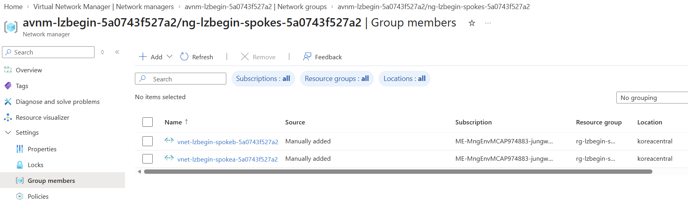
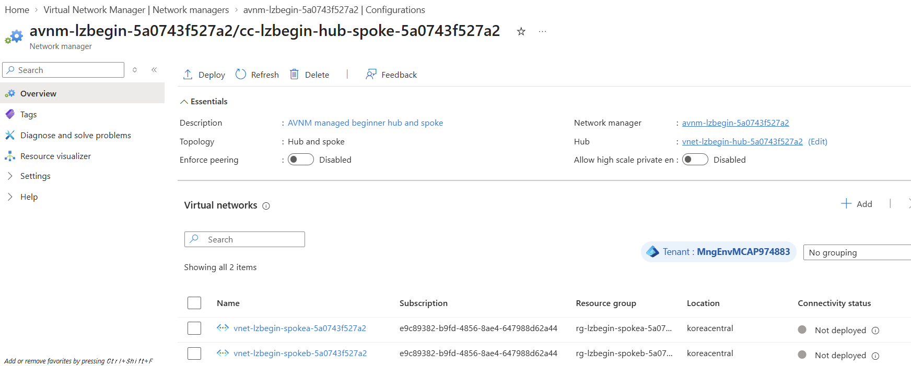
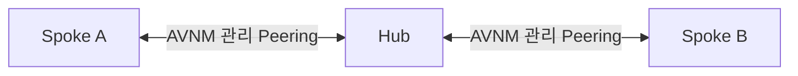
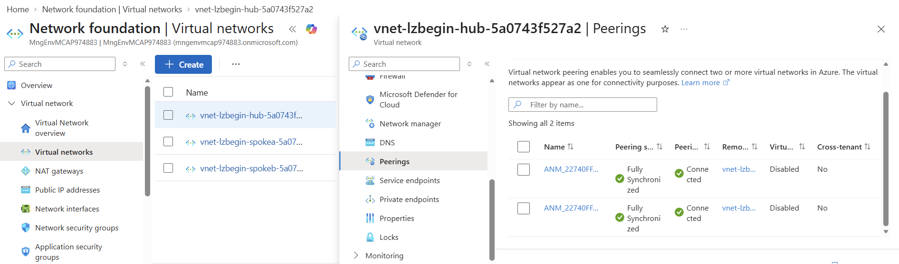

# 03. AVNM으로 Hub와 Spoke 연결 관리

> 목표 시간 20분. 수동 네 방향 Peering 대신 Azure Virtual Network Manager(AVNM) Connectivity로 Hub↔Spoke 연결을 배포하고 비전이성을 이해합니다.

## 공통 준비

👁️ **설명**

모듈 02의 세 VNet이 먼저 있어야 합니다. 모듈 01의 `STATE_FILE`을 그대로 사용합니다.
구독과 세 RG의 소유권 확인은 공통 준비에서 한 번만 실행합니다. 재접속 후 활성 구독이
원래 구독과 같다면 공통 준비에 기존 JSON 경로를 입력하세요. `STATE_FILE`이 비어 있을 때
묻는 경로는 `.workshop-state/<실행 ID>.json`처럼 점까지 입력합니다.
활성 구독이 다르거나 다른 실습/구독으로 전환했다면
[모듈 01의 세션 복구](01-prerequisites.md#세션-재연결-시-변수-복구)를 먼저 실행한 뒤 공통 준비로 돌아오세요.
이후 블록은 같은 세션을 공유하며 필요한 AVNM 이름과 ID는 상태 파일에서 복구합니다.
**한 블록 실행 → 확인 → 다음 블록** 순서입니다. 오류 시 다음 단계로 넘어가지 않습니다.
각 블록의 결과를 확인하고 다음 블록을 **직접** 실행합니다. 실패 시 이어서
붙여 넣거나 다음 생성 단계로 넘어가지 마세요. 공통 준비와 생성 블록의
안전 검사는 실패할 때 오류를 반환하지만 Cloud Shell을 종료하지 않습니다.
이 모듈의 AVNM·Group·정적 멤버·구성은 모두 **이번 실행에서 처음 생성**합니다.
기존 자원을 재사용하거나 덮어쓰지 않습니다. 각 생성 블록은 해당 범위가 비어
있는지만 확인한 뒤 Azure CLI 생성 명령 한 개를 실행하고, 이미 자원이 있다면
오류로 멈춥니다. 부분 실행 후 생성 블록을 다시 실행하지 말고 현재 상태를
확인한 뒤 남은 단계부터 진행하세요. 블록을 건너뛰거나 합쳐 실행하지 마세요.

🟢 **실행**

<!-- exec:prepare-03 -->
```bash
# 이번 실행의 상태·구독·세 RG 소유권을 한 번 확인합니다.
prepare_avnm_session() {
  source scripts/workshop-common.sh || return 1
  ensure_state_file || return 1
  load_run "$STATE_FILE" || return 1
  assert_subscription || return 1
  assert_owned_rg "$RG_HUB" || return 1
  assert_owned_rg "$RG_SPOKEA" || return 1
  assert_owned_rg "$RG_SPOKEB"
}
prepare_avnm_session
```

📋 **확인**

오류 없이 프롬프트로 돌아오면 모듈 03 작업을 실행할 준비가 된 상태입니다.

## 1. Connectivity·Security Admin·Routing AVNM 만들기

👁️ **설명**

이 워크숍은 AVNM의 **Connectivity·Security Admin·Routing** 기능을 사용합니다.
동적 멤버십, Direct connectivity, global mesh, hub gateway, 기존 Peering 자동 삭제는 사용하지 않습니다.
이번 Hub RG에는 AVNM이 아직 없어야 합니다. 목록 조회가 실패하거나 이미
자원이 있으면 생성하지 않습니다.
**모듈 03에서 AVNM을 생성합니다.** 관리 범위와 구성 사용량에 따라 비용이 발생할 수 있으므로
실습 후 모듈 07에서 정리하세요.

### 1-1. 현재 AVNM 목록 조회

👁️ **설명**

이번 Hub RG의 AVNM 목록이 비어 있는지 확인합니다.

🟢 **실행**

<!-- exec:inspect-avnm -->
```bash
# Hub RG의 AVNM 목록을 변경하지 않고 출력합니다.
az network manager list --resource-group "$RG_HUB" -o json --subscription "$SUBSCRIPTION_ID"
```

📋 **확인**

빈 배열 `[]`을 확인하세요. 목록에 자원이 있거나 조회가 실패하면 생성하지 마세요.

### 1-2. 세 기능 범위의 AVNM 최초 생성

👁️ **설명**

생성 직전 Hub RG의 목록이 비어 있는지 다시 확인합니다. 기존 AVNM을
재사용하거나 설정을 갱신하지 않습니다. 현재 CLI 확장의 manager 생성 옵션에는
Routing이 나열되지 않으므로 ARM 2025-01-01 API를 `az rest`로 호출합니다.

🟢 **실행**

<!-- exec:avnm-create -->
```bash
# Hub RG에 AVNM이 없을 때 Connectivity·Security Admin·Routing 범위로 만듭니다.
create_avnm_if_empty() {
  local managers manager_id body result
  managers=$(az network manager list \
    --resource-group "$RG_HUB" \
    -o json --subscription "$SUBSCRIPTION_ID") || return 1
  jq -e 'type == "array" and length == 0' <<<"$managers" >/dev/null ||
    { fail "Hub RG already contains an AVNM; do not overwrite it."; return 1; }
  manager_id="/subscriptions/$SUBSCRIPTION_ID/resourceGroups/$RG_HUB/providers/Microsoft.Network/networkManagers/$AVNM"
  body=$(jq -cn --arg location "$LOCATION" --arg scope "/subscriptions/$SUBSCRIPTION_ID" '{
    location:$location,
    properties:{
      description:"Beginner Hub and Spoke connectivity",
      networkManagerScopes:{subscriptions:[$scope]},
      networkManagerScopeAccesses:["Connectivity","SecurityAdmin","Routing"]
    }
  }') || return 1
  result=$(az rest --method put --url "$manager_id?api-version=2025-01-01" \
    --body "$body" -o json --subscription "$SUBSCRIPTION_ID") || return 1
  jq -e --arg id "$manager_id" --arg scope "/subscriptions/$SUBSCRIPTION_ID" '
    (.id | ascii_downcase) == ($id | ascii_downcase) and
    (.properties.networkManagerScopes.subscriptions | type == "array" and length == 1) and
    ((.properties.networkManagerScopes.subscriptions[0] | ascii_downcase) == ($scope | ascii_downcase)) and
    (.properties.networkManagerScopeAccesses | sort) == (["Connectivity","SecurityAdmin","Routing"] | sort)
  ' <<<"$result" >/dev/null ||
    { fail "Unexpected AVNM scope or resource ID; inspect the created manager before continuing."; return 1; }
  printf '%s\n' "$result"
}
create_avnm_if_empty
```

📋 **확인**

Hub RG에 `avnm-lzbegin-<runId>`가 만들어집니다. 응답의 scope access가
Connectivity·SecurityAdmin·Routing이고 구독 scope가 이번 구독인지 확인하세요.
생성 응답이 `Updating`이면 해당 AVNM의 `provisioningState=Succeeded`가
될 때까지 기다린 뒤 Group 생성으로 이동하세요. 응답이 오류이거나 범위가 다르면
생성 블록을 반복 실행하지 말고 실제 자원 상태를 확인합니다.

Azure Portal의 **Virtual Network Manager → Network managers → 이번 실행의 AVNM → Overview**에서도
세 기능, **Scope (In-tenant): Subscriptions (1)**, **Provisioning state: Succeeded**를 확인하세요.

### 1-3. AVNM 배포 완료 확인

👁️ **설명**

생성 요청이 끝나도 실제 배포가 진행 중일 수 있습니다. Group 생성 전에 범위와 완료 상태를 조회합니다.

🟢 **실행**

<!-- exec:avnm-ready -->
```bash
inspect_avnm_ready() {
  local manager expected_id
  manager=$(az network manager show --name "$AVNM" \
    --resource-group "$RG_HUB" -o json --subscription "$SUBSCRIPTION_ID") || return 1
  expected_id="/subscriptions/$SUBSCRIPTION_ID/resourceGroups/$RG_HUB/providers/Microsoft.Network/networkManagers/$AVNM"
  jq -e --arg id "$expected_id" --arg scope "/subscriptions/$SUBSCRIPTION_ID" '
    ((.id | ascii_downcase) == ($id | ascii_downcase)) and
    .provisioningState == "Succeeded" and
    (.networkManagerScopes.subscriptions | type == "array" and length == 1) and
    ((.networkManagerScopes.subscriptions[0] | ascii_downcase) == ($scope | ascii_downcase)) and
    (.networkManagerScopeAccesses | sort) == (["Connectivity","SecurityAdmin","Routing"] | sort)
  ' <<<"$manager" >/dev/null ||
    { fail "AVNM scope or provisioning state is not ready."; return 1; }
  printf '%s\n' "$manager"
}
inspect_avnm_ready
```

📋 **확인**

`provisioningState=Succeeded`이며 세 기능과 이번 구독의 전체 ID가 보여야 합니다.
`Updating`이면 잠시 기다린 뒤 이 읽기 전용 확인 블록만 다시 실행하세요.

## 2. Spoke 전용 Network Group 만들기

👁️ **설명**

Network Group에는 **Spoke A와 Spoke B만** 들어갑니다. Hub는 group member가 아니라 이후
Connectivity Configuration의 hub로 별도 지정합니다. 이 AVNM의 Network Group도 새로 만듭니다.

### 2-1. 현재 Network Group 목록 조회

👁️ **설명**

이번 AVNM의 group 이름을 확인합니다. Hub를 멤버로 지정하는 단계가 아닙니다.

🟢 **실행**

<!-- exec:inspect-network-groups -->
```bash
# AVNM에 속한 기존 Network Group의 이름과 ID를 확인합니다.
az network manager group list --network-manager-name "$AVNM" \
  --resource-group "$RG_HUB" -o json --subscription "$SUBSCRIPTION_ID"
```

📋 **확인**

빈 배열 `[]`을 확인하세요. 기존 group이나 조회 오류가 있으면 생성하지 않습니다.

### 2-2. Spoke Network Group 최초 생성

👁️ **설명**

현재 목록이 비어 있을 때만 Group을 새로 만듭니다.

🟢 **실행**

<!-- exec:network-group-create -->
```bash
# 이번 AVNM에 Group이 없을 때 Spoke 전용 Group을 만듭니다.
create_group_if_empty() {
  local groups
  groups=$(az network manager group list \
    --network-manager-name "$AVNM" \
    --resource-group "$RG_HUB" \
    -o json --subscription "$SUBSCRIPTION_ID") || return 1
  jq -e 'type == "array" and length == 0' <<<"$groups" >/dev/null ||
    { fail "AVNM already contains a Network Group; do not overwrite it."; return 1; }
  az network manager group create \
    --name "$NETWORK_GROUP" \
    --network-manager-name "$AVNM" \
    --resource-group "$RG_HUB" \
    --description "Workshop spoke virtual networks" \
    -o json --subscription "$SUBSCRIPTION_ID"
}
create_group_if_empty
```

📋 **확인**

Spoke용 Group이 생성됩니다. Hub를 정적 멤버로 추가하지 않습니다.

## 3. 정적 멤버로 Spoke A 추가

👁️ **설명**

이 워크숍은 동적 멤버십을 쓰지 않습니다. 처음에는 정적 멤버가 없으며
Spoke A VNet부터 등록합니다.

### 3-1. 현재 정적 멤버 조회

👁️ **설명**

Spoke A를 추가하기 전 Network Group에 이미 들어 있는 VNet을 살펴봅니다.
동적 멤버십을 만드는 명령이 아닙니다.

🟢 **실행**

<!-- exec:inspect-members-before-spokea -->
```bash
# group의 기존 정적 멤버와 각각의 resourceId를 읽습니다.
az network manager group static-member list --network-group "$NETWORK_GROUP" \
  --network-manager "$AVNM" --resource-group "$RG_HUB" -o json --subscription "$SUBSCRIPTION_ID"
```

📋 **확인**

처음 실행이면 빈 배열입니다. 다른 VNet이 이미 있으면 추가 작업을 멈추고 원인을 확인하세요.

### 3-2. Spoke A 정적 멤버 최초 생성

👁️ **설명**

생성 직전에 Group이 비어 있는지 확인하고 Spoke A VNet의 전체 ID로 등록합니다.

🟢 **실행**

<!-- exec:member-spokea -->
```bash
# 빈 Group에 A VNet을 첫 번째 정적 멤버로 등록합니다.
create_spokea_member_if_empty() {
  local members spokea_id
  members=$(az network manager group static-member list \
    --network-group "$NETWORK_GROUP" \
    --network-manager "$AVNM" \
    --resource-group "$RG_HUB" \
    -o json --subscription "$SUBSCRIPTION_ID") || return 1
  spokea_id="/subscriptions/$SUBSCRIPTION_ID/resourceGroups/$RG_SPOKEA/providers/Microsoft.Network/virtualNetworks/vnet-lzbegin-spokea-$RUN_ID"
  jq -e 'type == "array" and length == 0' <<<"$members" >/dev/null ||
    { fail "Network Group already contains static members; do not overwrite them."; return 1; }
  az network manager group static-member create \
    --name spokea \
    --network-group "$NETWORK_GROUP" \
    --network-manager "$AVNM" \
    --resource-group "$RG_HUB" \
    --resource-id "$spokea_id" \
    -o json --subscription "$SUBSCRIPTION_ID"
}
create_spokea_member_if_empty
```

📋 **확인**

Spoke A VNet만 group member여야 합니다. Hub나 다른 VNet이 대신 들어가면 다음 단계로 가지 마세요.

## 4. 정적 멤버로 Spoke B 추가

👁️ **설명**

B도 새 정적 멤버로 추가합니다. 앞에서 만든 A만 있는 상태여야 합니다.

### 4-1. A 등록 후 정적 멤버 조회

👁️ **설명**

A 등록 결과를 별도로 조회합니다. 목록 전파가 늦을 수 있으며 구성 생성 전
5-1에서 A/B 모두 반영됐는지 다시 기다립니다.

🟢 **실행**

<!-- exec:inspect-members-before-spokeb -->
```bash
# B를 추가하기 전에 A가 group에 표시되는지 확인합니다.
az network manager group static-member list --network-group "$NETWORK_GROUP" \
  --network-manager "$AVNM" --resource-group "$RG_HUB" -o json --subscription "$SUBSCRIPTION_ID"
```

📋 **확인**

`spokea`의 `resourceId`가 A VNet을 가리켜야 합니다. 오류라면 B 추가를 진행하지 않습니다.

### 4-2. Spoke B 정적 멤버 최초 생성

👁️ **설명**

B 생성 직전 A만 등록돼 있는지 확인합니다. B가 이미 있거나 다른 VNet이
섞여 있다면 덮어쓰지 않고 중단합니다.

🟢 **실행**

<!-- exec:member-spokeb -->
```bash
# A만 있는 Group에 B VNet을 두 번째 정적 멤버로 등록합니다.
create_spokeb_member_after_a() {
  local members spokeb_id
  members=$(az network manager group static-member list \
    --network-group "$NETWORK_GROUP" \
    --network-manager "$AVNM" \
    --resource-group "$RG_HUB" \
    -o json --subscription "$SUBSCRIPTION_ID") || return 1
  spokeb_id="/subscriptions/$SUBSCRIPTION_ID/resourceGroups/$RG_SPOKEB/providers/Microsoft.Network/virtualNetworks/vnet-lzbegin-spokeb-$RUN_ID"
  jq -e --arg spokea "/subscriptions/$SUBSCRIPTION_ID/resourceGroups/$RG_SPOKEA/providers/Microsoft.Network/virtualNetworks/vnet-lzbegin-spokea-$RUN_ID" '
    type == "array" and length == 1 and
    .[0].name == "spokea" and
    ((.[0].resourceId | ascii_downcase) == ($spokea | ascii_downcase)) and
    .[0].provisioningState == "Succeeded"
  ' <<<"$members" >/dev/null ||
    { fail "Expected only the completed Spoke A member before creating B."; return 1; }
  az network manager group static-member create \
    --name spokeb \
    --network-group "$NETWORK_GROUP" \
    --network-manager "$AVNM" \
    --resource-group "$RG_HUB" \
    --resource-id "$spokeb_id" \
    -o json --subscription "$SUBSCRIPTION_ID"
}
create_spokeb_member_after_a
```

📋 **확인**

이제 group에는 Spoke A와 Spoke B만 있어야 합니다. Hub를 member로 넣지 않습니다.

Azure Portal의 **Virtual Network Manager → 이번 실행의 AVNM → Network groups → Spoke 그룹 → Group members**에서도
두 VNet의 등록을 확인할 수 있습니다. 아래 화면처럼 A/B 두 항목의 **Source**가
`Manually added`인지 확인하세요. 목록에 바로 보이지 않으면 **Refresh**를 누릅니다.
화면의 구독·실행 ID는 예시이므로 자신의 값과 대조하세요. 이 화면은 그룹 멤버십만
확인하며, 실제 Hub↔Spoke 연결은 이후 commit과 Peering 검사에서 확인합니다.



### 4-3. Spoke A 전용 Routing Group 생성

👁️ **설명**

연결용 Group과 별도로 A의 반환 경로만 적용할 Group을 만듭니다. 이 Group에는 A만 등록합니다.

🟢 **실행**

<!-- exec:route-group-spokea-create -->
```bash
create_spokea_route_group() {
  local groups
  groups=$(az network manager group list --network-manager-name "$AVNM" \
    --resource-group "$RG_HUB" -o json --subscription "$SUBSCRIPTION_ID") || return 1
  jq -e --arg id "$NETWORK_GROUP_ID" '
    type == "array" and length == 1 and
    ((.[0].id | ascii_downcase) == ($id | ascii_downcase)) and
    .[0].provisioningState == "Succeeded"
  ' <<<"$groups" >/dev/null ||
    { fail "Expected only the completed connectivity group before creating the A routing group."; return 1; }
  az network manager group create --name "ng-lzbegin-route-spokea-$RUN_ID" \
    --network-manager-name "$AVNM" --resource-group "$RG_HUB" \
    --description "Spoke A routing scope" -o json --subscription "$SUBSCRIPTION_ID"
}
create_spokea_route_group
```

📋 **확인**

연결용 Spoke Group과 새 A Routing Group이 별도로 표시됩니다.

### 4-4. Spoke B 전용 Routing Group 생성

👁️ **설명**

B는 A와 반대쪽 `/16` 경로를 사용하므로 별도 Group이 필요합니다.

🟢 **실행**

<!-- exec:route-group-spokeb-create -->
```bash
create_spokeb_route_group() {
  local groups route_a_id
  route_a_id="$AVNM_ID/networkGroups/ng-lzbegin-route-spokea-$RUN_ID"
  groups=$(az network manager group list --network-manager-name "$AVNM" \
    --resource-group "$RG_HUB" -o json --subscription "$SUBSCRIPTION_ID") || return 1
  jq -e --arg spokes "$NETWORK_GROUP_ID" --arg a "$route_a_id" '
    type == "array" and length == 2 and
    ([.[].id | ascii_downcase] | sort) ==
      ([$spokes, $a] | map(ascii_downcase) | sort) and
    all(.[]; .provisioningState == "Succeeded")
  ' <<<"$groups" >/dev/null ||
    { fail "Expected only the completed connectivity and A routing groups."; return 1; }
  az network manager group create --name "ng-lzbegin-route-spokeb-$RUN_ID" \
    --network-manager-name "$AVNM" --resource-group "$RG_HUB" \
    --description "Spoke B routing scope" -o json --subscription "$SUBSCRIPTION_ID"
}
create_spokeb_route_group
```

📋 **확인**

이제 연결용 Group 하나와 A/B Routing Group 두 개가 있습니다.

### 4-5. A Routing Group에 Spoke A 등록

👁️ **설명**

A Routing Group이 비어 있을 때만 A VNet을 추가합니다. 기존 멤버가 있으면 덮어쓰지 않습니다.

🟢 **실행**

<!-- exec:route-member-spokea -->
```bash
create_spokea_route_member() {
  local members
  members=$(az network manager group static-member list \
    --network-group "ng-lzbegin-route-spokea-$RUN_ID" --network-manager "$AVNM" \
    --resource-group "$RG_HUB" -o json --subscription "$SUBSCRIPTION_ID") || return 1
  jq -e 'type == "array" and length == 0' <<<"$members" >/dev/null ||
    { fail "Spoke A routing group already contains a member."; return 1; }
  az network manager group static-member create --name spokea \
    --network-group "ng-lzbegin-route-spokea-$RUN_ID" --network-manager "$AVNM" \
    --resource-group "$RG_HUB" \
    --resource-id "/subscriptions/$SUBSCRIPTION_ID/resourceGroups/$RG_SPOKEA/providers/Microsoft.Network/virtualNetworks/vnet-lzbegin-spokea-$RUN_ID" \
    -o json --subscription "$SUBSCRIPTION_ID"
}
create_spokea_route_member
```

📋 **확인**

A Routing Group의 유일한 정적 멤버가 Spoke A VNet입니다.

### 4-6. B Routing Group에 Spoke B 등록

👁️ **설명**

B Routing Group이 비어 있을 때만 B VNet을 추가합니다. A를 B Group에 넣지 않습니다.

🟢 **실행**

<!-- exec:route-member-spokeb -->
```bash
create_spokeb_route_member() {
  local members
  members=$(az network manager group static-member list \
    --network-group "ng-lzbegin-route-spokeb-$RUN_ID" --network-manager "$AVNM" \
    --resource-group "$RG_HUB" -o json --subscription "$SUBSCRIPTION_ID") || return 1
  jq -e 'type == "array" and length == 0' <<<"$members" >/dev/null ||
    { fail "Spoke B routing group already contains a member."; return 1; }
  az network manager group static-member create --name spokeb \
    --network-group "ng-lzbegin-route-spokeb-$RUN_ID" --network-manager "$AVNM" \
    --resource-group "$RG_HUB" \
    --resource-id "/subscriptions/$SUBSCRIPTION_ID/resourceGroups/$RG_SPOKEB/providers/Microsoft.Network/virtualNetworks/vnet-lzbegin-spokeb-$RUN_ID" \
    -o json --subscription "$SUBSCRIPTION_ID"
}
create_spokeb_route_member
```

📋 **확인**

B Routing Group의 유일한 정적 멤버가 Spoke B VNet입니다. A/B를 서로의 Group에 넣지 마세요.

## 5. Hub-and-Spoke Connectivity Configuration 만들기

👁️ **설명**

이 단계가 수동 Peering 생성 대신 AVNM이 연결을 관리하도록 선언하는 부분입니다.
먼저 정적 멤버가 **정확히 A/B 두 개**로 반영됐는지 기다린 뒤 Hub VNet ID를
조회합니다. 매번 새 실습을 시작하므로 생성 단계에서는 앞의 두 확인을
반복하지 않고, 이번 상태 파일의 ID로 구성 값을 만듭니다. 기존 Connectivity
Configuration이 있으면 덮어쓰지 않고 중단합니다.

### 5-1. 두 Spoke의 정적 멤버 반영 확인

👁️ **설명**

멤버 생성 API가 끝난 직후에는 목록 반영이 늦을 수 있습니다. 최대 2분 동안
Spoke A/B만 있는지 읽기 전용으로 확인합니다. 다른 이름이나 VNet ID가 보이면
기다리지 않고 중단합니다.

🟢 **실행**

<!-- exec:inspect-static-members -->
```bash
# 먼저 멤버의 이름과 전체 ID를 검사하고, A/B가 모두 준비될 때까지 기다립니다.
wait_static_members() {
  local members ready spokea_id spokeb_id attempt
  spokea_id="/subscriptions/$SUBSCRIPTION_ID/resourceGroups/$RG_SPOKEA/providers/Microsoft.Network/virtualNetworks/vnet-lzbegin-spokea-$RUN_ID"
  spokeb_id="/subscriptions/$SUBSCRIPTION_ID/resourceGroups/$RG_SPOKEB/providers/Microsoft.Network/virtualNetworks/vnet-lzbegin-spokeb-$RUN_ID"
  for ((attempt=1; attempt<=12; attempt++)); do
    members=$(az network manager group static-member list \
      --network-group "$NETWORK_GROUP" --network-manager "$AVNM" \
      --resource-group "$RG_HUB" -o json --subscription "$SUBSCRIPTION_ID") ||
      { fail "Cannot read static members."; return 1; }
    jq -e --arg spokea "$spokea_id" --arg spokeb "$spokeb_id" '
      type == "array" and length <= 2 and
      ([.[].name] | unique | length) == length and
      all(.[]; (.name == "spokea" and
        ((.resourceId | ascii_downcase) == ($spokea | ascii_downcase))) or
        (.name == "spokeb" and
        ((.resourceId | ascii_downcase) == ($spokeb | ascii_downcase))))
    ' <<<"$members" >/dev/null ||
      { fail "Unexpected static-member identity; do not retry."; return 1; }
    ready=$(jq -r 'length == 2 and all(.[]; .provisioningState == "Succeeded")' <<<"$members") ||
      { fail "Invalid static-member response."; return 1; }
    if [[ "$ready" == true ]]; then return 0; fi
    if ((attempt < 12)); then sleep 10 || return 1; fi
  done
  fail "Spoke A/B static members were not ready after two minutes."
}
wait_static_members
```

📋 **확인**

오류 없이 프롬프트로 돌아오면 A/B가 반영된 상태입니다. 아직 구성은 만들지 않았습니다.
다른 멤버가 있으면 원인을 확인하고 다음 블록을 실행하지 마세요.

### 5-2. Hub VNet의 전체 ID 확인

👁️ **설명**

Hub는 Network Group 멤버가 아니라 별도로 지정할 VNet입니다. CLI에서 조회한
전체 ID가 이번 실행의 Hub RG·VNet 이름과 일치하는지 확인합니다.

🟢 **실행**

<!-- exec:inspect-avnm-hub -->
```bash
# 생성할 구성의 Hub 대상이 이번 실행의 VNet인지 읽기 전용으로 확인합니다.
inspect_avnm_hub() {
  local hub_id expected_hub_id
  hub_id=$(az network vnet show -g "$RG_HUB" -n "vnet-lzbegin-hub-$RUN_ID" \
    --query id -o tsv --subscription "$SUBSCRIPTION_ID") || return 1
  expected_hub_id="/subscriptions/$SUBSCRIPTION_ID/resourceGroups/$RG_HUB/providers/Microsoft.Network/virtualNetworks/vnet-lzbegin-hub-$RUN_ID"
  [[ "${hub_id,,}" == "${expected_hub_id,,}" ]] ||
    { fail "Unexpected Hub VNet ID: $hub_id"; return 1; }
  printf '%s\n' "$hub_id"
}
inspect_avnm_hub
```

📋 **확인**

전체 ID에 자신의 구독, Hub RG, `vnet-lzbegin-hub-<실행 ID>`가 표시됩니다.

### 5-3. Connectivity Configuration 최초 생성

👁️ **설명**

**5-1의 두 멤버와 5-2의 Hub ID 확인을 마친 뒤** 실행합니다. 앞 블록의
임시 변수 대신 상태 파일의 ID를 사용합니다. 새 실습용 AVNM에 이미 구성이
있거나 목록 조회에 실패하면 생성하지 않습니다. 오류가 났다면 처음부터
붙여 넣지 말고 현재 상태를 확인하세요.

🟢 **실행**

<!-- exec:connectivity-config-create -->
```bash
# 앞 단계에서 확인한 Hub와 Spoke Group의 ID로 새 HubAndSpoke 구성을 만듭니다.
create_connectivity_config_if_empty() {
  local hubs groups configs
  hubs=$(jq -cn --arg id "/subscriptions/$SUBSCRIPTION_ID/resourceGroups/$RG_HUB/providers/Microsoft.Network/virtualNetworks/vnet-lzbegin-hub-$RUN_ID" \
    '[{resourceId:$id,resourceType:"Microsoft.Network/virtualNetworks"}]') || return 1
  groups=$(jq -cn --arg id "$NETWORK_GROUP_ID" \
    '[{networkGroupId:$id,groupConnectivity:"None",isGlobal:false,useHubGateway:false}]') || return 1
  configs=$(az network manager connect-config list \
    --network-manager-name "$AVNM" \
    --resource-group "$RG_HUB" \
    -o json --subscription "$SUBSCRIPTION_ID") || return 1
  jq -e 'type == "array" and length == 0' <<<"$configs" >/dev/null ||
    { fail "AVNM already contains a Connectivity Configuration; do not overwrite it."; return 1; }
  az network manager connect-config create \
    --configuration-name "$CONNECTIVITY_CONFIG" \
    --description "AVNM managed beginner hub and spoke" \
    --applies-to-groups "$groups" \
    --hubs "$hubs" \
    --connectivity-topology HubAndSpoke \
    --delete-existing-peering False \
    --is-global False \
    --network-manager-name "$AVNM" \
    --resource-group "$RG_HUB" \
    -o json --subscription "$SUBSCRIPTION_ID"
}
create_connectivity_config_if_empty
```

📋 **확인**

`HubAndSpoke`, `deleteExistingPeering=False`, `isGlobal=False`, Hub VNet ID, Network Group ID가 모두
의도한 값이어야 합니다. Hub gateway, global mesh, destructive overwrite는 사용하지 않습니다.
생성된 구성은 Azure Portal의 **Virtual Network Manager → Configurations → 해당 Connectivity Configuration**
화면에서도 확인할 수 있습니다. 화면의 `Not deployed`는 아직 다음 단계에서 배포(commit)하지 않은 상태입니다.



## 6. koreacentral에 Connectivity 배포(commit)

👁️ **설명**

Configuration을 만든 것만으로 실제 연결이 적용되지는 않습니다. 이 블록이 Korea Central에
Connectivity 배포를 요청합니다. 재실행은 같은 configuration을 다시 commit하는 동작입니다.

🟢 **실행**

<!-- exec:connectivity-commit -->
```bash
# 이번 Connectivity Configuration 하나를 Korea Central에 적용합니다.
az network manager post-commit \
  --network-manager-name "$AVNM" \
  --commit-type Connectivity \
  --configuration-ids "$CONNECTIVITY_CONFIG_ID" \
  --target-locations "$LOCATION" \
  --resource-group "$RG_HUB" \
  -o json --subscription "$SUBSCRIPTION_ID"
```

📋 **확인**

commit 요청이 성공하면 다음 단계에서 각 VNet의 effective configuration과 실제 Peering을 확인합니다.

## 7. Hub의 effective connectivity 응답 확인

👁️ **설명**

Hub는 정적 Spoke Network Group의 멤버가 아니라 별도로 지정한 대상입니다. Hub의
effective 목록은 비어 있거나, 의도한 configuration 하나를 반환할 수 있습니다. 배포 상태와
실제 Hub Peering 두 개를 뒤의 블록에서 확인하고, Spoke A/B의 effective configuration과 함께 판정합니다.

🟢 **실행**

<!-- exec:effective-hub -->
```bash
# Hub는 그룹 밖이므로 빈 목록 또는 이번 구성 하나만 허용합니다.
inspect_effective_hub() {
  local effective hub_id
  effective=$(az network manager list-effective-connectivity-config \
    --resource-group "$RG_HUB" \
    --virtual-network-name "vnet-lzbegin-hub-$RUN_ID" \
    -o json --subscription "$SUBSCRIPTION_ID") || return 1
  hub_id="/subscriptions/$SUBSCRIPTION_ID/resourceGroups/$RG_HUB/providers/Microsoft.Network/virtualNetworks/vnet-lzbegin-hub-$RUN_ID"
  jq -e --arg config "$CONNECTIVITY_CONFIG_ID" --arg hub "$hub_id" --arg group "$NETWORK_GROUP_ID" '
    def falsey: . == false or . == "False";
    (.value | type == "array" and length <= 1) and
    all(.value[];
      ((.id | ascii_downcase) == ($config | ascii_downcase)) and
      .connectivityTopology == "HubAndSpoke" and
      .provisioningState == "Succeeded" and
      (.deleteExistingPeering | falsey) and
      (.isGlobal | falsey) and
      (.hubs | length == 1) and
      ((.hubs[0].resourceId | ascii_downcase) == ($hub | ascii_downcase)) and
      (.targetVirtualNetwork.id == null or
        ((.targetVirtualNetwork.id | ascii_downcase) == ($hub | ascii_downcase))) and
      (.appliesToGroups | length == 1) and
      ((.appliesToGroups[0].networkGroupId | ascii_downcase) == ($group | ascii_downcase)) and
      .appliesToGroups[0].groupConnectivity == "None" and
      (.appliesToGroups[0].isGlobal | falsey) and
      (.appliesToGroups[0].useHubGateway | falsey)
    )
' <<<"$effective" >/dev/null ||
    { fail "Unexpected Hub effective connectivity."; return 1; }
  printf '%s\n' "$effective"
}
inspect_effective_hub
```

📋 **확인**

Hub는 group member가 아니므로 `value: []`도 정상입니다. `all(.value[]; ...)`은
빈 목록이면 통과하고, 구성이 하나 반환되면 해당 구성의 ID·Hub·Group·설정을 검사합니다.
배포 성공 여부는 두 Spoke의 effective configuration과 뒤의 양방향
Peering 검사로 판단합니다.

## 8. Spoke A의 effective connectivity 확인

👁️ **설명**

Spoke A도 같은 configuration을 받아야 합니다. Hub에만 적용되고 Spoke에 보이지 않으면 commit이 아직 완전히 반영되지 않은 상태입니다.

🟢 **실행**

<!-- exec:effective-spokea -->
```bash
# A의 effective 구성이 이번 Hub와 Network Group을 가리키는지 검사합니다.
inspect_effective_spokea() {
  local effective expected_hub_id
  effective=$(az network manager list-effective-connectivity-config \
    --resource-group "$RG_SPOKEA" \
    --virtual-network-name "vnet-lzbegin-spokea-$RUN_ID" \
    -o json --subscription "$SUBSCRIPTION_ID") || return 1
  expected_hub_id="/subscriptions/$SUBSCRIPTION_ID/resourceGroups/$RG_HUB/providers/Microsoft.Network/virtualNetworks/vnet-lzbegin-hub-$RUN_ID"
  jq -e --arg config "$CONNECTIVITY_CONFIG_ID" --arg hub "$expected_hub_id" --arg group "$NETWORK_GROUP_ID" '
    def falsey: . == false or . == "False";
    (.value | type == "array" and length == 1) and
    all(.value[];
      ((.id | ascii_downcase) == ($config | ascii_downcase)) and
      .connectivityTopology == "HubAndSpoke" and
      .provisioningState == "Succeeded" and
      (.deleteExistingPeering | falsey) and
      (.isGlobal | falsey) and
      (.hubs | length == 1) and
      ((.hubs[0].resourceId | ascii_downcase) == ($hub | ascii_downcase)) and
      (.appliesToGroups | length == 1) and
      ((.appliesToGroups[0].networkGroupId | ascii_downcase) == ($group | ascii_downcase))
    )
' <<<"$effective" >/dev/null ||
    { fail "Unexpected Spoke A effective connectivity."; return 1; }
  printf '%s\n' "$effective"
}
inspect_effective_spokea
```

📋 **확인**

아래는 Spoke A에서 확인한 결과를 바탕으로 한 **출력 예시**입니다.
`<구독 ID>`와 `<실행 ID>`는 자신의 값으로 바꿔 비교하세요.

```json
{
  "skipToken": "",
  "value": [
    {
      "appliesToGroups": [
        {
          "groupConnectivity": "None",
          "isGlobal": "False",
          "networkGroupId": "/subscriptions/<구독 ID>/resourceGroups/rg-lzbegin-hub-<실행 ID>/providers/Microsoft.Network/networkManagers/avnm-lzbegin-<실행 ID>/networkGroups/ng-lzbegin-spokes-<실행 ID>",
          "useHubGateway": "False"
        }
      ],
      "configurationGroups": [
        {
          "description": "Workshop spoke virtual networks",
          "id": "/subscriptions/<구독 ID>/resourceGroups/rg-lzbegin-hub-<실행 ID>/providers/Microsoft.Network/networkManagers/avnm-lzbegin-<실행 ID>/networkGroups/ng-lzbegin-spokes-<실행 ID>",
          "provisioningState": "Succeeded",
          "resourceGroup": "rg-lzbegin-hub-<실행 ID>"
        }
      ],
      "connectivityTopology": "HubAndSpoke",
      "deleteExistingPeering": "False",
      "description": "AVNM managed beginner hub and spoke",
      "hubs": [
        {
          "resourceId": "/subscriptions/<구독 ID>/resourceGroups/rg-lzbegin-hub-<실행 ID>/providers/Microsoft.Network/virtualNetworks/vnet-lzbegin-hub-<실행 ID>",
          "resourceType": "Microsoft.Network/virtualNetworks"
        }
      ],
      "id": "/subscriptions/<구독 ID>/resourceGroups/rg-lzbegin-hub-<실행 ID>/providers/Microsoft.Network/networkManagers/avnm-lzbegin-<실행 ID>/connectivityConfigurations/cc-lzbegin-hub-spoke-<실행 ID>",
      "isGlobal": "False",
      "provisioningState": "Succeeded",
      "resourceGroup": "rg-lzbegin-hub-<실행 ID>"
    }
  ]
}
```

`value`에 이번 구성 하나만 있고 `id`는 `$CONNECTIVITY_CONFIG_ID`,
`hubs[0].resourceId`는 이번 Hub VNet ID, `appliesToGroups[0].networkGroupId`는
`$NETWORK_GROUP_ID`와 각각 전체 ID가 일치해야 합니다. `connectivityTopology`는
`HubAndSpoke`, `provisioningState`는 `Succeeded`인지 확인하세요. 예시의
`"False"`는 실제 Azure CLI 응답의 문자열 표현이며, 검사 명령은 boolean `false`도 허용합니다.

## 9. Spoke B의 effective connectivity 확인

👁️ **설명**

Spoke B도 동일하게 확인합니다. 두 Spoke 모두 같은 configuration을 읽을 수 있어야 AVNM이 의도한 범위에 배포된 것입니다.

🟢 **실행**

<!-- exec:effective-spokeb -->
```bash
# B도 A와 같은 구성 ID 및 Hub 대상을 사용해야 합니다.
inspect_effective_spokeb() {
  local effective expected_hub_id
  effective=$(az network manager list-effective-connectivity-config \
    --resource-group "$RG_SPOKEB" \
    --virtual-network-name "vnet-lzbegin-spokeb-$RUN_ID" \
    -o json --subscription "$SUBSCRIPTION_ID") || return 1
  expected_hub_id="/subscriptions/$SUBSCRIPTION_ID/resourceGroups/$RG_HUB/providers/Microsoft.Network/virtualNetworks/vnet-lzbegin-hub-$RUN_ID"
  jq -e --arg config "$CONNECTIVITY_CONFIG_ID" --arg hub "$expected_hub_id" --arg group "$NETWORK_GROUP_ID" '
    def falsey: . == false or . == "False";
    (.value | type == "array" and length == 1) and
    all(.value[];
      ((.id | ascii_downcase) == ($config | ascii_downcase)) and
      .connectivityTopology == "HubAndSpoke" and
      .provisioningState == "Succeeded" and
      (.deleteExistingPeering | falsey) and
      (.isGlobal | falsey) and
      (.hubs | length == 1) and
      ((.hubs[0].resourceId | ascii_downcase) == ($hub | ascii_downcase)) and
      (.appliesToGroups | length == 1) and
      ((.appliesToGroups[0].networkGroupId | ascii_downcase) == ($group | ascii_downcase))
    )
' <<<"$effective" >/dev/null ||
    { fail "Unexpected Spoke B effective connectivity."; return 1; }
  printf '%s\n' "$effective"
}
inspect_effective_spokeb
```

📋 **확인**

Spoke B도 같은 configuration ID와 `HubAndSpoke` topology를 보여야 합니다.

## 10. Hub에서 AVNM이 만든 Peering 확인

👁️ **설명**

이제 실제 Peering이 생겼는지 Hub VNet에서 확인합니다. AVNM이 생성한 이름은 계약이 아니므로
이름보다 **remote VNet ID와 Connected 상태**를 봅니다.

🟢 **실행**

<!-- exec:inspect-avnm-peerings-hub -->
```bash
# AVNM 생성 이름 대신 Hub에서 A/B를 향한 전체 remote VNet ID를 비교합니다.
inspect_hub_peerings() {
  local peerings spokea_id spokeb_id
  peerings=$(az network vnet peering list -g "$RG_HUB" \
    --vnet-name "vnet-lzbegin-hub-$RUN_ID" \
    -o json --subscription "$SUBSCRIPTION_ID") || return 1
  spokea_id="/subscriptions/$SUBSCRIPTION_ID/resourceGroups/$RG_SPOKEA/providers/Microsoft.Network/virtualNetworks/vnet-lzbegin-spokea-$RUN_ID"
  spokeb_id="/subscriptions/$SUBSCRIPTION_ID/resourceGroups/$RG_SPOKEB/providers/Microsoft.Network/virtualNetworks/vnet-lzbegin-spokeb-$RUN_ID"
  jq -e --arg spokea "$spokea_id" --arg spokeb "$spokeb_id" '
    type == "array" and
    length == 2 and
    ([.[].remoteVirtualNetwork.id | ascii_downcase] | sort) ==
      ([$spokea, $spokeb] | map(ascii_downcase) | sort) and
    all(.[]; .peeringState == "Connected")
' <<<"$peerings" >/dev/null ||
    { fail "Unexpected Hub peerings."; return 1; }
  jq '[.[] | {Name:.name,State:.peeringState,Remote:.remoteVirtualNetwork.id}]' <<<"$peerings"
}
inspect_hub_peerings
```

📋 **확인**

Hub에는 Spoke A와 Spoke B를 향한 두 개의 `Connected` Peering이 보여야 합니다. 이름은 고정 문자열로 가정하지 않습니다.
아래는 Hub에서 확인한 결과를 바탕으로 한 **출력 예시**입니다. `Remote`에는
각각 다른 Spoke의 전체 VNet ID가 표시되어야 합니다. `Name`은 AVNM이 자동
생성하므로 예시의 접두어·숫자·형식을 기준으로 검사하지 마세요. 구독 UUID와
실행 ID는 자신의 값으로 바꿔 비교합니다.

```json
[
  {
    "Name": "ANM_22740FFA83EB4B03043CC7E_gin-hub-<실행 ID>_-spokea-<실행 ID>_9610771880",
    "State": "Connected",
    "Remote": "/subscriptions/<구독 UUID>/resourceGroups/rg-lzbegin-spokea-<실행 ID>/providers/Microsoft.Network/virtualNetworks/vnet-lzbegin-spokea-<실행 ID>"
  },
  {
    "Name": "ANM_22740FFA83EB4B03043CC7E_gin-hub-<실행 ID>_-spokeb-<실행 ID>_7200113890",
    "State": "Connected",
    "Remote": "/subscriptions/<구독 UUID>/resourceGroups/rg-lzbegin-spokeb-<실행 ID>/providers/Microsoft.Network/virtualNetworks/vnet-lzbegin-spokeb-<실행 ID>"
  }
]
```

## 11. Spoke A에서 AVNM Peering 확인

👁️ **설명**

Spoke A는 Hub 하나만 remote로 가져야 합니다. B와 직접 연결이 생기면 이 워크숍의 비전이성 학습 조건이 달라집니다.

🟢 **실행**

<!-- exec:inspect-avnm-peerings-spokea -->
```bash
# A에서 Hub 방향 Peering만 Connected인지 조회합니다.
inspect_spokea_peerings() {
  local peerings hub_id
  peerings=$(az network vnet peering list -g "$RG_SPOKEA" \
    --vnet-name "vnet-lzbegin-spokea-$RUN_ID" \
    -o json --subscription "$SUBSCRIPTION_ID") || return 1
  hub_id="/subscriptions/$SUBSCRIPTION_ID/resourceGroups/$RG_HUB/providers/Microsoft.Network/virtualNetworks/vnet-lzbegin-hub-$RUN_ID"
  jq -e --arg hub "$hub_id" '
    type == "array" and length == 1 and
    ((.[0].remoteVirtualNetwork.id | ascii_downcase) == ($hub | ascii_downcase)) and
    .[0].peeringState == "Connected"
' <<<"$peerings" >/dev/null ||
    { fail "Unexpected Spoke A peerings."; return 1; }
  jq '[.[] | {Name:.name,State:.peeringState,Remote:.remoteVirtualNetwork.id}]' <<<"$peerings"
}
inspect_spokea_peerings
```

📋 **확인**

Spoke A에서는 Hub 하나만 `Connected`여야 하며, generated peering name은 안정적인 계약이 아닙니다.

## 12. Spoke B에서 AVNM Peering 확인

👁️ **설명**

Spoke B도 같은 방식으로 Hub 하나만 확인합니다. Hub 쪽 결과만 보고 전체 구성이 맞다고 판단하지 않습니다.

🟢 **실행**

<!-- exec:inspect-avnm-peerings-spokeb -->
```bash
# B에서도 Hub 방향 Peering만 Connected인지 별도로 조회합니다.
inspect_spokeb_peerings() {
  local peerings hub_id
  peerings=$(az network vnet peering list -g "$RG_SPOKEB" \
    --vnet-name "vnet-lzbegin-spokeb-$RUN_ID" \
    -o json --subscription "$SUBSCRIPTION_ID") || return 1
  hub_id="/subscriptions/$SUBSCRIPTION_ID/resourceGroups/$RG_HUB/providers/Microsoft.Network/virtualNetworks/vnet-lzbegin-hub-$RUN_ID"
  jq -e --arg hub "$hub_id" '
    type == "array" and length == 1 and
    ((.[0].remoteVirtualNetwork.id | ascii_downcase) == ($hub | ascii_downcase)) and
    .[0].peeringState == "Connected"
' <<<"$peerings" >/dev/null ||
    { fail "Unexpected Spoke B peerings."; return 1; }
  jq '[.[] | {Name:.name,State:.peeringState,Remote:.remoteVirtualNetwork.id}]' <<<"$peerings"
}
inspect_spokeb_peerings
```

📋 **확인**

Spoke B에서도 Hub 하나만 `Connected`여야 합니다.

## 13. 연결되지 않은 경로 예상하기

👁️ **설명**



AVNM이 Hub↔Spoke Peering을 자동으로 만들었더라도 Spoke A의 패킷이 Hub를 거쳐 B로 자동 중계되지는 않습니다.
다음 모듈에서 VM을 만들기 전에 Firewall과 AVNM Routing의 **왕복 경로**를
준비합니다. 따라서 경로가 없는 상태의 VM 통신 실패 실험은 수행하지 않습니다.
임의로 A↔B 직접 Peering을 추가하면 비전이성 학습 목표가 사라집니다.

<a id="트러블슈팅"></a>
## Portal 확인과 트러블슈팅

👁️ **설명**

AVNM은 중앙 관리 계층이고, 실제 Peering은 각 VNet의 Peerings 화면에도 반영됩니다.
Hub와 두 Spoke의 화면을 각각 열어 remote VNet과 상태를 확인합니다.

🟢 **실행**

각 **Virtual Network Manager**, **Network Group**, **Connectivity configurations**, 그리고 각 **VNet → Peerings** 화면을 확인합니다.

📋 **확인**

- AVNM은 Connectivity·SecurityAdmin·Routing 범위입니다.
- Network Group에는 Spoke A와 Spoke B만 있습니다.
- Connectivity Configuration은 `HubAndSpoke`, `deleteExistingPeering=False`, `isGlobal=False`입니다.
- Hub에는 두 개, 각 Spoke에는 하나의 `Connected` Peering이 있습니다.
- Spoke A↔B 직접 Peering은 없습니다.

아래는 **Hub VNet → Peerings** 관리 콘솔 화면의 예시입니다. Hub의 두 Peering이
`Connected`이고 동기화 상태가 `Fully Synchronized`인지 확인하세요. 화면의
구독·실행 ID와 AVNM이 생성한 Peering 이름은 자신의 실습 값과 다를 수 있습니다.
각 Spoke의 Hub 방향 Peering과 A↔B 직접 Peering 부재는 해당 Spoke 화면에서 별도로 확인합니다.



| 증상 | 조치 |
|---|---|
| commit은 성공했지만 effective configuration이 안 보임 | 잠시 기다린 뒤 effective 블록을 다시 실행 |
| 생성 시 이미 자원이 있음 | 생성 블록을 재실행하지 말고 자원 상태를 확인하고 남은 단계부터 진행 |
| Hub가 group member로 들어감 | Hub를 member에서 제거하고 hub 필드로만 지정 |
| Connected인데 통신 불가 | 모듈 04의 AVNM Routing·Firewall과 모듈 05의 Security Admin·VM 서비스를 각각 확인 |
| 소유 검사 실패 | 활성 구독과 상태 파일 확인 후 공통 준비 재실행; 태그로 우회하지 않기 |

## 완료 체크

- AVNM, Network Group, 정적 멤버, Connectivity Configuration, commit을 모두 확인했습니다.
- Hub에는 두 개, 각 Spoke에는 하나의 `Connected` Peering이 있습니다.
- Spoke A↔B 직접 연결이 없고, 비전이성을 설명할 수 있습니다.

## 다음 단계

- [이전: 네트워크 뼈대](02-network-foundation.md)
- [다음: Firewall과 AVNM Routing](04-connectivity-nsg.md)
- [중단 시 정리](07-cleanup-production.md)
