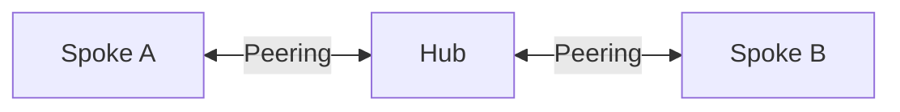

# 03. Hub와 Spoke 연결

> 목표 시간 20분. 네 방향 VNet Peering을 하나씩 만들고 비전이성을 이해합니다.

## 공통 준비

👁️ **설명**

모듈 02의 세 VNet이 먼저 있어야 합니다. 모듈 01의 `STATE_FILE`을 그대로 사용합니다.
구독과 세 RG의 소유권 확인은 공통 준비에서 한 번만 실행합니다. 재접속 후 `STATE_FILE`이
비어 있다면 기존 JSON 경로를 묻습니다. `.workshop-state/<실행 ID>.json`처럼 점까지 입력하고
다른 실습/구독으로 전환할 때는 [상태 복구](01-prerequisites.md#세션-재연결-시-변수-복구)를 실행하세요.
이후 블록은 같은 세션을 공유하며 필요한 상대 ID는 그 자리에서 조회합니다.
**한 블록 실행 → 확인 → 다음 블록** 순서입니다. 오류 시 다음 단계로 넘어가지 않습니다.
`&&`는 앞 검사 실패 시 해당 작업을 멈추며 Cloud Shell을 종료하지 않습니다.

🟢 **실행**

<!-- exec:prepare-03 -->
```bash
source scripts/workshop-common.sh &&
ensure_state_file &&
load_run "$STATE_FILE" &&
assert_subscription &&
assert_owned_rg "$RG_HUB" &&
assert_owned_rg "$RG_SPOKEA" &&
assert_owned_rg "$RG_SPOKEB"
```

📋 **확인**

오류 없이 프롬프트로 돌아옵니다. 아직 Peering을 만들지 않았습니다.

## 1. 네 방향 Peering 생성

👁️ **설명**

전화번호를 양쪽 연락처에 등록하듯 양쪽 VNet에 연결 설정이 필요합니다.
`Connected`는 VM 서비스나 NSG 허용까지 보장하지 않습니다.
각 블록의 **로컬 `--vnet-name`과 상대 `--remote-vnet`**을 비교하세요.
A↔B 직접 연결은 만들지 않습니다. 상대 ID는 구독·RG·VNet 이름을 지정하여 조회하고
그 결과를 그대로 연결 명령에 전달합니다. 조회 실패 시 `&&` 뒤의 생성은 실행되지 않습니다.

### 1-1. Hub → Spoke A

👁️ **설명**

A VNet의 ID를 조회해 Hub 쪽에 연결을 등록합니다. Peering은 양쪽 설정이 필요하므로 이 단계만으로 연결이 완성되지는 않습니다.

🟢 **실행**

<!-- exec:peering-hub-to-spokea -->
```bash
remote_id=$(az network vnet show -g "$RG_SPOKEA" -n "vnet-lzbegin-spokea-$RUN_ID" \
  --query id -o tsv --subscription "$SUBSCRIPTION_ID") &&
az network vnet peering create -g "$RG_HUB" --vnet-name "vnet-lzbegin-hub-$RUN_ID" \
  -n hub-to-spokea --remote-vnet "$remote_id" --allow-vnet-access true \
  --allow-forwarded-traffic false --allow-gateway-transit false -o json --subscription "$SUBSCRIPTION_ID"
```

📋 **확인**

이름은 `hub-to-spokea`, 상대 ID는 A입니다. 역방향 생성 전 `Initiated`는 정상입니다.

### 1-2. Spoke A → Hub

👁️ **설명**

이번에는 A 쪽에 Hub를 상대 VNet으로 등록합니다. 앞 단계와 짝을 이루어 Hub↔A 연결을 완성합니다.

🟢 **실행**

<!-- exec:peering-spokea-to-hub -->
```bash
remote_id=$(az network vnet show -g "$RG_HUB" -n "vnet-lzbegin-hub-$RUN_ID" \
  --query id -o tsv --subscription "$SUBSCRIPTION_ID") &&
az network vnet peering create -g "$RG_SPOKEA" --vnet-name "vnet-lzbegin-spokea-$RUN_ID" \
  -n spokea-to-hub --remote-vnet "$remote_id" --allow-vnet-access true \
  --allow-forwarded-traffic false --allow-gateway-transit false -o json --subscription "$SUBSCRIPTION_ID"
```

📋 **확인**

이름은 `spokea-to-hub`, 상대는 Hub입니다. 첫 번째 쌍이 `Connected`가 됩니다.

### 1-3. Hub → Spoke B

👁️ **설명**

Hub에 두 번째 상대인 B를 등록합니다. 앞 단계의 A ID를 재사용하지 않고 B의 ID를 새로 조회합니다.

🟢 **실행**

<!-- exec:peering-hub-to-spokeb -->
```bash
remote_id=$(az network vnet show -g "$RG_SPOKEB" -n "vnet-lzbegin-spokeb-$RUN_ID" \
  --query id -o tsv --subscription "$SUBSCRIPTION_ID") &&
az network vnet peering create -g "$RG_HUB" --vnet-name "vnet-lzbegin-hub-$RUN_ID" \
  -n hub-to-spokeb --remote-vnet "$remote_id" --allow-vnet-access true \
  --allow-forwarded-traffic false --allow-gateway-transit false -o json --subscription "$SUBSCRIPTION_ID"
```

📋 **확인**

상대는 A가 아닌 B입니다. 아직 B의 역방향이 없어 `Initiated`일 수 있습니다.

### 1-4. Spoke B → Hub

👁️ **설명**

B 쪽에 Hub 연결을 등록하여 두 번째 Peering 쌍을 완성합니다. B에서 A로 직접 연결하지는 않습니다.

🟢 **실행**

<!-- exec:peering-spokeb-to-hub -->
```bash
remote_id=$(az network vnet show -g "$RG_HUB" -n "vnet-lzbegin-hub-$RUN_ID" \
  --query id -o tsv --subscription "$SUBSCRIPTION_ID") &&
az network vnet peering create -g "$RG_SPOKEB" --vnet-name "vnet-lzbegin-spokeb-$RUN_ID" \
  -n spokeb-to-hub --remote-vnet "$remote_id" --allow-vnet-access true \
  --allow-forwarded-traffic false --allow-gateway-transit false -o json --subscription "$SUBSCRIPTION_ID"
```

📋 **확인**

상대는 Hub이며 두 번째 쌍도 `Connected`가 됩니다.

## 2. 저장된 연결 상태를 각각 조회

### 2-1. Hub의 두 연결

👁️ **설명**

Hub에 저장된 Peering 목록을 조회합니다. 연결 수뿐 아니라 각 상대 VNet과 연결 상태를 함께 확인합니다.

🟢 **실행**

<!-- exec:inspect-peering-hub -->
```bash
az network vnet peering list -g "$RG_HUB" --vnet-name "vnet-lzbegin-hub-$RUN_ID" \
  --query '[].{Name:name,State:peeringState,Remote:remoteVirtualNetwork.id}' -o table --subscription "$SUBSCRIPTION_ID"
```

📋 **확인**

`hub-to-spokea`, `hub-to-spokeb` 두 행 모두 `Connected`입니다.

### 2-2. A의 연결

👁️ **설명**

A에서 보이는 연결을 조회합니다. A는 Hub에만 연결되어 있어야 하며 B와 직접 연결하면 비전이성 실습 조건이 달라집니다.

🟢 **실행**

<!-- exec:inspect-peering-spokea -->
```bash
az network vnet peering list -g "$RG_SPOKEA" --vnet-name "vnet-lzbegin-spokea-$RUN_ID" \
  --query '[].{Name:name,State:peeringState,Remote:remoteVirtualNetwork.id}' -o table --subscription "$SUBSCRIPTION_ID"
```

📋 **확인**

`spokea-to-hub` 한 행이 `Connected`입니다. B로 향하는 행은 없어야 합니다.

### 2-3. B의 연결

👁️ **설명**

B에서도 Hub를 향한 연결 하나를 확인합니다. Hub 쪽 결과만으로 모든 방향의 구성이 맞다고 판단하지 않습니다.

🟢 **실행**

<!-- exec:inspect-peering-spokeb -->
```bash
az network vnet peering list -g "$RG_SPOKEB" --vnet-name "vnet-lzbegin-spokeb-$RUN_ID" \
  --query '[].{Name:name,State:peeringState,Remote:remoteVirtualNetwork.id}' -o table --subscription "$SUBSCRIPTION_ID"
```

📋 **확인**

`spokeb-to-hub` 한 행이 `Connected`이고 상대 ID의 구독·RG·이름이 맞습니다.

`allow-forwarded-traffic=false`는 직접 연결에 맞춘 값입니다. 모듈 06에서는 Firewall 전달 패킷을
위해 변경합니다. `allow-gateway-transit`는 VPN/ExpressRoute 게이트웨이 공유 옵션이며,
이 실습에는 게이트웨이가 없습니다. 이 값을 켠다고 Hub가 자동 라우터가 되지는 않습니다.

## 3. 연결되지 않은 경로 예상하기

👁️ **설명**



A의 패킷은 Hub에 연결됐다는 이유만으로 B로 자동 중계되지 않습니다.
모듈 04에서 실패를 확인한 뒤 모듈 05–06에서 Firewall과 **왕복 UDR**로 해결합니다.
임의로 A↔B Peering을 추가하면 비전이성 학습 목표가 사라집니다.

<a id="트러블슈팅"></a>
## Portal 확인과 트러블슈팅

👁️ **설명**

Peering은 각 VNet의 설정으로 저장됩니다. Hub와 두 Spoke의 화면을 각각 열어 네 방향을 확인합니다.

🟢 **실행**

각 **VNet → Peerings**에서 Hub 두 개, 각 Spoke 한 개를 확인합니다.

📋 **확인**

네 방향 모두 `Connected`이며 상대 VNet이 의도한 Hub 또는 Spoke인지 확인합니다.
값이 다르면 아래 표에서 원인을 찾고 다음 모듈로 넘어가지 마세요.

| 증상 | 조치 |
|---|---|
| Initiated | 상대 VNet의 역방향 Peering과 이름 확인 |
| Disconnected | 상대 Peering 삭제 여부 확인; 해당 쌍만 복구 |
| Connected인데 통신 불가 | VM 서비스·NSG·경로를 별도로 확인; VM은 다음 모듈에서 생성 |
| 소유 검사 실패 | 활성 구독과 상태 파일 확인 후 공통 준비 재실행; 태그로 우회하지 않기 |

## 완료 체크

- 네 방향 모두 Connected이며 Spoke 직접 Peering은 없습니다.
- Connected가 모든 통신 허용을 뜻하지 않는 이유를 설명할 수 있습니다.

## 다음 단계

- [이전: 네트워크 뼈대](02-network-foundation.md)
- [다음: 통신과 NSG](04-connectivity-nsg.md)
- [중단 시 정리](07-cleanup-production.md)
