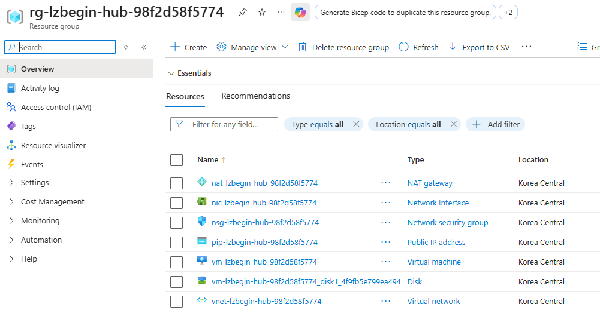
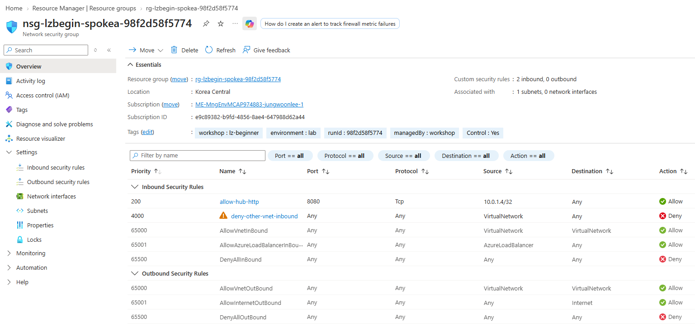

# 04. 통신과 최소 권한

> 목표 시간 30분. 공인 IP 없는 VM 3대로 “연결됨”과 “허용됨”을 구분합니다.
> VM 준비 시간과 Run Command 대기 때문에 더 걸릴 수 있습니다.

## 공통 준비

👁️ **설명**

모듈 03의 **AVNM Connectivity 배포가 만든 Hub↔Spoke Peering**이 먼저 필요합니다.
모듈 01의 `STATE_FILE`을 사용합니다.
준비는 한 번만 실행하며 이후 블록은 같은 Cloud Shell 세션을 공유합니다.
새 세션에서 `STATE_FILE`이 비어 있으면 기존 JSON 경로를 묻습니다.
**`.workshop-state/<실행 ID>.json`처럼 폴더 앞의 점까지** 입력하세요.
경로가 이미 있으면 다시 묻지 않으며, 다른 실습/구독으로 전환할 때는
[상태 복구](01-prerequisites.md#세션-재연결-시-변수-복구)를 실행하세요.
**한 블록 실행 → 확인 → 다음 설명** 순서로 진행합니다.
실패하면 다음 단계로 넘어가지 않습니다. `&&`는 앞 명령 실패 시 다음 작업을 막되 셸을 종료하지 않습니다.
현재 구독과 세 RG의 소유권은 **아래 준비에서 한 번만 확인**합니다.
이후에는 같은 실습의 구독·RG 변수를 유지하고 개별 Azure CLI 명령을 실행합니다.
자원 ID/IP를 되풀이해서 검사하는 `assert`는 사용하지 않으며, 조회 결과와 통신 검증으로 확인합니다.
이 시점의 AVNM은 연결만 관리합니다. Spoke A→B 패킷을 대신 전달하지 않으므로,
이 모듈에서는 NSG가 허용되어도 A→B가 계속 실패해야 정상입니다.

🟢 **실행**

<!-- exec:prepare-04 -->
```bash
source scripts/workshop-common.sh &&
ensure_state_file &&
load_run "$STATE_FILE" &&
assert_subscription &&
assert_owned_rg "$RG_HUB" &&
assert_owned_rg "$RG_SPOKEA" &&
assert_owned_rg "$RG_SPOKEB"
```

📋 **확인**

오류 없이 프롬프트로 돌아옵니다. 아직 자원을 배포하지 않았습니다.

## 1. VM과 NAT 배포 준비

👁️ **설명**

네트워킹이 학습 주제이므로 반복적인 VM/NIC/디스크 구성은 **하나의 보조 Bicep 배포**로 유지합니다.
VM 3대·디스크·NIC·NAT Gateway 3개·Public IP 3개를 만들지만 기존 Subnet을 덮어쓰지 않습니다.
Bicep은 원하는 자원 상태를 파일로 표현합니다. `what-if`는 미리 보기, `create`는 실제 배포입니다.
세 RG를 대상으로 하므로 구독 범위의 `az deployment sub`를 사용합니다.
NAT는 나가는 연결의 주소 변환이지 방화벽이 아닙니다.

### 1-1. 로컬 SSH 키 준비

👁️ **설명**

공개 키만 VM 생성에 사용하며 SSH 인바운드를 열지는 않습니다. 개인 키를 Git에 올리지 마세요.
이 단계는 로컬 파일만 준비합니다. 뒤의 미리 보기/배포는 키 경로를 직접 읽습니다.

🟢 **실행**

<!-- exec:support-key -->
```bash
mkdir -p -m 700 ".workshop-keys/$RUN_ID" &&
chmod 700 ".workshop-keys/$RUN_ID" &&
if [[ ! -e ".workshop-keys/$RUN_ID/id_ed25519" && ! -e ".workshop-keys/$RUN_ID/id_ed25519.pub" ]]; then
  ssh-keygen -t ed25519 -N '' -f ".workshop-keys/$RUN_ID/id_ed25519" -C "lz-beginner-$RUN_ID"
else
  test -s ".workshop-keys/$RUN_ID/id_ed25519" &&
  test -s ".workshop-keys/$RUN_ID/id_ed25519.pub"
fi
```

📋 **확인**

새 키의 fingerprint가 나오거나 기존 키 쌍을 그대로 사용합니다.
파일 한쪽만 있으면 실패합니다. 원인을 확인하고 다른 키를 덮어쓰지 않습니다.

### 1-2. 배포 미리 보기

👁️ **설명**

`what-if`로 보조 템플릿이 만들거나 변경할 자원을 먼저 확인합니다.
이 명령은 실제 VM과 NAT를 배포하지 않으며, 다음 단계의 유료 배포 범위를 검토하는 데 사용합니다.

🟢 **실행**

<!-- exec:support-preview -->
```bash
public_key=$(cat ".workshop-keys/$RUN_ID/id_ed25519.pub") &&
[[ -n "$public_key" ]] &&
az deployment sub what-if --name "support-$RUN_ID" --location "$LOCATION" \
  --template-file infra/lab-support.bicep \
  --parameters runId="$RUN_ID" location="$LOCATION" \
    hubResourceGroup="$RG_HUB" spokeaResourceGroup="$RG_SPOKEA" spokebResourceGroup="$RG_SPOKEB" \
    sshPublicKey="$public_key" --subscription "$SUBSCRIPTION_ID"
```

📋 **확인**

VM·NIC·Public IP·NAT와 모듈 배포가 추가됩니다.
VNet/Subnet 삭제나 운영 자원 변경이 보이면 배포하지 마세요.

### 1-3. 비용 확인 후 한 번의 지원 배포

👁️ **설명**

미리 보기에서 확인한 범위의 VM과 NAT를 실제로 배포합니다. 유료 자원 생성에 동의할 때만 `CREATE`를 입력합니다.

⚠️ **주의**

45분 timeout은 로컬 대기만 끝내며 Azure 배포를 취소하지 않습니다.
시간 초과 후에는 Portal 배포 상태부터 확인합니다.

🟢 **실행**

<!-- exec:support-deploy -->
```bash
public_key=$(cat ".workshop-keys/$RUN_ID/id_ed25519.pub") &&
[[ -n "$public_key" ]] &&
read -rp "유료 VM 3대와 NAT 3개를 배포합니다. CREATE 입력: " confirm &&
if [[ "$confirm" == CREATE ]]; then
  timeout 2700 az deployment sub create --name "support-$RUN_ID" --location "$LOCATION" \
    --template-file infra/lab-support.bicep \
    --parameters runId="$RUN_ID" location="$LOCATION" \
      hubResourceGroup="$RG_HUB" spokeaResourceGroup="$RG_SPOKEA" spokebResourceGroup="$RG_SPOKEB" \
      sshPublicKey="$public_key" -o json --subscription "$SUBSCRIPTION_ID"
else
  fail "Cancelled"
fi
```

📋 **확인**

배포의 `provisioningState`가 `Succeeded`입니다. VM NIC에는 Public IP가 없습니다.
Public IP는 NAT용이며 NAT를 생성하는 것만으로 Subnet에 연결되지는 않습니다.

Azure Portal에서도 **Resource groups → Hub·Spoke A·Spoke B의 각 리소스 그룹 → Overview**에서
생성된 **VM과 NAT Gateway를 각각 확인**할 수 있습니다.
아래는 Hub 리소스 그룹의 예시이며, 두 Spoke에서도 같은 방법으로 확인하세요.
화면의 실행 ID 대신 자신의 RG·실행 ID를 사용합니다.



## 2. 각 NAT를 연결하고 따로 조회

👁️ **설명**

앞 배포가 성공해야 합니다. 같은 RG에 만든 NAT의 **이름을 직접 지정**하여 Subnet에 연결합니다.
NAT ID 조회와 별도 ID 비교는 필요하지 않습니다.
[공식 CLI 예시](https://learn.microsoft.com/azure/nat-gateway/manage-nat-gateway#create-a-nat-gateway-and-associate-it-with-an-existing-subnet)도 이 방식을 사용합니다.
각 연결 후 JSON에서 NAT·NSG 이름과 `DefaultOutbound=false`를 직접 비교하세요.
조회 명령의 성공이 설정의 정확성까지 자동 판정하는 것은 아닙니다. 값이 다르거나 `null`이면 다음 단계로 넘어가지 않습니다.

### 2-1. Hub NAT 연결

👁️ **설명**

Hub의 관리 Subnet에 Hub NAT를 연결하여 검사 VM의 명시적인 인터넷 출구를 준비합니다.
NAT를 생성하는 단계와 Subnet에 연결하는 단계는 별개입니다.

🟢 **실행**

<!-- exec:attach-nat-hub -->
```bash
az network vnet subnet update -g "$RG_HUB" --vnet-name "vnet-lzbegin-hub-$RUN_ID" -n snet-management \
  --nat-gateway "nat-lzbegin-hub-$RUN_ID" -o json --subscription "$SUBSCRIPTION_ID"
```

📋 **확인**

관리 Subnet의 `natGateway.id`가 Hub NAT입니다.

### 2-2. Hub 연결 결과 조회

👁️ **설명**

관리 Subnet에 저장된 NAT·NSG·기본 outbound 설정을 조회합니다. 응답의 각 값을 아래 기준과 직접 비교하세요.

🟢 **실행**

<!-- exec:inspect-nat-hub -->
```bash
az network vnet subnet show -g "$RG_HUB" --vnet-name "vnet-lzbegin-hub-$RUN_ID" -n snet-management \
  --query '{Subnet:name,NatGateway:natGateway.id,NSG:networkSecurityGroup.id,DefaultOutbound:defaultOutboundAccess}' \
  -o json --subscription "$SUBSCRIPTION_ID"
```

📋 **확인**

`Subnet=snet-management`, NAT ID의 마지막 이름은 `nat-lzbegin-hub-<실행 ID>`,
NSG 이름은 `nsg-lzbegin-hub-<실행 ID>`, `DefaultOutbound=false`여야 합니다.

### 2-3. Spoke A NAT 연결

👁️ **설명**

A 워크로드 Subnet에 같은 RG의 A NAT를 연결합니다. Peering이 있어도 Hub NAT가 A의 출구로 자동 공유되지는 않습니다.

🟢 **실행**

<!-- exec:attach-nat-spokea -->
```bash
az network vnet subnet update -g "$RG_SPOKEA" --vnet-name "vnet-lzbegin-spokea-$RUN_ID" -n snet-workload \
  --nat-gateway "nat-lzbegin-spokea-$RUN_ID" -o json --subscription "$SUBSCRIPTION_ID"
```

📋 **확인**

A의 Subnet에 A NAT가 연결됩니다. Hub NAT를 공유하지 않습니다.

### 2-4. Spoke A 연결 결과 조회

👁️ **설명**

A Subnet의 연결 설정을 조회합니다. NAT뿐 아니라 모듈 02에서 연결한 A NSG도 유지되는지 확인합니다.

🟢 **실행**

<!-- exec:inspect-nat-spokea -->
```bash
az network vnet subnet show -g "$RG_SPOKEA" --vnet-name "vnet-lzbegin-spokea-$RUN_ID" -n snet-workload \
  --query '{Subnet:name,NatGateway:natGateway.id,NSG:networkSecurityGroup.id,DefaultOutbound:defaultOutboundAccess}' \
  -o json --subscription "$SUBSCRIPTION_ID"
```

📋 **확인**

`Subnet=snet-workload`, NAT 이름은 `nat-lzbegin-spokea-<실행 ID>`,
NSG 이름은 `nsg-lzbegin-spokea-<실행 ID>`, `DefaultOutbound=false`여야 합니다.

### 2-5. Spoke B NAT 연결

👁️ **설명**

B VM의 관리 통신을 위해 B Subnet에 B NAT를 연결합니다. 대상 VNet·RG·NAT 이름을 모두 B로 지정합니다.

🟢 **실행**

<!-- exec:attach-nat-spokeb -->
```bash
az network vnet subnet update -g "$RG_SPOKEB" --vnet-name "vnet-lzbegin-spokeb-$RUN_ID" -n snet-workload \
  --nat-gateway "nat-lzbegin-spokeb-$RUN_ID" -o json --subscription "$SUBSCRIPTION_ID"
```

📋 **확인**

B의 Subnet에 B NAT가 연결됩니다.

### 2-6. Spoke B 연결 결과 조회

👁️ **설명**

B의 NAT 연결과 NSG·outbound 설정을 조회합니다. 세 구역 모두 관리용 출구가 준비되어야 뒤의 Run Command를 진행할 수 있습니다.

🟢 **실행**

<!-- exec:inspect-nat-spokeb -->
```bash
az network vnet subnet show -g "$RG_SPOKEB" --vnet-name "vnet-lzbegin-spokeb-$RUN_ID" -n snet-workload \
  --query '{Subnet:name,NatGateway:natGateway.id,NSG:networkSecurityGroup.id,DefaultOutbound:defaultOutboundAccess}' \
  -o json --subscription "$SUBSCRIPTION_ID"
```

📋 **확인**

`Subnet=snet-workload`, NAT 이름은 `nat-lzbegin-spokeb-<실행 ID>`,
NSG 이름은 `nsg-lzbegin-spokeb-<실행 ID>`, `DefaultOutbound=false`여야 합니다.
세 구역의 값이 모두 맞는지 비교한 뒤 Network Watcher와 응답 서비스 준비로 진행합니다.

## 3. 공유 Network Watcher 준비

👁️ **설명**

Watcher는 경로/NSG 판정 도구입니다. 기존 리전 watcher는 그대로 사용합니다.
공유 `NetworkWatcherRG`를 retag하거나 cleanup에서 삭제하지 않습니다.

### 3-1. 현재 리전 Watcher 조회

👁️ **설명**

현재 실습 리전에 Network Watcher가 있는지 조회합니다. 기존 자원이 있으면 공유 자원으로 재사용하며 새로 만들지 않습니다.

🟢 **실행**

<!-- exec:inspect-watcher -->
```bash
az network watcher list --query "[?location=='$LOCATION'].id" -o json --subscription "$SUBSCRIPTION_ID"
```

📋 **확인**

ID 배열이 있으면 3-2를 건너뛰고 3-3으로 갑니다. `[]`이면 3-2가 필요합니다.
오류를 빈 배열로 해석하지 않습니다.

### 3-2. 없는 경우에만 공유 RG 준비

👁️ **설명**

Watcher를 새로 활성화해야 한다면 먼저 공유 `NetworkWatcherRG`를 준비합니다.
기존 그룹의 태그를 바꾸지 않고, 이번 실습의 삭제 대상에도 포함하지 않습니다.

🟢 **실행**

<!-- exec:watcher-group -->
```bash
exists=$(az group exists --name NetworkWatcherRG -o tsv --subscription "$SUBSCRIPTION_ID") &&
case "$exists" in
  true) printf '기존 공유 RG를 그대로 사용합니다.\n' ;;
  false) az group create --name NetworkWatcherRG --location "$LOCATION" -o json --subscription "$SUBSCRIPTION_ID" ;;
  *) fail "Cannot determine whether NetworkWatcherRG exists" ;;
esac
```

📋 **확인**

기존 RG면 메시지만 나옵니다. 새 RG에도 실습 소유 태그를 붙이지 않습니다.

### 3-3. 리전 Watcher 활성화

👁️ **설명**

앞의 조회 변수를 믿지 않고 현재 목록을 다시 읽습니다. 기존 watcher면 변경하지 않습니다.

🟢 **실행**

<!-- exec:watcher-enable -->
```bash
watchers=$(az network watcher list --query "[?location=='$LOCATION'].id" -o json --subscription "$SUBSCRIPTION_ID") &&
jq -e 'type == "array" and all(.[]; type == "string" and length > 0)' <<< "$watchers" >/dev/null &&
if [[ $(jq length <<< "$watchers") == 0 ]]; then
  exists=$(az group exists --name NetworkWatcherRG -o tsv --subscription "$SUBSCRIPTION_ID") &&
  [[ "$exists" == true ]] &&
  az network watcher configure --locations "$LOCATION" --enabled true \
    --resource-group NetworkWatcherRG -o json --subscription "$SUBSCRIPTION_ID"
else
  printf '기존 리전 Watcher를 사용합니다.\n'
fi
```

📋 **확인**

활성화 응답 또는 기존 watcher 사용 메시지가 나옵니다.
권한 오류이면 운영자에게 요청하고 다음 단계로 넘어가지 않습니다.

## 4. Spoke 응답 서비스 준비

👁️ **설명**

**네트워크를 시험하려면 요청에 응답할 서버가 먼저 있어야 합니다.**
Spoke A에는 `spokea`, Spoke B에는 `spokeb`라는 짧은 문자열을 돌려주는 HTTP 서비스를 준비합니다.
이후 Hub에서 응답 본문을 비교하면 단순히 연결이 된 것뿐 아니라 **의도한 Spoke에 도달했는지**도 알 수 있습니다.
업무용 웹 애플리케이션이 아닌, TCP 8080의 비민감한 연결 확인용 서비스입니다.

**실행 위치와 전달 흐름**

```text
Cloud Shell: run-vm.sh
  → Azure VM Run Command / VM agent
  → 선택한 Spoke VM: guest-server.sh
  → systemd로 HTTP 서비스 실행
  → VM 내부에서 응답 확인 → 결과를 Cloud Shell로 반환
```

Cloud Shell에서 VM의 사설 IP로 직접 SSH하는 방식이 아닙니다.
Run Command는 VM agent를 통해 실행하고 Azure HTTPS endpoint로 결과를 반환합니다.
따라서 공인 IP나 SSH 인바운드를 열지 않아도 되지만, VM agent와 관리용 outbound가 정상이어야 합니다.

**`run-vm.sh` — Cloud Shell에서 하는 작업**

[스크립트 소스](../scripts/run-vm.sh)를 읽을 때 아래 순서로 따라가세요.

| 작업 | 실제 동작과 이유 |
|---|---|
| 실행 대상 확인 | 상태 JSON의 구독과 지정한 구역의 RG 소유권을 확인하고, `spokea` 또는 `spokeb`에 해당하는 VM 이름을 선택합니다. 공통 준비와 별개로, 독립 실행 스크립트 안의 안전 검사는 유지합니다. |
| 전송할 스크립트 준비 | 로컬 `guest-server.sh`의 **내용**을 임시 파일에 담습니다. 첫 줄에 Bash shebang을 넣고 종료 코드를 기록할 `EXIT` trap을 추가합니다. 원본 파일은 바꾸지 않습니다. |
| VM에서 실행 요청 | `az vm run-command invoke --command-id RunShellScript`로 내용을 전달합니다. `guest-server.sh`를 Cloud Shell 자체에서 실행하는 것이 아닙니다. |
| 게스트 결과 판정 | API 응답의 stdout/stderr를 분리하고 오류 출력을 보존합니다. stdout의 마지막 `__LZ_EXIT__:0`을 확인한 뒤 제어용 마커를 제거하고 실제 결과만 보여 줍니다. API의 `Succeeded`만으로 성공을 판단하지 않습니다. |

아래 실행 명령의 세 인수는 **기존 상태 파일 → 대상 구역 → VM에 보낼 로컬 스크립트 경로**입니다.

**`guest-server.sh` — 선택한 Spoke VM 안에서 하는 작업**

[스크립트 소스](../scripts/guest-server.sh)는 다음과 같이 파일과 서비스를 준비합니다.

| 작업 | 실제 동작과 이유 |
|---|---|
| Spoke 식별과 Python 확인 | 이 교재 호출에서는 VM의 호스트 이름으로 A/B를 구분합니다. Hub 등 예상과 다른 이름이면 중단합니다. `python3`가 설치되어 있는지 확인하며 패키지를 새로 내려받지는 않습니다. |
| 응답 파일 생성 | `/var/lib/lzbegin-http/index.html`에 `spokea` 또는 `spokeb`를 씁니다. 디렉터리는 `0755`, 파일은 `0644`로 설정하여 서비스 계정이 읽을 수 있게 합니다. |
| systemd 서비스 등록 | `/etc/systemd/system/lzbegin-http.service`를 작성합니다. `/var/lib/lzbegin-http`를 기준으로 `python3 -m http.server 8080 --bind 0.0.0.0`을 실행하도록 지정합니다. |
| 서비스 권한 제한 | 파일·서비스 설정은 관리 권한으로 준비하지만 HTTP 프로세스는 `nobody/nogroup`으로 실행합니다. 권한 상승, 시스템·홈 파일 접근 및 임시 디렉터리 공유도 제한합니다. |
| 시작과 재부팅 자동 실행 | `systemctl daemon-reload`로 설정을 읽고 `systemctl enable --now`로 부팅 시 자동 실행과 현재 서비스 시작을 요청합니다. 이어서 `is-active`로 실행 상태를 확인합니다. |
| 실제 응답 확인 | VM 내부에서 `http://127.0.0.1:8080/`에 접속해 본문이 자신의 Spoke 문자열인지 확인합니다. 시작 직후 연결 오류는 최대 10회 시도하며, 다른 본문이나 끝까지 응답이 없으면 실패로 종료합니다. |

`0.0.0.0`은 VM의 모든 IPv4 인터페이스에서 수신한다는 뜻이지 공인 IP를 만든다는 뜻이 아닙니다.
이 스크립트는 **NSG·Peering·NAT·UDR을 변경하지 않습니다.** 다른 VM에서 접근할 수 있는지는
네트워크 경로와 NSG가 결정하므로 다음 단계에서 따로 확인합니다.

⚠️ **주의**

Run Command 자체는 높은 관리 권한으로 실행되므로 신뢰할 수 없는 스크립트를 전달하지 마세요.
45분 timeout은 로컬 대기만 끝냅니다. 시간 초과 시 VM 안의 작업은 계속될 수 있으므로 무작정 재실행하지 않습니다.

### 4-1. A 서비스

👁️ **설명**

Cloud Shell에서 A VM으로 서비스 준비 스크립트를 전달합니다.
A 내부의 HTTP 응답을 먼저 확인하여 이후 네트워크 차단과 서버 미준비를 구분합니다.

🟢 **실행**

<!-- exec:service-spokea -->
```bash
bash scripts/run-vm.sh "$STATE_FILE" spokea scripts/guest-server.sh
```

📋 **확인**

`PASS: local service spokea`. A VM **내부에서** TCP 8080 서비스가 `spokea`를 응답했습니다.
아직 Hub→A 통신 성공을 의미하지는 않습니다.

### 4-2. B 서비스

👁️ **설명**

B VM에도 같은 방식으로 응답 서비스를 준비합니다.
응답 문자열은 `spokeb`이므로 이후 연결이 의도한 VM에 도달했는지 구분할 수 있습니다.

🟢 **실행**

<!-- exec:service-spokeb -->
```bash
bash scripts/run-vm.sh "$STATE_FILE" spokeb scripts/guest-server.sh
```

📋 **확인**

`PASS: local service spokeb`. B VM 내부에서도 서비스가 준비되었습니다.
A 성공이 B 성공을 대신하지 않습니다.

두 로컬 서비스가 정상인 상태에서 5단계로 진행합니다. 그다음 연결이 실패하면
“서버가 아직 준비되지 않았는지”와 “NSG 또는 경로가 막는지”를 구분하기가 쉬워집니다.

## 5. 필요한 TCP 8080만 허용

👁️ **설명**

IP는 NIC에서 매번 조회하며 `.4`라고 추측하지 않습니다. `/32`는 VM 한 개입니다.
출발지 포트는 클라이언트가 매번 고르므로 `*`, 목적지 포트는 `8080`으로 제한합니다.
이 실습은 Subnet당 테스트 VM 한 대이며 운영 목적지 범위는 워크로드 경계에 맞춰 설계해야 합니다.

### 5-1. Hub → A

👁️ **설명**

Hub VM의 실제 사설 IP를 조회하고 A NSG에서 해당 VM의 TCP 8080 연결만 허용합니다.
VNet 전체가 아니라 `/32` 주소 하나로 출발지를 제한합니다.

🟢 **실행**

<!-- exec:allow-hub-spokea -->
```bash
source_ip=$(az network nic show -g "$RG_HUB" -n "nic-lzbegin-hub-$RUN_ID" \
  --query 'ipConfigurations[0].privateIPAddress' -o tsv --subscription "$SUBSCRIPTION_ID") &&
az network nsg rule create -g "$RG_SPOKEA" --nsg-name "nsg-lzbegin-spokea-$RUN_ID" -n allow-hub-http \
  --priority 200 --direction Inbound --access Allow --protocol Tcp \
  --source-address-prefixes "$source_ip/32" --source-port-ranges '*' \
  --destination-address-prefixes '*' --destination-port-ranges 8080 -o json --subscription "$SUBSCRIPTION_ID"
```

📋 **확인**

A NSG의 `allow-hub-http`, 우선순위 `200`, 출발지는 Hub 한 대입니다.
모듈 02의 `4000` 차단보다 먼저 평가됩니다.

### 5-2. Hub → B

👁️ **설명**

B NSG에도 Hub VM의 HTTP 연결을 허용합니다. A와 B는 서로 다른 NSG이므로 각각 규칙을 만들어야 합니다.

🟢 **실행**

<!-- exec:allow-hub-spokeb -->
```bash
source_ip=$(az network nic show -g "$RG_HUB" -n "nic-lzbegin-hub-$RUN_ID" \
  --query 'ipConfigurations[0].privateIPAddress' -o tsv --subscription "$SUBSCRIPTION_ID") &&
az network nsg rule create -g "$RG_SPOKEB" --nsg-name "nsg-lzbegin-spokeb-$RUN_ID" -n allow-hub-http \
  --priority 200 --direction Inbound --access Allow --protocol Tcp \
  --source-address-prefixes "$source_ip/32" --source-port-ranges '*' \
  --destination-address-prefixes '*' --destination-port-ranges 8080 -o json --subscription "$SUBSCRIPTION_ID"
```

📋 **확인**

같은 규칙이 이번에는 B NSG에 생성됩니다. A의 규칙이 자동 전파되지 않습니다.

### 5-3. A → B를 NSG에서 허용

👁️ **설명**

경로 부재를 NSG 차단과 구분하기 위해 B의 NSG에서는 A를 허용합니다.

🟢 **실행**

<!-- exec:allow-spokea-spokeb -->
```bash
source_ip=$(az network nic show -g "$RG_SPOKEA" -n "nic-lzbegin-spokea-$RUN_ID" \
  --query 'ipConfigurations[0].privateIPAddress' -o tsv --subscription "$SUBSCRIPTION_ID") &&
az network nsg rule create -g "$RG_SPOKEB" --nsg-name "nsg-lzbegin-spokeb-$RUN_ID" -n allow-spokea-http \
  --priority 210 --direction Inbound --access Allow --protocol Tcp \
  --source-address-prefixes "$source_ip/32" --source-port-ranges '*' \
  --destination-address-prefixes '*' --destination-port-ranges 8080 -o json --subscription "$SUBSCRIPTION_ID"
```

📋 **확인**

`allow-spokea-http`, 우선순위 `210`, 출발지는 A VM 한 대입니다.

### 5-4. 기준 상태 검증

👁️ **설명**

검증기는 **현재 통신 상태를 증거로 판정**하는 단일 목적 스크립트입니다.
새 HTTP 연결·NSG 판정·유효 경로를 함께 검사하는 안전 내부 동작은 수동으로 쪼개지 않습니다.

🟢 **실행**

<!-- exec:verify-baseline -->
```bash
bash scripts/verify-core.sh "$STATE_FILE" baseline
```

📋 **확인**

`PASS: core baseline evidence complete.` 및 아래 증거를 확인합니다.

| 흐름 | NSG | 유효 next hop | HTTP |
|---|---|---|---|
| Hub→A/B | Allow | `VNetPeering` | 각각 `spokea`, `spokeb` |
| A→B | Allow | `None` | 연결 실패가 정상 |

`None`은 버림 경로 유형입니다. 직접 A↔B Peering이 없는 현재 구성에서
실제 유효 경로와 차단을 확인하는 것이지, 실패만으로 비전이성을 증명하지 않습니다.

Azure Portal에서도 **Network security groups → 해당 Spoke의 NSG → Overview**에서
설정한 인바운드 규칙을 확인할 수 있습니다. 아래 Spoke A 예시처럼 `allow-hub-http`의
우선순위 `200`·TCP `8080` 허용과 `deny-other-vnet-inbound`의 우선순위 `4000` 차단을 비교하세요.
Spoke B에서는 `allow-spokea-http`(`210`)도 확인합니다. 화면의 실행 ID와 IP는 예시이므로 자신의 실습 값과 대조하세요.



## 6. 임시 NSG 차단과 복구

### 6-1. A에 임시 Deny 생성

👁️ **설명**

A NSG에 기존 Allow보다 먼저 평가되는 임시 Deny를 추가합니다.
다른 조건은 유지한 채 NSG 규칙 하나가 Hub→A 통신에 미치는 영향을 비교합니다.

🟢 **실행**

<!-- exec:deny-hub -->
```bash
source_ip=$(az network nic show -g "$RG_HUB" -n "nic-lzbegin-hub-$RUN_ID" \
  --query 'ipConfigurations[0].privateIPAddress' -o tsv --subscription "$SUBSCRIPTION_ID") &&
az network nsg rule create -g "$RG_SPOKEA" --nsg-name "nsg-lzbegin-spokea-$RUN_ID" -n test-deny-hub \
  --priority 100 --direction Inbound --access Deny --protocol Tcp \
  --source-address-prefixes "$source_ip/32" --source-port-ranges '*' \
  --destination-address-prefixes '*' --destination-port-ranges 8080 -o json --subscription "$SUBSCRIPTION_ID"
```

📋 **확인**

`100`이 `200`보다 먼저 평가됩니다. 기존 Allow는 지우지 않았습니다.

### 6-2. 차단 원인 검증

👁️ **설명**

새 HTTP 연결과 NSG 판정을 함께 확인합니다.
서버 중단이나 경로 문제를 NSG 차단 성공으로 오인하지 않도록 검증 스크립트를 사용합니다.

🟢 **실행**

<!-- exec:verify-nsg-denied -->
```bash
bash scripts/verify-core.sh "$STATE_FILE" nsg-denied
```

📋 **확인**

A의 로컬 서비스는 살아 있고 `test-deny-hub`가 차단 원인입니다. Hub→B는 유지됩니다.
기존 TCP 연결은 살아 있을 수 있어 검증은 매번 새 연결을 사용합니다.

### 6-3. 임시 규칙만 삭제

👁️ **설명**

실험을 위해 추가한 `test-deny-hub`만 제거하여 기존 Allow 규칙이 다시 적용되도록 합니다.

⚠️ **주의**

**앞 검증이 실패했어도 이 복구는 수행합니다.** NSG 전체나 기존 Allow를 삭제하지 않습니다.

🟢 **실행**

<!-- exec:restore-hub -->
```bash
az network nsg rule delete -g "$RG_SPOKEA" --nsg-name "nsg-lzbegin-spokea-$RUN_ID" \
  -n test-deny-hub --subscription "$SUBSCRIPTION_ID"
```

📋 **확인**

오류 없이 삭제됩니다. 실제 복구는 다음 검증으로 확인합니다.

### 6-4. 복구 상태 검증

👁️ **설명**

임시 Deny를 제거한 뒤 처음의 통신 상태로 돌아왔는지 검사합니다.
규칙 삭제 명령의 성공과 실제 HTTP 연결의 복구를 구분해서 확인합니다.

🟢 **실행**

<!-- exec:verify-restored -->
```bash
bash scripts/verify-core.sh "$STATE_FILE" restored
```

📋 **확인**

Hub→A/B 정상 HTTP와 A→B의 현재 `None` 경로 차단이 기준 상태로 돌아왔습니다.

<a id="트러블슈팅"></a>
## Portal 확인과 트러블슈팅

👁️ **설명**

NSG 규칙 목록과 NIC에 실제 적용되는 경로·보안 규칙을 함께 봅니다. 규칙 생성 결과와 유효 설정을 구분하는 단계입니다.

🟢 **실행**

**VM → Networking → Network settings**, **NIC → Effective routes / Effective security rules**에서 대조합니다.

📋 **확인**

Hub→Spoke의 경로와 HTTP 허용 규칙이 유지되고, 임시 `test-deny-hub`가 제거되었는지 확인합니다.
통신 검증이 실패했다면 아래 표로 원인을 구분합니다.

| 증상 | 조치 |
|---|---|
| Run Command 결과 없음 | NAT 연결·VM agent·Azure HTTPS outbound 확인; public SSH를 열지 않기 |
| guest marker 누락/Invalid Run Command response | stderr·stdout 구분자·출력 잘림 확인; API 성공을 게스트 성공으로 해석하지 않기 |
| NSG Allow인데 timeout | 로컬 서비스·실제 IP·유효 경로를 순서대로 확인 |
| A→B가 모듈 04에서 성공 | 직접 Peering/임의 UDR 추가 여부 확인 |
| watcher 권한 오류 | 리전 watcher 활성화와 구독 진단 권한을 운영자에게 요청 |
| NSG 변경 전파 지연 | 규칙 상태를 확인하고 잠시 후 새 연결로 재검증 |

## 완료 체크

- Hub→A/B 연결과 NSG 차단/복구를 확인했습니다.
- NSG가 허용해도 경로가 없으면 연결되지 않음을 확인했습니다.
- `test-deny-hub`를 제거했습니다.

## 다음 단계

- [이전: AVNM 연결 관리](03-avnm-connectivity.md)
- [다음: 중앙 Firewall](05-firewall.md)
- [중단 시 정리](07-cleanup-production.md)
