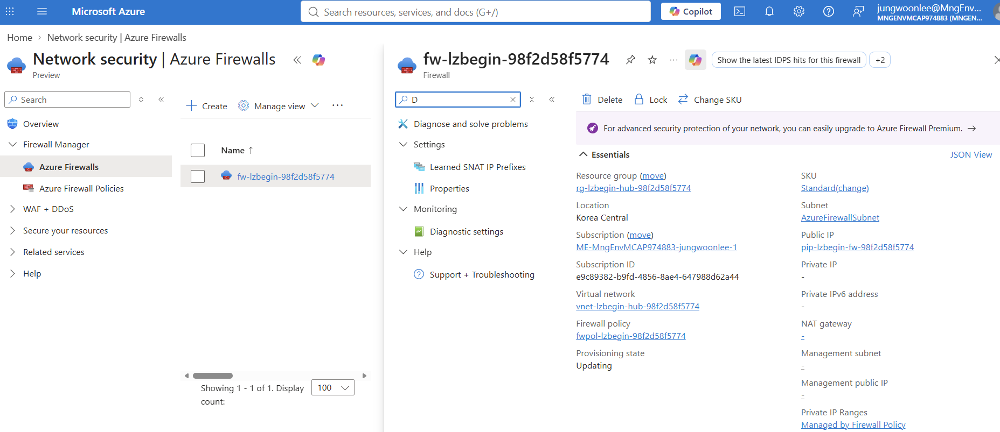
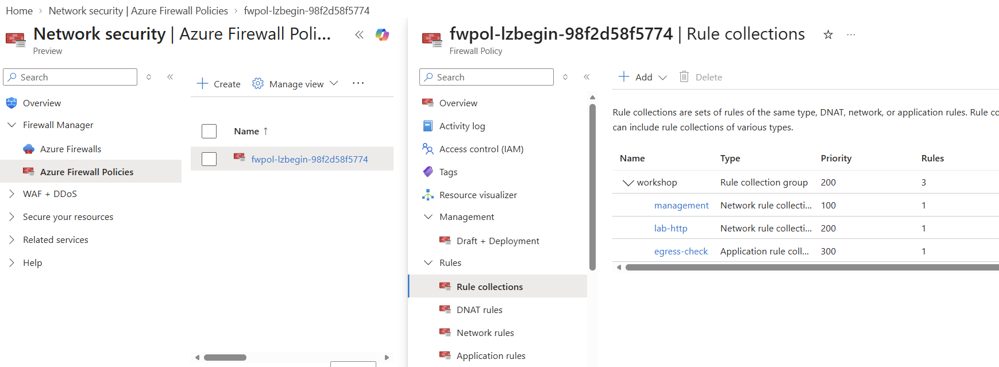

# 05. 중앙 Firewall

> 목표 시간 20–30분. Firewall Standard와 중앙 로그를 준비합니다. 실제 배포 대기는 더 길 수 있습니다.

## 목표와 공통 준비

👁️ **설명**

모듈 04의 `restored` 검증이 완료되어 있어야 합니다. NAT는 주소 변환,
Firewall은 허용·차단과 검사 로그를 담당합니다. 앞에서 만든 세 VM과 네트워크를 그대로 사용하여
중앙 보안을 구성합니다. Firewall 배포·대기 중에도 시간 과금이 발생할 수 있습니다.
중도 중단 시에는 [정리](07-cleanup-production.md)를 실행하세요.

모듈 01의 `STATE_FILE`로 아래 준비를 한 번 실행합니다. 이후 같은 Cloud Shell에서
**한 블록 실행 → 결과 확인 → 다음 단계**로 진행하세요. 새 세션에서 `STATE_FILE`이
비어 있으면 기존 `.workshop-state/<실행 ID>.json` 경로를 묻고, 설정돼 있으면 다시 묻지 않습니다.
다른 실습/구독으로 전환할 때는 [상태 복구](01-prerequisites.md#세션-재연결-시-변수-복구)를 실행합니다.
`&&` 앞의 검사 실패 시 해당 작업은 멈춥니다. 오류를 무시하고 다음 블록을 실행하지 마세요.
구독과 세 RG의 소유권은 공통 준비에서 확인하며, 개별 작업에서는 같은 검사를 반복하지 않습니다.

🟢 **실행**

<!-- exec:prepare-05 -->
```bash
source scripts/workshop-common.sh &&
ensure_state_file &&
load_run "$STATE_FILE" &&
assert_subscription &&
assert_owned_rg "$RG_HUB" &&
assert_owned_rg "$RG_SPOKEA" &&
assert_owned_rg "$RG_SPOKEB"
```

📋 **확인**

오류 없이 프롬프트로 돌아옵니다. 아직 유료 자원을 생성하지 않았습니다.

이번 모듈은 **방화벽·규칙·로그 준비**입니다. 배포만으로 패킷이 Firewall로 향하지 않습니다.
모듈 06에서 경로를 바꾸기 전까지 Spoke 인터넷 출구는 NAT입니다.
관리 통신과 진단 수집을 먼저 준비해야 전환 후에도 원인을 찾을 수 있습니다.
NSG는 Subnet의 허용·차단을, Firewall Policy는 Firewall을 **통과하는** 흐름의 허용·차단을
담당합니다. NSG 규칙을 만든 것만으로 Firewall 규칙이 생기거나 그 반대가 되지는 않습니다.

## 1. Firewall과 로그 도구 준비

👁️ **설명**

Provider는 **구독**에서 자원 종류를 사용할 수 있게 하고, CLI 확장은 **현재 Cloud Shell**에
명령을 추가합니다. 둘 다 Firewall을 배포하지 않습니다. 사전 점검까지 끝낸 뒤에만 유료 자원을 만듭니다.

### 1-1. 로그 서비스 Provider 등록

👁️ **설명**

Log Analytics 자원을 사용할 수 있도록 해당 Provider를 구독에 등록합니다.
workspace를 만들기 전에 서비스 종류의 등록을 완료하는 단계입니다.

🟢 **실행**

<!-- exec:register-logs -->
```bash
az provider register --namespace Microsoft.OperationalInsights --wait --subscription "$SUBSCRIPTION_ID"
```

📋 **확인**

등록 대기가 오류 없이 끝납니다. VM이나 Firewall 생성 명령은 아닙니다.

### 1-2. Firewall CLI 확장 설치

👁️ **설명**

Firewall과 Policy 명령에 필요한 Azure CLI 확장을 준비합니다.
교재에서 확인한 버전을 사용하며, Azure 자원이 아니라 현재 CLI 환경을 변경합니다.

🟢 **실행**

<!-- exec:install-firewall-cli -->
```bash
az extension add --name azure-firewall --version 2.2.1 --upgrade --yes
```

📋 **확인**

`azure-firewall 2.2.1` 설치가 완료됩니다. 로컬 CLI 변경이며 Azure 자원은 배포하지 않습니다.
설치 실패 시 조직 다운로드 정책을 확인하고 검증 없이 다른 버전으로 계속하지 않습니다.

### 1-3. 로그 조회 CLI 확장 설치

👁️ **설명**

다음 모듈에서 Firewall 로그를 조회할 수 있도록 Log Analytics CLI 확장을 설치합니다.
로그 저장소를 만드는 작업과 CLI 도구를 준비하는 작업은 별개입니다.

🟢 **실행**

<!-- exec:install-logs-cli -->
```bash
az extension add --name log-analytics --upgrade --yes
```

📋 **확인**

`log-analytics` 설치가 끝납니다. Cloud Shell 전체에 `exit`나 오류 설정을 적용하지 않습니다.

### 1-4. 읽기 전용 Firewall 사전 점검

👁️ **설명**

`--extension`은 기존 세 VM의 재사용 상태를 검사하는 스크립트 옵션 이름입니다.
이 단계는 선택 과정이 아니라 Firewall 배포 전 필수 점검입니다.

🟢 **실행**

<!-- exec:extension-preflight -->
```bash
bash scripts/preflight.sh "$STATE_FILE" --extension
```

📋 **확인**

preflight PASS. 기존 세 VM의 리전·크기·실행 상태와 Provider를 확인합니다.
VM을 추가하지 않으므로 추가 6 vCPU quota를 요구하지 않습니다.
VM이 없거나 중지되어 있으면 모듈 04의 환경을 복구합니다.

## 2. Firewall와 로그 저장소를 하나씩 생성

👁️ **설명**

Firewall은 트래픽 처리 자원, Policy는 규칙, workspace는 로그 저장·조회 공간입니다.
Public IP는 인터넷 출구, 사설 IP는 모듈 06 UDR의 next hop에 사용합니다.
만드는 순서는 **workspace → Public IP → Policy → Firewall → IP 구성**입니다.
Policy를 Firewall에 연결해도 Spoke 패킷이 자동으로 Firewall로 이동하지는 않습니다.
로그도 workspace만 만든 상태에서는 수집되지 않으며 4단계의 진단 연결이 필요합니다.

⚠️ **주의**

다음 명령부터 workspace·Public IP·Policy·Firewall을 생성하며 비용이 발생합니다.
[전체 실습의 비용 안내](01-prerequisites.md#1-계정과-비용-확인)를 확인한 뒤 진행하세요.
각 블록은 별도 동의 입력 없이 실행됩니다. 실습을 중단한다면 [정리](07-cleanup-production.md)로 이동하세요.

### 2-1. Log Analytics workspace

👁️ **설명**

Firewall의 허용·차단 로그를 모아 조회할 저장소를 만듭니다.
이 단계에서는 workspace만 생성하며 실제 로그 수집 연결은 4단계에서 설정합니다.
`--retention-time 30`은 로그 보존 기간이며 Firewall 자체의 실행 기간과는 별개입니다.

🟢 **실행**

<!-- exec:firewall-workspace -->
```bash
az monitor log-analytics workspace create -g "$RG_HUB" -n "log-lzbegin-$RUN_ID" \
  -l "$LOCATION" --sku PerGB2018 --retention-time 30 \
  --tags workshop=lz-beginner environment=lab "runId=$RUN_ID" managedBy=workshop -o json --subscription "$SUBSCRIPTION_ID"
```

📋 **확인**

`log-lzbegin-<실행 ID>`, `retentionInDays=30`. 보존 30일은 무료 수집을 뜻하지 않습니다.

### 2-2. Firewall 전용 Public IP

👁️ **설명**

Firewall의 인터넷 출구에 사용할 Standard 고정 Public IP를 만듭니다.
VM이나 기존 NAT의 Public IP와 구분하여 Firewall에 연결할 주소를 준비합니다.
이 Public IP는 밖으로 나갈 때의 출발지 주소이며, VM에 인바운드 접속을 여는 설정이 아닙니다.

🟢 **실행**

<!-- exec:firewall-public-ip -->
```bash
az network public-ip create -g "$RG_HUB" -n "pip-lzbegin-fw-$RUN_ID" \
  -l "$LOCATION" --sku Standard --allocation-method Static --version IPv4 \
  --tags workshop=lz-beginner environment=lab "runId=$RUN_ID" managedBy=workshop -o json --subscription "$SUBSCRIPTION_ID"
```

📋 **확인**

이름에 `fw`가 있고 SKU는 `Standard`입니다. VM에 붙일 주소가 아닙니다.

### 2-3. Firewall Policy

👁️ **설명**

Firewall에 적용할 중앙 규칙의 관리 단위인 Policy를 만듭니다.
현재는 정책의 틀만 준비하고, 역할별 허용 규칙은 3단계에서 추가합니다.
`--threat-intel-mode Alert`는 관련 위협을 기록하는 설정입니다. 이 값만으로
실습 HTTP 흐름을 허용하거나 차단하지 않으며, 명시적인 규칙이 필요합니다.

🟢 **실행**

<!-- exec:firewall-policy -->
```bash
az network firewall policy create -g "$RG_HUB" -n "fwpol-lzbegin-$RUN_ID" \
  -l "$LOCATION" --sku Standard --threat-intel-mode Alert \
  --tags workshop=lz-beginner environment=lab "runId=$RUN_ID" managedBy=workshop -o json --subscription "$SUBSCRIPTION_ID"
```

📋 **확인**

`fwpol-lzbegin-<실행 ID>`, Standard 정책입니다. Threat intelligence `Alert`는 Deny가 아닙니다.

### 2-4. Standard Firewall 생성

👁️ **설명**

앞서 만든 Policy를 연결한 Standard Firewall 자원을 Hub RG에 생성합니다.
아직 Hub VNet의 Firewall Subnet과 Public IP를 연결하지 않았으므로 사설 IP가
없을 수 있습니다. 생성 응답만으로 다음 모듈의 경로 전환 준비가 끝난 것은 아닙니다.

⚠️ **주의**

2700초 timeout은 Cloud Shell의 대기만 끝내며 Azure 배포를 취소하지 않습니다.
시간 초과나 `Updating` 응답이면 생성 명령을 재실행하거나 2-5로 넘어가기 전에
Portal의 배포 상태를 확인하세요.

🟢 **실행**

<!-- exec:firewall-create -->
```bash
timeout 2700 az network firewall create -g "$RG_HUB" -n "fw-lzbegin-$RUN_ID" \
  -l "$LOCATION" --sku AZFW_VNet --tier Standard \
  --firewall-policy "fwpol-lzbegin-$RUN_ID" \
  --tags workshop=lz-beginner environment=lab "runId=$RUN_ID" managedBy=workshop -o json --subscription "$SUBSCRIPTION_ID"
```

📋 **확인**

Firewall의 Policy ID가 앞 단계 정책입니다. 아직 IP 구성이 없으므로 경로 전환은 금지입니다.

### 2-5. 예약 Subnet과 Public IP 연결

👁️ **설명**

모듈 02에서 예약한 Hub의 `AzureFirewallSubnet`과 2-2의 Public IP를 Firewall의 `primary`
IP 구성으로 묶습니다. 이때 할당되는 **사설 IP**가 나중에 두 Spoke 경로 테이블의 next hop이 됩니다.
Public IP는 인터넷 출구에 쓰며, forced tunneling은 사용하지 않습니다.

🟢 **실행**

<!-- exec:firewall-ip-config -->
```bash
timeout 2700 az network firewall ip-config create -g "$RG_HUB" \
  --firewall-name "fw-lzbegin-$RUN_ID" -n primary \
  --public-ip-address "pip-lzbegin-fw-$RUN_ID" \
  --vnet-name "vnet-lzbegin-hub-$RUN_ID" -o json --subscription "$SUBSCRIPTION_ID"
```

📋 **확인**

`primary` IP 구성이 생기고 Firewall 전용 Subnet·Public IP를 참조합니다.

### 2-6. 준비 상태 조회

👁️ **설명**

Firewall의 배포 상태와 할당된 사설 IP를 조회합니다.
이 사설 IP가 다음 모듈 UDR의 next hop이 되므로 완료 상태와 주소를 함께 확인합니다.

🟢 **실행**

<!-- exec:inspect-firewall -->
```bash
az network firewall show -g "$RG_HUB" -n "fw-lzbegin-$RUN_ID" \
  --query '{State:provisioningState,PrivateIP:ipConfigurations[0].privateIPAddress}' -o json --subscription "$SUBSCRIPTION_ID"
```

📋 **확인**

`State: Succeeded`, `10.0.2.0/26` 안의 사설 IP입니다.
빈 IP/진행 중 상태이면 Portal에서 확인하고 기다립니다. **완료 전에 3단계의 Policy 규칙을
추가하지 마세요.** Firewall의 쓰기 작업과 Policy 갱신이 겹치면 실패할 수 있습니다.
다음 모듈도 현재 상태를 다시 검사합니다.
예를 들어 `10.0.2.4`는 가능한 할당 결과 중 하나일 뿐이며, 자신의 실제 출력 값을 사용합니다.

Azure Portal의 **Network security → Azure Firewalls → 내 `fw-lzbegin-<실행 ID>` → Overview**에서도
생성된 Firewall의 Hub RG, Standard SKU, Firewall Policy, 전용 Subnet과 Public IP를 확인할 수 있습니다.
아래 이미지는 배포 도중 찍은 예시로 `Updating` 상태와 빈 Private IP가 표시됩니다.
**자원이 목록에 보이는 것만으로 준비 완료가 아닙니다.** 위 CLI 조회에서 `Succeeded`와
Firewall 사설 IP를 확인한 뒤 진행하세요. 화면의 실행 ID 대신 자신의 ID를 사용합니다.



## 3. 통신 규칙을 역할별로 추가

👁️ **설명**

구조는 **Policy → Rule collection group → Collection → Rule**입니다.
Policy는 Firewall에 연결되고, `workshop` group은 이 실습의 collection들을 묶습니다.
그룹의 우선순위 `200`과 그룹 안 collection의 우선순위 `100`·`200`·`300`은
서로 **다른 단계의 순서**입니다. NSG 규칙 우선순위와도 직접 비교하지 않습니다.
`management`는 VM agent 관리, `lab-http`는 A→B 실험, `egress-check`는 출구 확인입니다.
이후 실험에서는 `lab-http`만 바꿉니다. Firewall은 상태를 추적하므로 허용된 연결의 응답을 위해
B→A의 새 연결을 허용할 필요는 없지만, **돌아오는 네트워크 경로**는 따로 필요합니다.
지금 규칙을 추가해도 모듈 06에서 Spoke 경로를 바꾸기 전에는 A→B 흐름의
Firewall Allow/Deny 로그가 생기지 않습니다.

⚠️ **주의**

`AzureCloud:443`은 tenant 전용 태그가 아닙니다. 다른 Azure 고객의 공인 주소도 포함합니다.
Network rule이 application rule보다 먼저 평가될 수 있으므로 운영용 tenant 제한 정책으로 복사하지 마세요.

### 3-1. Collection group 생성

👁️ **설명**

Policy 안에 실습 규칙을 묶을 `workshop` 그룹을 만듭니다.
그룹 아래에 관리 통신·실험용 HTTP·인터넷 출구 확인을 위한 collection을 각각 추가합니다.
그룹을 만들었다는 응답과 내부 규칙이 이미 저장됐다는 뜻은 다릅니다.

🟢 **실행**

<!-- exec:firewall-rule-group -->
```bash
az network firewall policy rule-collection-group create -g "$RG_HUB" \
  --policy-name "fwpol-lzbegin-$RUN_ID" -n workshop --priority 200 -o json --subscription "$SUBSCRIPTION_ID"
```

📋 **확인**

`workshop` 그룹이 생깁니다. 아직 아래 세 collection은 없습니다.

### 3-2. VM 관리 통신 허용

👁️ **설명**

Spoke VM agent의 Azure HTTPS 관리 통신을 허용합니다.
인터넷 출구를 Firewall로 전환한 뒤에도 Run Command 결과를 받을 수 있도록 먼저 준비합니다.
출발지는 두 Spoke의 VM Subnet이고, 목적지는 Azure 서비스 태그 `AzureCloud`의 TCP 443입니다.
Hub 테스트 VM의 트래픽은 별도 경로이므로 이 규칙의 출발지에 넣지 않습니다.

🟢 **실행**

<!-- exec:firewall-management-rule -->
```bash
az network firewall policy rule-collection-group collection add-filter-collection \
  -g "$RG_HUB" --policy-name "fwpol-lzbegin-$RUN_ID" --rcg-name workshop -n management \
  --collection-priority 100 --action Allow --rule-name azure-management \
  --rule-type NetworkRule --ip-protocols TCP \
  --source-addresses 10.10.1.0/24 10.20.1.0/24 \
  --destination-addresses AzureCloud --destination-ports 443 -o json --subscription "$SUBSCRIPTION_ID"
```

📋 **확인**

`management`는 Allow, 우선순위 100, 출발지는 두 Spoke VM Subnet, 목적지는
AzureCloud TCP 443입니다. 모듈 06에서 경로를 바꾸기 전 이 값도 다시 검사합니다.
오류가 났어도 collection이 저장됐을 수 있습니다. 이름만 보고 `add-filter-collection`을
재실행하지 말고 아래 [Policy 갱신 실패 복구](#policy-갱신-실패-복구)를 먼저 확인하세요.

### 3-3. A 한 대 → B 한 대 TCP 8080 허용

👁️ **설명**

NSG에서 A→B를 허용한 것과 별개로, 모듈 06에서 Firewall을 통과할 TCP 8080 흐름에도
명시적인 Allow가 필요합니다. A와 B의 **NIC 사설 IP 한 개씩**을 조회해 출발지·목적지로
지정하므로 Subnet 전체의 VM 간 HTTP를 허용하지 않습니다.
앞 단계의 임시 IP 변수를 재사용하지 않으며, 이 규칙만 모듈 06에서 Deny/Allow로 바꿉니다.

🟢 **실행**

<!-- exec:firewall-http-rule -->
```bash
a=$(az network nic show -g "$RG_SPOKEA" -n "nic-lzbegin-spokea-$RUN_ID" \
  --query 'ipConfigurations[0].privateIPAddress' -o tsv --subscription "$SUBSCRIPTION_ID") &&
b=$(az network nic show -g "$RG_SPOKEB" -n "nic-lzbegin-spokeb-$RUN_ID" \
  --query 'ipConfigurations[0].privateIPAddress' -o tsv --subscription "$SUBSCRIPTION_ID") &&
az network firewall policy rule-collection-group collection add-filter-collection \
  -g "$RG_HUB" --policy-name "fwpol-lzbegin-$RUN_ID" --rcg-name workshop -n lab-http \
  --collection-priority 200 --action Allow --rule-name spokea-to-spokeb \
  --rule-type NetworkRule --ip-protocols TCP \
  --source-addresses "$a" --destination-addresses "$b" --destination-ports 8080 -o json --subscription "$SUBSCRIPTION_ID"
```

📋 **확인**

`lab-http`의 출발지/목적지가 각 VM의 실제 주소이고 목적지 포트는 8080입니다.

### 3-4. 인터넷 출구 확인 HTTPS 허용

👁️ **설명**

외부 서비스가 보는 출발지 공인 IP를 확인할 수 있도록 `api.ipify.org`의 HTTPS를 허용합니다.
인터넷 전체를 허용하지 않고 검증에 사용할 FQDN과 프로토콜을 지정합니다.
앞의 두 collection은 **NetworkRule(IP·포트)**이고, 이 collection은
**ApplicationRule(FQDN·HTTPS)**입니다. 나중에 NAT 대신 Firewall이 Spoke 인터넷
출구가 되었는지 확인하기 위한 별도의 검증 흐름입니다.

🟢 **실행**

<!-- exec:firewall-egress-rule -->
```bash
az network firewall policy rule-collection-group collection add-filter-collection \
  -g "$RG_HUB" --policy-name "fwpol-lzbegin-$RUN_ID" --rcg-name workshop -n egress-check \
  --collection-priority 300 --action Allow --rule-name public-ip-check \
  --rule-type ApplicationRule --source-addresses 10.10.1.0/24 10.20.1.0/24 \
  --protocols Https=443 --target-fqdns api.ipify.org -o json --subscription "$SUBSCRIPTION_ID"
```

📋 **확인**

`egress-check`는 `api.ipify.org` HTTPS만 허용합니다.

### 3-5. 저장된 collection 조회

👁️ **설명**

세 collection이 Policy에 저장된 상태를 조회합니다.
규칙을 중복 생성하기보다 이름·우선순위·Allow 동작과 출발지·목적지를 먼저 비교하세요.
조회 결과만으로 Firewall을 지난 실제 패킷이나 진단 로그가 존재한다고 판단하지 않습니다.

🟢 **실행**

<!-- exec:inspect-firewall-rules -->
```bash
az network firewall policy rule-collection-group show -g "$RG_HUB" \
  --policy-name "fwpol-lzbegin-$RUN_ID" -n workshop -o json --subscription "$SUBSCRIPTION_ID"
```

📋 **확인**

세 collection 이름·우선순위·Allow와 규칙 내용을 확인합니다.
추가 명령은 최초 생성용입니다. 중간 실패 후에는 이 조회로 이미 있는 것을 확인하고 누락된 단계만 실행합니다.

Azure Portal의 **Network security → Azure Firewall Policies → 내 `fwpol-lzbegin-<실행 ID>` → Rule collections**에서도
생성된 `workshop` 그룹과 `management`·`lab-http`·`egress-check` collection을 확인할 수 있습니다.
아래는 그룹 우선순위 200과 세 collection의 우선순위 100·200·300을 보여 주는 예시입니다.
화면의 실행 ID 대신 자신의 ID를 확인하세요. 규칙 목록이 보이는 것만으로 실제 트래픽 허용이나 로그 수집이 검증되지는 않습니다.



## 4. 진단 수집을 먼저 활성화

👁️ **설명**

Policy에 규칙을 저장하는 것과 **허용/차단 결과를 workspace에 기록하는 것**은 별개입니다.
Firewall 자원에 진단 설정을 붙여 필요한 로그 종류를 전송하고, 저장된 설정을 다시 조회합니다.
실제 로그가 도착했는지는 경로를 전환해 트래픽을 발생시키는 모듈 06에서 검증합니다.

### 4-1. 지원 category 확인 후 진단 설정 생성

👁️ **설명**

Firewall/workspace ID를 구독·RG·이름으로 조회하여 원본 그대로 전달합니다.
조회 성공 후 필요한 두 로그 category의 지원 여부를 확인하고 진단 설정을 생성합니다.
ID 형식 재검사 대신, 실제 로그 수집에 필요한 category와 저장된 설정을 확인합니다.
`AZFWNetworkRule`은 관리·HTTP 같은 네트워크 규칙, `AZFWApplicationRule`은
`api.ipify.org` 같은 애플리케이션 규칙의 결과를 확인하기 위한 category입니다.

🟢 **실행**

<!-- exec:firewall-diagnostics -->
```bash
fw_id=$(az network firewall show -g "$RG_HUB" -n "fw-lzbegin-$RUN_ID" \
  --query id -o tsv --subscription "$SUBSCRIPTION_ID") &&
law_id=$(az monitor log-analytics workspace show -g "$RG_HUB" -n "log-lzbegin-$RUN_ID" \
  --query id -o tsv --subscription "$SUBSCRIPTION_ID") &&
categories=$(az monitor diagnostic-settings categories list --resource "$fw_id" -o json --subscription "$SUBSCRIPTION_ID") &&
jq -e '(.value | type == "array") and
  ([.value[].name] | index("AZFWNetworkRule") != null and index("AZFWApplicationRule") != null)' \
  <<< "$categories" >/dev/null &&
az monitor diagnostic-settings create --name workshop --resource "$fw_id" \
  --workspace "$law_id" --export-to-resource-specific true \
  --logs '[{"category":"AZFWNetworkRule","enabled":true},{"category":"AZFWApplicationRule","enabled":true}]' -o json --subscription "$SUBSCRIPTION_ID"
```

📋 **확인**

workspace ID가 이번 Hub의 workspace입니다.
`--export-to-resource-specific true`는 AzureDiagnostics 대신 자원별 전용 테이블을 선택합니다.
두 category가 `enabled=true`인지도 출력에서 확인하세요.

### 4-2. 저장된 진단 설정 검사

👁️ **설명**

저장된 진단 설정이 이번 workspace와 필요한 두 로그 category를 사용하는지 검사합니다.
앞 블록의 ID 변수를 재사용하지 않고 현재 자원 ID를 다시 조회합니다.
다른 실습의 workspace로 잘못 연결되면 성공처럼 보이지 않도록 **전체 리소스 ID**를 비교합니다.

🟢 **실행**

<!-- exec:inspect-firewall-diagnostics -->
```bash
fw_id=$(az network firewall show -g "$RG_HUB" -n "fw-lzbegin-$RUN_ID" \
  --query id -o tsv --subscription "$SUBSCRIPTION_ID") &&
law_id=$(az monitor log-analytics workspace show -g "$RG_HUB" -n "log-lzbegin-$RUN_ID" \
  --query id -o tsv --subscription "$SUBSCRIPTION_ID") &&
setting=$(az monitor diagnostic-settings show --name workshop --resource "$fw_id" -o json --subscription "$SUBSCRIPTION_ID") &&
jq -e --arg id "$law_id" '((.workspaceId | ascii_downcase) == ($id | ascii_downcase) and .logAnalyticsDestinationType == "Dedicated" and
  (.logs | type == "array") and
  any(.logs[]; .category == "AZFWNetworkRule" and .enabled == true) and
  any(.logs[]; .category == "AZFWApplicationRule" and .enabled == true))
  or error("ERROR: Unexpected Firewall diagnostics or workspace ID.")' <<< "$setting"
```

📋 **확인**

`true`입니다. 설정 성공은 로그 도착 증거가 아닙니다. 실제 흐름 로그는 다음 모듈에서 확인합니다.

<a id="트러블슈팅"></a>
## Portal 확인과 트러블슈팅

👁️ **설명**

Firewall 자원, 적용 Policy, 진단 저장소가 올바르게 연결됐는지 Portal에서 확인합니다. 이 단계는 경로 전환 전의 구성 확인입니다.

🟢 **실행**

**Firewall → Overview / Firewall policy / Diagnostic settings**에서 Policy와 workspace를 확인합니다.

📋 **확인**

이번 실행의 Policy와 workspace가 연결되어 있어야 합니다.
실제 트래픽과 로그 도착은 모듈 06에서 검증하며, 설정에 문제가 있으면 아래 표를 참고합니다.

### Policy 갱신 실패 복구

`FirewallPolicyUpdateFailed`와 함께 `faulted referenced firewalls`가 표시되면 **새 규칙을 다시
추가하기 전에** Firewall의 `provisioningState`와 사설 IP, Policy와 `workshop` 그룹의 상태를
조회합니다. Activity Log에 `AnotherOperationInProgress`가 있다면 진행 중인 Firewall 작업이
끝날 때까지 기다립니다. 그룹에 실패한 규칙이 이미 저장됐을 수 있으므로 해당 collection의
우선순위·Action·주소·포트를 실제로 확인하세요.

이번 실습의 그룹 우선순위가 **200이고**, 저장된 규칙이 의도한 값과 일치하며 Firewall이
`Succeeded`인 경우에만 기존 그룹에 `--priority 200`을 다시 적용해 실패한 갱신을 재시도할
수 있습니다. 이는 기존 collection을 삭제하거나 중복 추가하지 않습니다. 이후 그룹과 Policy가
모두 `Succeeded`인지 다시 확인하고, 이미 저장된 규칙의 생성 단계는 건너뛰세요.
우선순위나 규칙이 다르거나 재시도도 실패하면 다음 규칙으로 넘어가지 말고 Activity Log 오류를
운영자와 확인합니다.

위 조건을 **확인한 경우에만** 기존 그룹을 재적용합니다. 긴 명령은 줄바꿈 없이 한 줄로 복사하세요.

```bash
az network firewall policy rule-collection-group update -g "$RG_HUB" --policy-name "fwpol-lzbegin-$RUN_ID" -n workshop --priority 200 -o json --subscription "$SUBSCRIPTION_ID"
```

| 증상 | 조치 |
|---|---|
| Firewall private IP 없음 | provisioningState/IP configuration 확인; UDR 적용 금지 |
| timeout | Azure 작업 취소가 아님; Portal에서 완료/실패 상태 확인 |
| collection already exists | 목록 조회 후 누락 collection만 추가 |
| 진단 category 없음 | SKU/실제 category 목록 확인; 검사 생략 금지 |
| 로그 조회 권한 부족 | workspace Log Analytics Reader 등 운영자 승인 권한 확인 |

## 완료 체크

- Firewall 사설 IP와 정확한 Policy를 확인했습니다.
- 관리 예외와 실험용 규칙을 구분했습니다.
- 올바른 workspace의 전용 테이블 진단 수집을 확인했습니다.

## 다음 단계

- [이전: 통신과 NSG](04-connectivity-nsg.md)
- [다음: 경로와 보안 검증](06-routing-validation.md)
- [중단 시 정리](07-cleanup-production.md)
