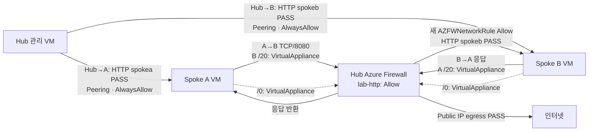

# 06. AVNM 경로·통신과 Firewall 로그 검증

> 목표 시간 15–25분. AVNM 적용 및 전용 로그 수집에는 추가 시간이 걸릴 수 있습니다.

## 공통 준비

👁️ **설명**

모듈 04에서 **VM보다 먼저** Firewall·전용 진단·AVNM Routing을 배포했고, 모듈 05에서
VM·AVNM Security Admin의 `Always Allow`를 준비했습니다. 이 모듈에서는 경로를 만들거나
NAT를 분리하지 않습니다. Spoke A/B NAT와 해당 Public IP는 처음부터 없어야 합니다.
Hub 관리 VM의 NAT와 Firewall Public IP는 그대로 유지합니다. Azure Firewall과 VM에는
검증 중에도 비용이 발생합니다. 한 블록씩 실행하고 📋 결과가 다르면 **다음 블록으로
넘어가지 마세요**. 재접속 시 [모듈 01의 세션 복구](01-prerequisites.md#세션-재연결-시-변수-복구)를
거쳐 같은 Cloud Shell Bash에서 준비 블록을 다시 실행합니다. 경로를 묻기 전
`ls .workshop-state/`로 기존 파일명을 보여줍니다.
`예:`의 실제 경로를 참고하되 파일이 여러 개라면 현재 실습의 파일을 선택하세요.

🟢 **실행**

<!-- exec:prepare-06 -->
```bash
prepare_validation_session() {
  source scripts/workshop-common.sh || return 1
  source scripts/workshop-ipam.sh || return 1
  source scripts/workshop-safety.sh || return 1
  ensure_state_file || return 1
  load_run "$STATE_FILE" || return 1
  require_run_schema_four || return 1
  assert_subscription || return 1
  assert_owned_rg "$RG_HUB" || return 1
  assert_owned_rg "$RG_SPOKEA" || return 1
  assert_owned_rg "$RG_SPOKEB" || return 1
  load_ipam_cidrs
}
prepare_validation_session
```

📋 **확인**

오류 없이 종료되어야 합니다. 검사는 읽기 전용이며 다른 실습의 구독·RG라면 중단합니다.
`command not found`는 같은 셸에서 이 준비를 다시 실행해야 한다는 뜻입니다.
이 준비에서 경로·NAT 상태를 확인하는 함수를 읽습니다.

## 1. 경로·HTTP·Firewall Allow 로그·인터넷 출구 확인

👁️ **설명**

모듈 05의 Security Admin `Always Allow`는 지정한 TCP 8080 흐름에 한해 NSG
평가를 우회합니다. **Hub→A**, **Hub→B**는 Hub 직접 Peering, **A→B**의
요청·반환은 각각의 상대 Spoke `/20`을 통해 Firewall을 거칩니다. 세 흐름은 각각 새 HTTP
요청과 예상 서버 응답(`spokea` 또는 `spokeb`)으로 확인합니다. A→B는 성공뿐 아니라
이번 요청 **직전에 기록한 UTC 시각 이후**의 `AZFWNetworkRule` Allow 로그에서
A/B 사설 IP·TCP/8080·이번 Firewall 전체 ID를 대조해야 합니다. 단순 HTTP 성공이나
과거 로그는 Firewall 경유의 증거가 아닙니다. 전용 `AZFWApplicationRule` 진단도
설정되어 있어야 합니다.

이 실행에서 AVNM 구성과 두 Subnet의 상대 Spoke `/20`·`/0` 배포, 두 NIC의 Active 유효 경로,
Spoke NAT/Public IP 부재를 함께 검사하므로 같은 항목을 별도 블록에서 반복하지
않습니다. 전파 지연 시 1–2분 기다렸다가 **이 블록 전체**를 다시 실행하세요.
경로가 계속 없으면 모듈 04의 Group·Subnet 연결·Firewall IP 및 모듈 05의
VM/NIC 상태를 확인하고, 수동 경로를 만들어 우회하지 마세요.

Security Admin 구성은 `sc-lzbegin-http-<실행 ID>`, collection은 `spokea`와
`spokeb`입니다. 현재 NIC IP의 `/32`를 대상으로 `spokea/hub-to-a`(200),
`spokeb/hub-to-b`(210), `spokeb/a-to-b`(220)가 `AlwaysAllow`여야 합니다.
이 모듈에서는 AVNM 규칙이나 Firewall Policy를 변경하지 않습니다.

🟢 **실행**

<!-- exec:verify-allowed -->
```bash
bash scripts/verify-extension.sh "$STATE_FILE" allowed
```

📋 **확인**

세 HTTP 흐름과 **새 Allow 로그**, Spoke A/B의 Firewall Public IP egress 및
실제 외부 목적지로의 유효 경로가 함께 PASS여야 합니다.

실제 실행 결과의 **발췌 예시**입니다. 구독·실행 ID와 시각은 실행마다 다릅니다.
반복되는 CLI Preview 경고와 `--ids` 사용 시 구독 옵션 경고는 생략했습니다.

```text
PASS: Enforced Connectivity is effective on both spokes; four forwarded peerings are connected.
PASS: <Spoke B 사설 IP> /20 -> VirtualAppliance
PASS: <Spoke A 사설 IP> /20 -> VirtualAppliance
PASS: 8.8.8.8 /0 -> VirtualAppliance
PASS: 8.8.8.8 /0 -> VirtualAppliance
PASS: <Spoke A 사설 IP> /20 -> VNetPeering
PASS: <Spoke B 사설 IP> /20 -> VNetPeering
PASS: effective AVNM rule spokea/hub-to-a (AlwaysAllow)
PASS: effective AVNM rule spokeb/a-to-b (AlwaysAllow)
PASS: HTTP spokea
PASS: HTTP spokeb
PASS: HTTP spokeb
Waiting for current flow logs (1/20).
...
[
  {
    "Action": "Allow",
    "SourceIp": "<Spoke A 사설 IP>",
    "DestinationIp": "<Spoke B 사설 IP>",
    "DestinationPort": "8080",
    "TimeGenerated": "<이번 요청 이후 UTC 시각>",
    "_ResourceId": "<이번 Firewall 전체 resource ID>"
  }
]
PASS: matching Firewall Allow evidence found.
PASS: 104.26.12.205 /0 -> VirtualAppliance
PASS: 172.67.74.152 /0 -> VirtualAppliance
PASS: extension allowed has matching AVNM routes, admin rules, HTTP, Firewall log and egress evidence.
```

### 현재 구성과 allowed 흐름 결과



상대 Spoke `/20`·`/0`의 `VirtualAppliance`는 Spoke 왕복·인터넷 경로가 Firewall을 향함을,
`VNetPeering`은 Hub→Spoke 직접 경로를 뜻합니다. `AlwaysAllow`와 HTTP 응답은
중앙 규칙 적용 및 실제 통신을, 새 `AZFWNetworkRule`의 A→B `Allow`는 Firewall
경유를 증명합니다. `Waiting for current flow logs`는 이번 요청의 로그를
기다리는 정상 동작입니다. 마지막 `/0` 두 줄은 조회한 외부 IP로의 경로이며,
최종 PASS는 egress 검사까지 통과했다는 뜻입니다. 외부 IP 값은 달라질 수 있습니다.

검증 실패는 허용의 증거가 아닙니다. 로그 수집이 늦다면 최대 10분 기다린 뒤
**새 요청을 보내는 검증 전체**를 다시 실행하세요.

## Portal 확인과 트러블슈팅

👁️ **설명**

**Virtual Network Manager → Routing / Deployments**에서 두 Group에 대한 배포와
적용 상태를 확인하고, **Spoke Subnet → Route table**에서 연결을 확인합니다.
**NIC → Effective routes**에서는 실제 Active 상대 Spoke `/20`·`/0`과 next hop Firewall
사설 IP를 확인합니다. AVNM 관리형 테이블의 이름이나 RG를 미리 정해 검색하지 않습니다.
**Log Analytics → Logs → AZFWNetworkRule**에서는 `TimeGenerated`,
`SourceIp`, `DestinationIp`, `DestinationPort`, `Action`, `_ResourceId`를
검증 직전 UTC 시각과 대조합니다. 전용 로그가 없으면 진단 설정의 workspace,
`Dedicated`, `AZFWNetworkRule`·`AZFWApplicationRule` 범주를 검사합니다.

| 증상 | 조치 |
|---|---|
| Subnet 경로는 있는데 NIC 경로 없음 | AVNM 비동기 적용을 기다리고 두 Routing Group/대상 Subnet과 배포 상태 재확인 |
| 한 방향 상대 Spoke `/20` 또는 `/0`만 보임 | 반대 Group·collection·rule 및 next hop IP 확인; HTTP를 성공으로 간주하지 않기 |
| HTTP 성공인데 로그 없음 | 이번 Firewall ID·전용 테이블·시각·진단 범주 확인, 로그 수집 대기 후 새 요청 |
| `api.loganalytics.io` DNS 오류·조회 실패 | Cloud Shell 연결 복구; 빈 결과나 허용 증거로 오인하지 않기 |
| Hub→A/B HTTP 실패 | AVNM Security Admin 배포/규칙 또는 VM 서비스를 모듈 05에서 재확인 |
| 외부 IP 조회 실패 | DNS·Firewall HTTPS FQDN 허용 규칙·외부 서비스 상태 확인; NAT/경로 임의 변경 금지 |
| Spoke NAT 또는 Public IP 발견 | 계획 밖 자원으로 간주해 중단; 소유권·참조를 확인하고 모듈 07 정리 절차 참조 |

## 완료 체크

- 두 Spoke Subnet의 AVNM 경로와 **실제 NIC의 상대 Spoke `/20`·`/0`**이 Firewall을 가리킵니다.
- Spoke NAT/PIP는 없고 Hub NAT는 유지됩니다. Hub→A/B, A→B HTTP와 A→B의 새 Firewall Allow 로그를 확인했습니다.
- 두 Spoke의 인터넷 출구가 Firewall Public IP이며 Firewall Policy는 변경하지 않았습니다.

## 다음 단계

- [이전: VM과 AVNM Security Admin](05-firewall.md)
- [다음: 전체 정리](07-cleanup-production.md)
